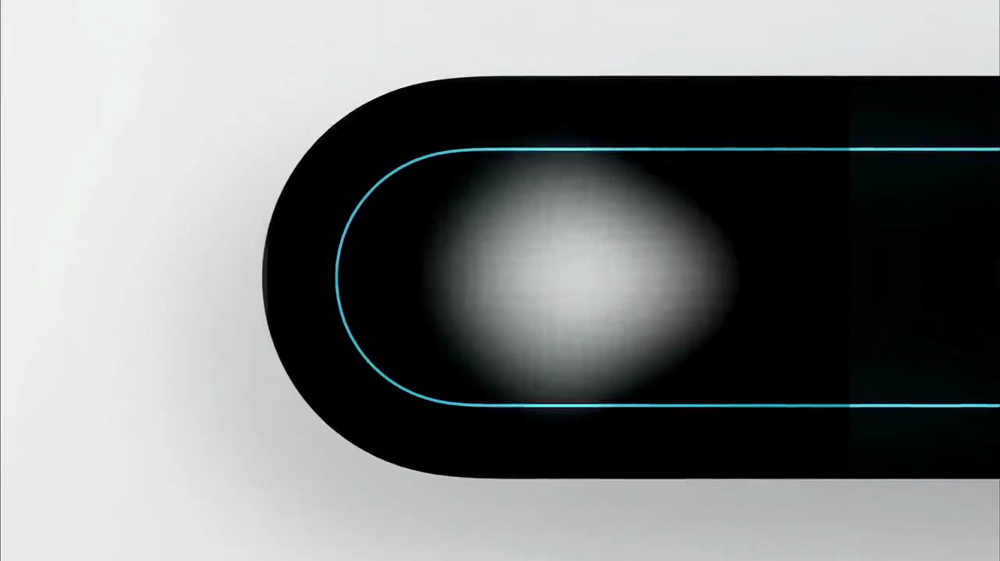
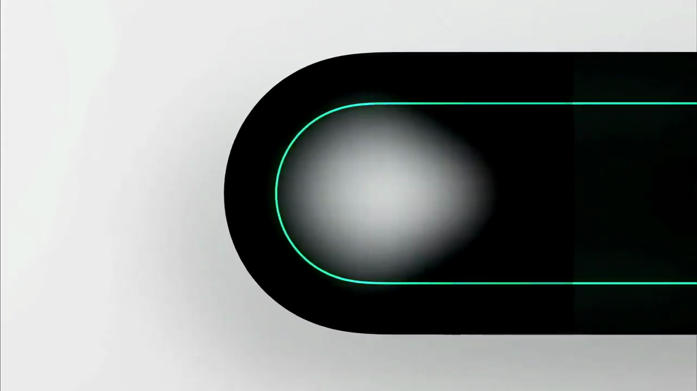
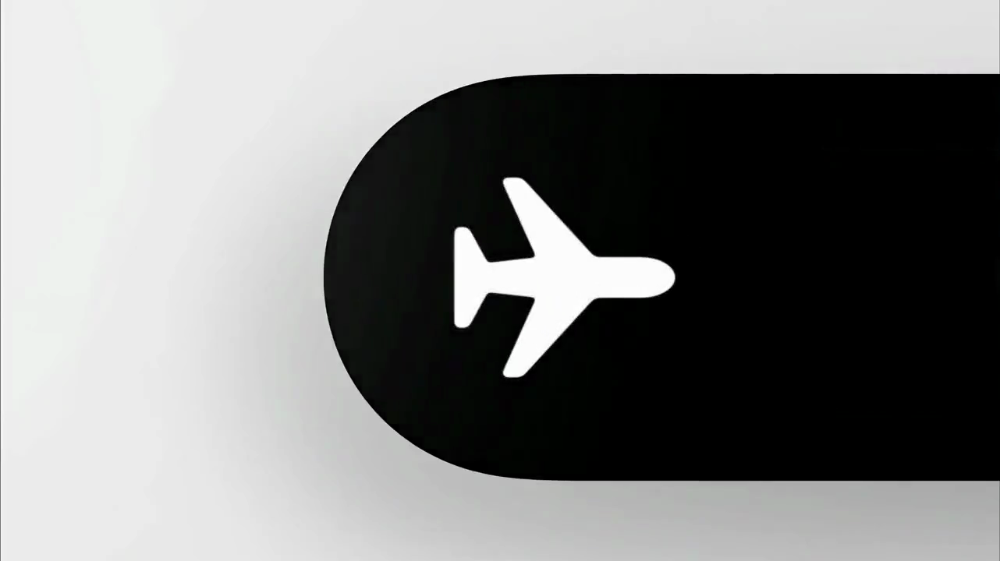
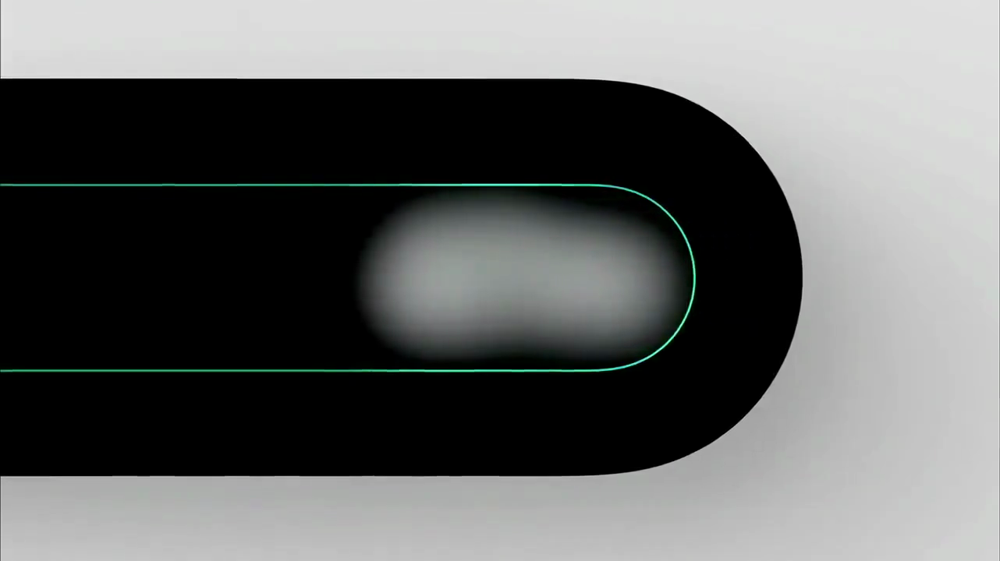
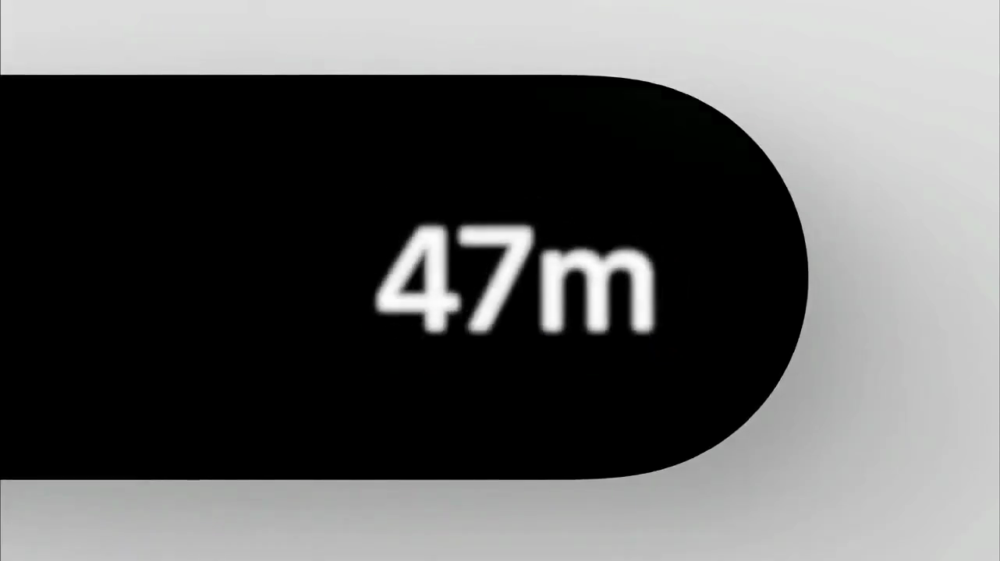

## 問題

圖示與文字放進圓角容器後，即使幾何邊距一致，也可能看起來偏向一側。如何暫時排除輪廓細節，檢查元素與容器的視覺重量？

## 做法

[官方貼文](https://x.com/Kubai087/status/2122514434069537097)稱這段影片已有多年，用模糊展示元素的「真實體積」。這是發文者的解釋，不是體積量測或原片年代證據。以下觀察來自該帖直接附帶的 20.415 秒影片；未確認示範所屬產品或作業系統。

*0.5 秒：黑色膠囊左端放白色飛機圖示，內側疊一條青色圓角輔助線。*

*4.5 秒：飛機輪廓化成白色模糊色塊，青色輔助線仍清楚可見。*

*6.5 秒：輔助線轉為綠色，左端圓弧包住模糊色塊，呈現比較後的狀態。*

*10.5 秒：鏡頭拉遠，長膠囊左端的飛機已清晰，右端仍有模糊的文字色塊。*

*16.5 秒：鏡頭移到右端，綠色內側圓弧與模糊文字色塊一起顯示。*

*19.8 秒：模糊與輔助線退去，右端文字恢復為清晰的「47m」。*

- 示範順序是清晰元素 → 模糊其內容但保留容器及輔助線 → 比較色塊與圓弧的關係 → 恢復清晰。圖示、文字分別示範，沒有提供可直接套用的偏移像素或模糊半徑。
- 模糊是檢查手段，影片沒有顯示使用者操作，也沒有證明執行了自動對齊演算法。

## 為什麼有效（推論）

- 去掉尖角、字腔等高頻細節後，明暗色塊可能更容易暴露視覺重心與邊距的不均衡；內側圓弧則提供固定比較基準。
- 恢復清晰可再次檢查可辨識性，避免只讓模糊色塊平衡，卻破壞原圖形的觀看感受。影片不構成可讀性或操作效率的測試。

## 借鑑要點

- **適合**：工具列圖示、膠囊狀狀態區、圖文並列按鈕的最後一輪視覺校正。
- **不適合**：用模糊取代文字基線、間距規則或命中範圍檢查；也不應把此示範當成通用數學公式。
- **移植時注意**：先保留幾何對齊版本，再以暫時模糊作對照；校正後回到實際尺寸，檢查不同字串、圖示及背景。偏移量需依真實素材決定，不從影片猜參數。
