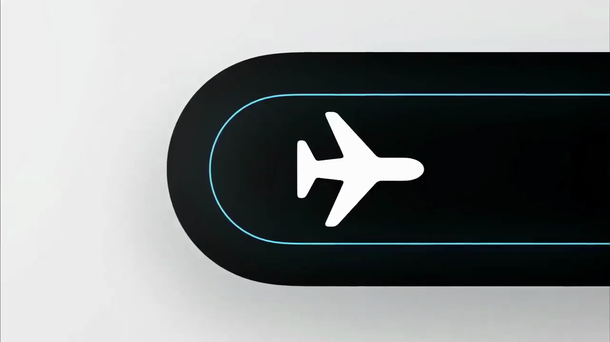
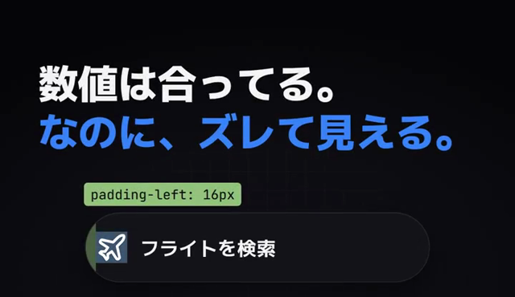
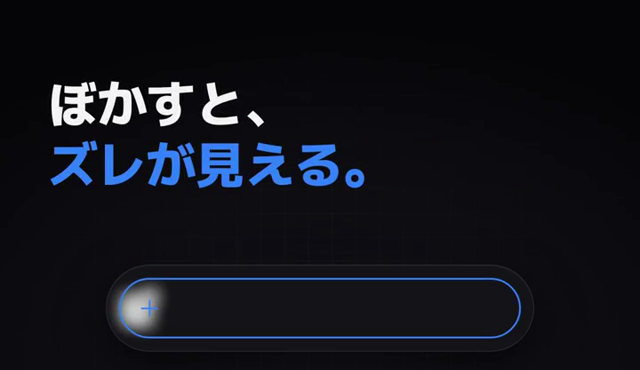
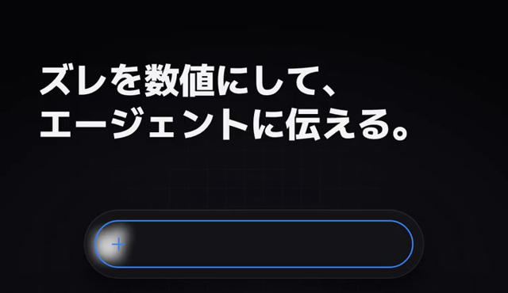
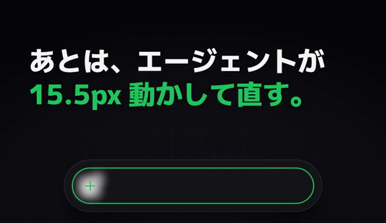
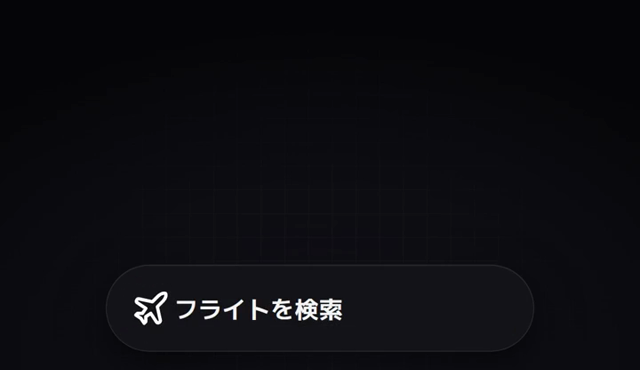

## 問題

圖示與文字放進圓角容器後，即使幾何邊距一致，也可能看起來偏向一側。如何暫時排除輪廓細節，檢查元素與容器的視覺重量？

## 做法

[官方貼文](https://x.com/Kubai087/status/2122514434069537097)稱這段影片已有多年，用模糊展示元素的「真實體積」。這是發文者的解釋，不是體積量測或原片年代證據。以下觀察來自該帖直接附帶的 20.415 秒影片；未確認示範所屬產品或作業系統。

*0.5 秒：黑色膠囊左端放白色飛機圖示，內側疊一條青色圓角輔助線。*

*4.5 秒：飛機輪廓化成白色模糊色塊，青色輔助線仍清楚可見。*

*6.5 秒：輔助線轉為綠色，左端圓弧包住模糊色塊，呈現比較後的狀態。*

*10.5 秒：鏡頭拉遠，長膠囊左端的飛機已清晰，右端仍有模糊的文字色塊。*

*16.5 秒：鏡頭移到右端，綠色內側圓弧與模糊文字色塊一起顯示。*

*19.8 秒：模糊與輔助線退去，右端文字恢復為清晰的「47m」。*

- 示範順序是清晰元素 → 模糊其內容但保留容器及輔助線 → 比較色塊與圓弧的關係 → 恢復清晰。圖示、文字分別示範，沒有提供可直接套用的偏移像素或模糊半徑。
- 模糊是檢查手段，影片沒有顯示使用者操作，也沒有證明執行了自動對齊演算法。

### 2026-11-25 補充：把按鈕端點差距轉成數值

[原帖](https://x.com/_youmaro/status/2125459492406186305)由 [Kubai 引用](https://x.com/Kubai087/status/2125461223072485874)。原作者稱建立了以模糊內容量測圓角端點差距、供 Agent 調整 padding 或 translate 的 skill。這與本卡既有的圓角容器／模糊內容對照流程相同，補充在此；不據此認定舊片的作者。以下是 25 秒示範的抽樣觀察，沒有安裝或執行該 skill。

*約 1 秒：飛機圖示與文字放在深色膠囊按鈕內，圖示旁標出 padding-left: 16px。*

*約 5 秒：內容模糊，藍色內側輪廓仍清晰，左端白色光團可與圓弧比較。*

*約 11.5 秒：模糊光團上出現藍色十字，保留相同圓弧作為比較基準。*

*約 16 秒：光團位置改變，內側輪廓轉為綠色。*

*約 20.5 秒：圖示與文字恢復清晰，呈現校正後的膠囊按鈕；裁圖未保留下方 After 標記。*

- 影片順序為標示幾何間距 → 模糊並顯示輪廓 → 顯示量測輸出 → 位移校正 → Before／After 清晰對照。影片輸出顯示 aligned 從 false 轉為 true，並示範 15.5px 的修正；這只是該素材的示例數值，不是通用偏移量或獨立驗證結果。
- 新影格裁去下方終端內容與安裝資訊，只保留設計區；原有六張歷史影格不變。這是作者錄製的展示，未驗證量測算法、字型差異、鍵盤操作或真實產品採用。

## 為什麼有效（推論）

- 去掉尖角、字腔等高頻細節後，明暗色塊可能更容易暴露視覺重心與邊距的不均衡；內側圓弧則提供固定比較基準。
- 恢復清晰可再次檢查可辨識性，避免只讓模糊色塊平衡，卻破壞原圖形的觀看感受。影片不構成可讀性或操作效率的測試。

## 借鑑要點

- **適合**：工具列圖示、膠囊狀狀態區、圖文並列按鈕的最後一輪視覺校正。
- **不適合**：用模糊取代文字基線、間距規則或命中範圍檢查；也不應把此示範當成通用數學公式。
- **移植時注意**：先保留幾何對齊版本，再以暫時模糊作對照；校正後回到實際尺寸，檢查不同字串、圖示及背景。偏移量需依真實素材決定，不從影片猜參數。

### 本次補充來源日期

新示範發布者為 Yuki Masaki（@_youmaro），原帖2125459492406186305發布於2026-11-25T05:20:06+00:00；Kubai引用2125461223072485874發布於同日05:26:59+00:00。這只補足本次來源，不能解除歷史影片作者未確認的缺漏。aligned輸出是本次收錄時對原影片的觀察，裁切影格未保留終端輸出，不作獨立算法驗證。
