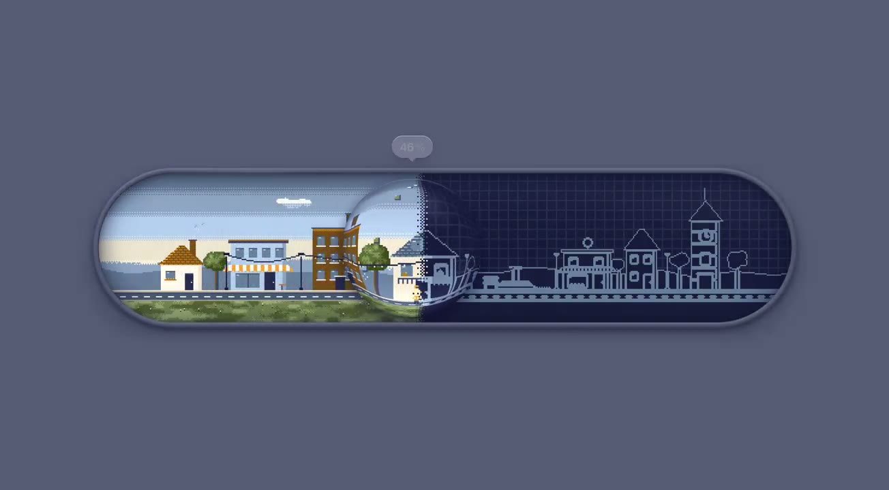
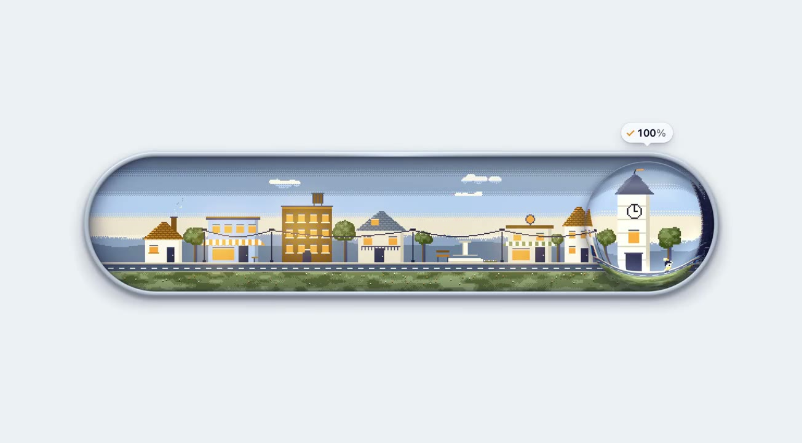

## 問題

等待下載時，細長進度條只能傳達比例；若加入場景，又要避免讓人看不出實際完成到哪裡。

## 做法

*膠囊容器左側已呈現彩色建築，右側仍是深色線稿，圓形邊界標示當前進度。*

*建築場景完整著色，右端上方保留 100% 標記。*

原作者陳述：ianneo_ai 把下載比作蓋小鎮，Kubai 轉發其示範。抽樣影格呈現進度重置後，彩色場景由左向右展開，圓形進度標記隨邊界移動，最後回到完整場景；見[本地影片](01-source.mp4)。被引用的較早開關帖另註靈感來自 Lattice_Node，這條靈感歸屬應保留，但不能據此推定下載示範直接使用其程式。來源未證明此展示連接真實檔案下載。

## 為什麼有效（推論）

收錄者推論：用「線稿變成完整場景」對應進度，可能增加等待時的可觀察變化；百分比仍保留明確數值。作者想再下載一次的說法是個人感受，不能當作完成率提升的證據。

## 借鑑要點

- **適合**：有明確完成比例、可容納品牌趣味的等待畫面。
- **不適合**：進度不確定或需要頻繁取消重試的任務。
- **移植時注意**：動畫須對應真實進度，另呈現停滯、失敗與取消，並提供減少動態的版本。

原帖：[下載示範](https://x.com/ianneo_ai/status/2119975856403816506)、[較早開關與靈感說明](https://x.com/ianneo_ai/status/2119712336558878871)、[Kubai 分享](https://x.com/Kubai087/status/2120003271997932030)。
