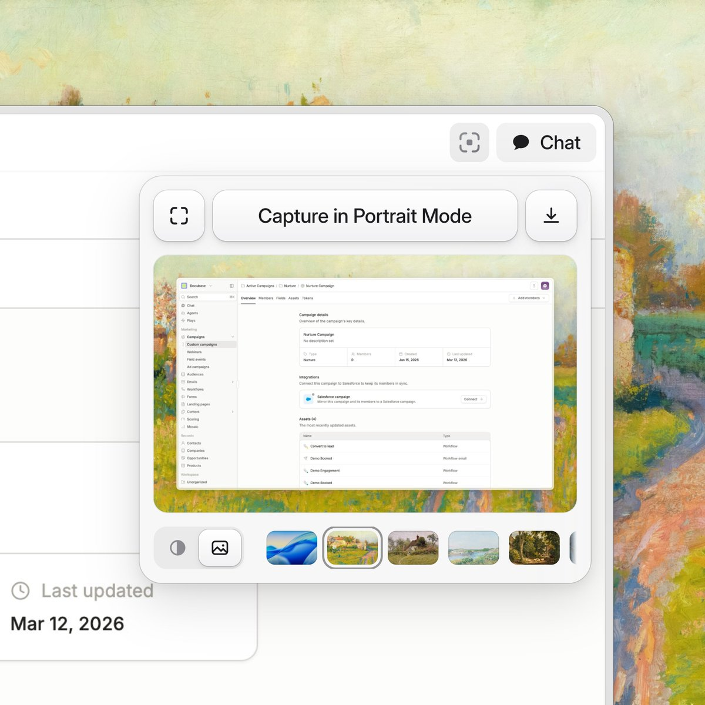
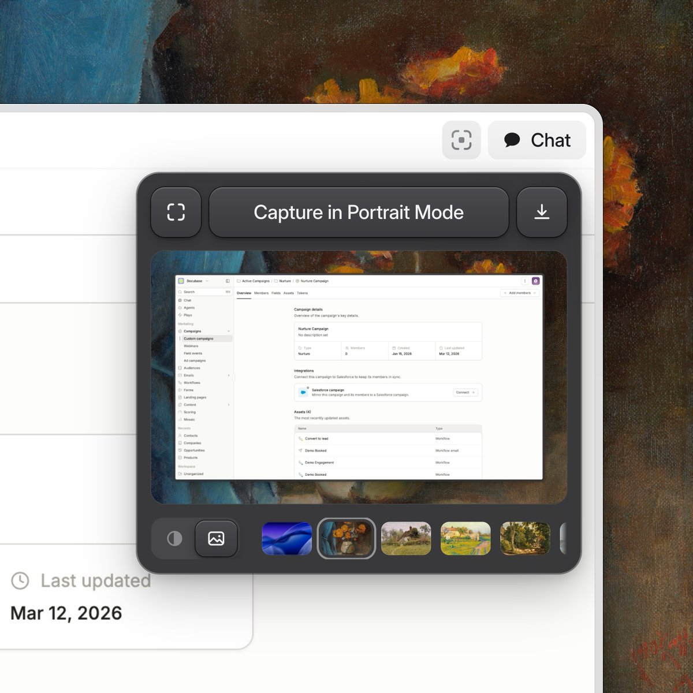

## 問題

擷取工具的按鈕、預覽與背景縮圖集中在一個浮層中，若只靠相近灰色分區，控制項可能混成一整塊；陰影過重又容易蓋過被預覽的內容。

## 做法

原作者 @levibkline 把兩張圖描述為 Portrait 擴充功能的深淺模式。Kubai 於 2026-11-06 引用並歸納其處理：描邊、投影、極淡背景漸變與內側高光。作品與圖片歸原作者，這組歸納是 Kubai 的評論；封包未交代上架狀態，按設計示範收錄。

兩張圖的工具列結構相同：中央為寬幅擷取按鈕，左右各放方形圖示按鈕；下方是帶裝飾背景的預覽，再接模式控制與橫排縮圖。按鈕邊緣有細線與陰影，選中背景則用外圈區分。深色版保留位置與形狀，改用深灰表面及較亮的邊緣。

*原作者淺色圖：工具列、預覽與縮圖分成三層，選中背景有外圈標記。*

*原作者深色圖：同一組控制項改用深灰表面，按鈕邊緣仍可分辨。*

## 為什麼有效（推論）

收錄者推論：描邊標出輪廓，投影交代前後，微弱漸變與高光再補充表面感，可能比單純加深陰影更容易控制層次。圖片沒有證明點擊辨識或操作速度提升。

## 借鑑要點

- **適合**：控制項少、需要明確按壓感的工具浮層。
- **不適合**：高密度資料表，或材質效果會干擾內容比較的介面。
- **移植時注意**：把表面、描邊、陰影與高光分開設 token；深淺模式各看邊界對比，另補焦點、停用及按下狀態，不能只憑兩張靜態圖推定互動完整。

來源：[Kubai 評論](https://x.com/Kubai087/status/2118582684008251830)、[@levibkline 原帖](https://x.com/levibkline/status/2118371924594348505)。
