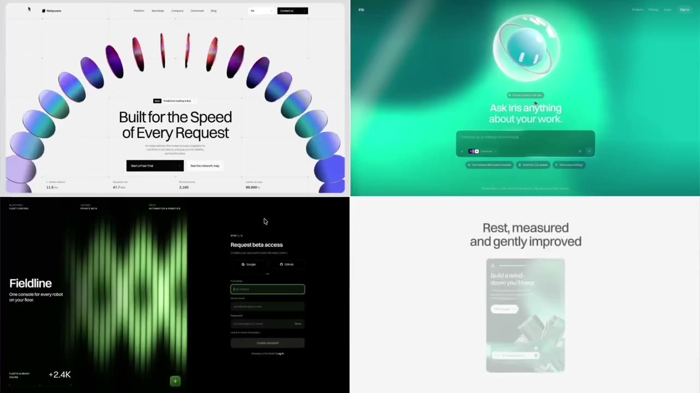
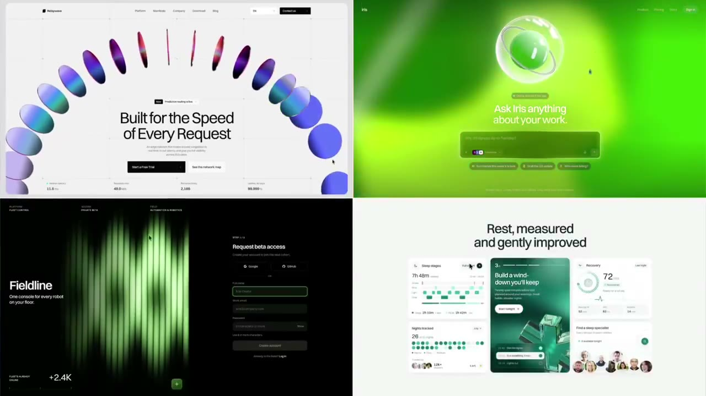
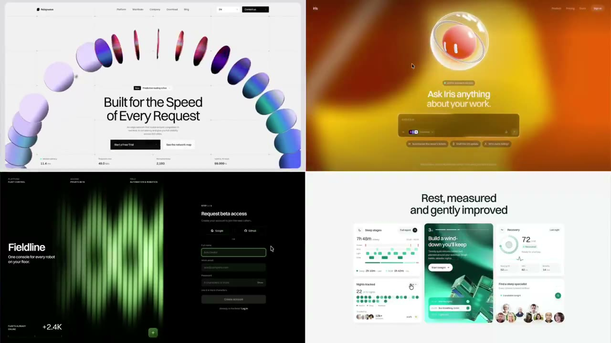

## 問題

探索 AI 輔助介面的視覺方向時，只看一種配色或材質，容易把局部效果誤當完整風格。這組並排作品可作比較參考，但不足以代表功能完成度。

## 做法

Praha 於 2026-10-29 把影片稱為自己團隊近期作品，並反問 AI 是否只能產生粗糙設計。Kubai 同日原文轉發，沒有另外說明生成方式；作品歸 Praha 及其團隊，不歸 Kubai。

影片以四格同時展示不同介面：淺底拱形色塊圍住主標題、彩色球體搭配中央輸入區、深底綠色波形，以及淺底搭配綠色資料卡。片段中彩色背景與局部圖形變化，文字區與各格位置仍可對照。原帖未提供工具、Prompt、人工修改比例、完整流程或上線資料，按作品示範收錄。

*0.211 秒：四格分別呈現拱形色塊、發光球體、綠色波形與淺色資料卡。*

*1.898 秒：右上區域偏向黃綠色，四格仍維持不同的背景與文字配置。*

*4.429 秒：右上轉為橙色調，其他格仍保留各自的主圖與內容位置。*

[Praha 本地作品影片](01-source.mp4)

## 為什麼有效（推論）

收錄者推論：並排可幫助比較留白、明暗、主圖比例與資訊密度，避免只因某個特效亮眼就決定方向。作者對 AI 的表述不構成自動生成品質或可用性的測量。

## 借鑑要點

- **適合**：概念探索、情緒板與不同視覺方向的討論。
- **不適合**：直接據此選定元件庫，或認定畫面已可操作與上線。
- **移植時注意**：一次取一項可說明的關係，例如主圖與標題比例；放入自己的真實文案及功能，再檢查手機布局與閱讀需求，別照搬整組材質。

來源：[Praha 原帖](https://x.com/Praha37v/status/2115680698057282032)、[Kubai 轉發](https://x.com/Kubai087/status/2115722096898977792)。
