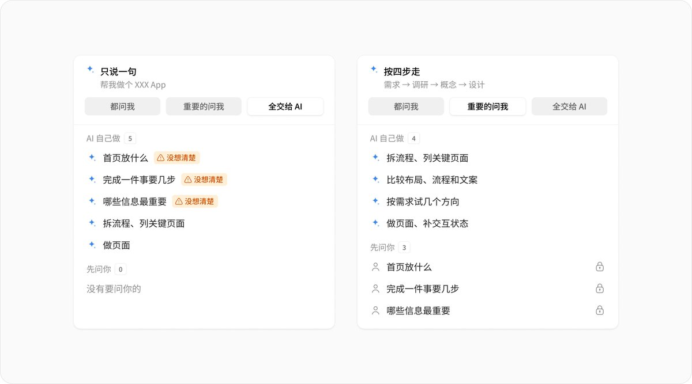

## 問題

只告訴 AI 要做哪種 App，它仍得自行決定首頁重點、操作步驟與資訊主次。畫面完整，不代表這些決定已符合真正使用者的需求。

## 做法

Ian 於 2026-11-01 把介面設計整理為四階段，Kubai 同日轉發。方法與附圖歸 Ian，轉發不構成 Kubai 的新流程或實作成果。

1. **需求**：明確誰在何種情境完成什麼事，讓 AI 拆流程、列頁面與內容，把不確定項目留給人判斷。
2. **調研**：帶著具體問題比較風格、布局、操作與文案，確認參考做法是否適用。
3. **概念**：用情緒板與草圖試幾個方向，依同一份需求比較內容重點和流程。
4. **設計**：再製作頁面、補狀態與手機布局，由人檢查主次、異常、反饋及可實作性。

附圖把一句話全交給 AI，與先確認重要決定的方式並排。這是責任分工示意，不是已上線的工作流工具。

*Ian 的對照圖把首頁、步驟與資訊主次列為待確認事項，右側另列 AI 可協助的工作。*

## 為什麼有效（推論）

收錄者推論：把需求判斷與頁面製作分階段，可能減少先完成外觀、後重做流程的情況。原文是方法建議，沒有提供專案比較或返工率數據。

## 借鑑要點

- **適合**：需求尚有缺口、需要 AI 協助探索與細化的新介面。
- **不適合**：把四階段當成不可往返的固定關卡，或用它取代使用者研究。
- **移植時注意**：每階段留下已知、待確認及選擇理由；變更需求時回看下游決定，以使用者任務檢查方案，不以生成頁數判定完成。

來源：[Ian 原文](https://x.com/ianneo_ai/status/2116760296060801284)、[Kubai 轉發](https://x.com/Kubai087/status/2116767986694713839)。
