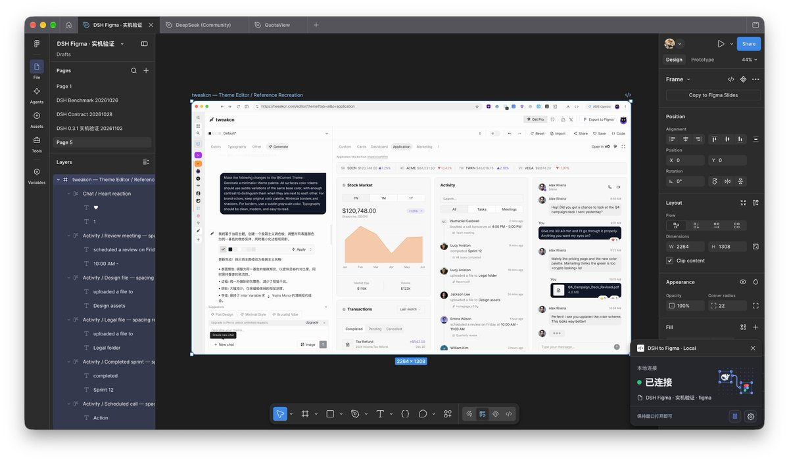

## 問題

新專案需要探索視覺方向時，只有參考截圖難以直接調整元件；確定方向後，還要把外觀轉成可維護的設計結構。

## 做法

*Figma 畫布顯示主題編輯器介面，左側展開文字等圖層，右下角顯示本地連線面板。*

原作者陳述：double_asa 提供 DSH-to-Figma，稱可由參考圖生成高保真可編輯 UI，再繼續拆組件與繪製其他頁面；由 Kubai 轉發。另一張附圖中的執行回報稱已複製文字、圖標與圖表，但亦註明最後校對時斷線，少量文字間距修正未確認。其引用背景是 Kubai 對 tweakcn 以自然語言生成主題的分享，兩者是不同工具與步驟，不能把主題生成能力一併歸給 DSH-to-Figma。本卡未開啟產出檔驗證。

## 為什麼有效（推論）

收錄者推論：把參考圖轉成可逐項調整的結構，可能方便比較風格與延伸頁面；但畫面相似不代表元件、變數或響應式規則已建立。

## 借鑑要點

- **適合**：已有參考方向、需要快速整理候選介面的設計探索。
- **不適合**：直接把未校對的重建稿當成完整設計系統。
- **移植時注意**：逐項驗證文字、圖層、佈局與元件重用，再延伸其他頁面；保留生成未完成的校對項目。

原帖：[double_asa 的工具分享](https://x.com/double_asa/status/2117515869354172666)、[Kubai 轉發](https://x.com/Kubai087/status/2117516504149499960)、[Kubai 的 tweakcn 背景帖](https://x.com/Kubai087/status/2117482260907876409)。
