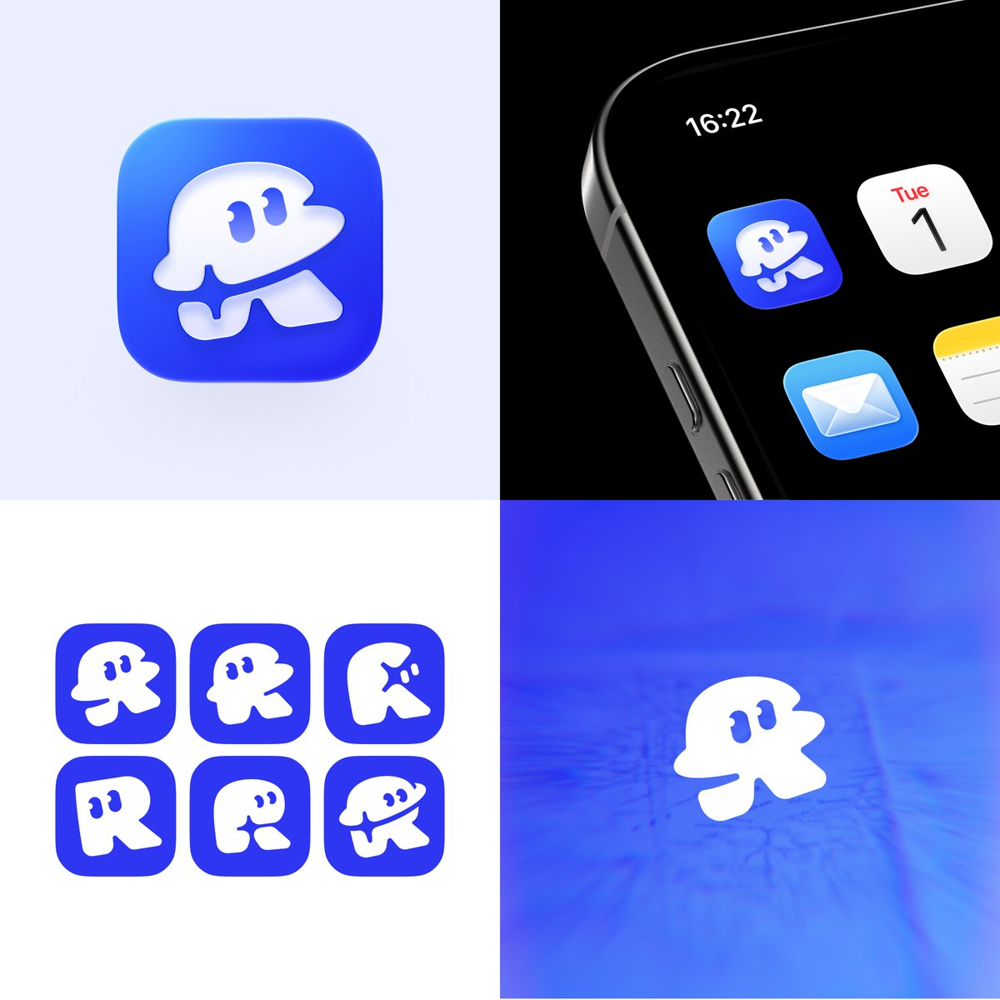

## 問題

給情侶與好友使用的位置分享 App，需要在名稱識別與親近感之間找到圖形方向。單純放字母可能缺少表情，加入太多意象又可能使小圖標難以辨識。

## 做法

Kubai 於 2026-11-01 介紹 Rove 圖標，明說以五角星與字母 R 為出發點進行多種嘗試。他將 Rove 描述為可共享位置、接收到達提醒的地圖 App；來源沒有確認圖中哪個版本已正式採用，因此以概念探索收錄。

畫面觀察：藍色圓角方形上放置帶兩個眼形孔洞的白色符號，另並列六個較平面的變體，調整輪廓、字母結構與表情位置；右側附手機桌面情境。11-03 的來源是作者轉發自己的原作，沒有補充新的設計說明。

*圖片包含立體藍白圖標、桌面情境及六個白色符號變體；桌面情境不等於發布證據。*

## 為什麼有效（推論）

收錄者推論：共用配色並並列變體，能把討論聚焦在輪廓與字母可讀性；眼形細節可能增添角色感。這不是作者提供的辨識測試或品牌成效。

## 借鑑要點

- **適合**：名稱首字母與角色化圖形可以共同發展的產品。
- **不適合**：要求使用者一眼解讀所有隱含意象的識別系統。
- **移植時注意**：分開測試字母與整體剪影是否清楚；縮小後檢查眼形孔洞與細部間隙，先挑一個穩定輪廓，再決定陰影與高光。

原帖：[圖標設計原作](https://x.com/Kubai087/status/2116815254202278142)、[作者後續自轉發](https://x.com/Kubai087/status/2117507051048047039)。
