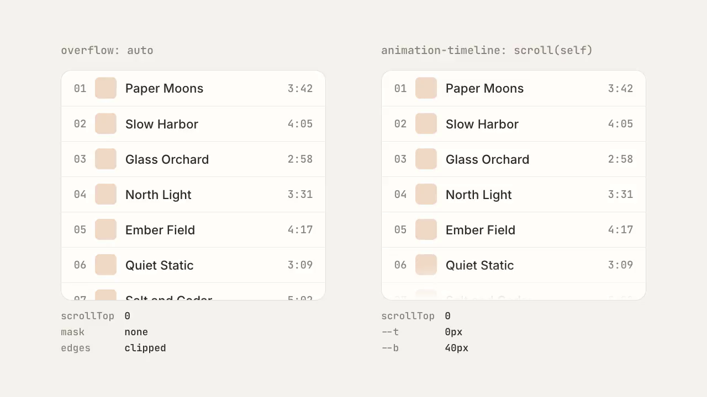
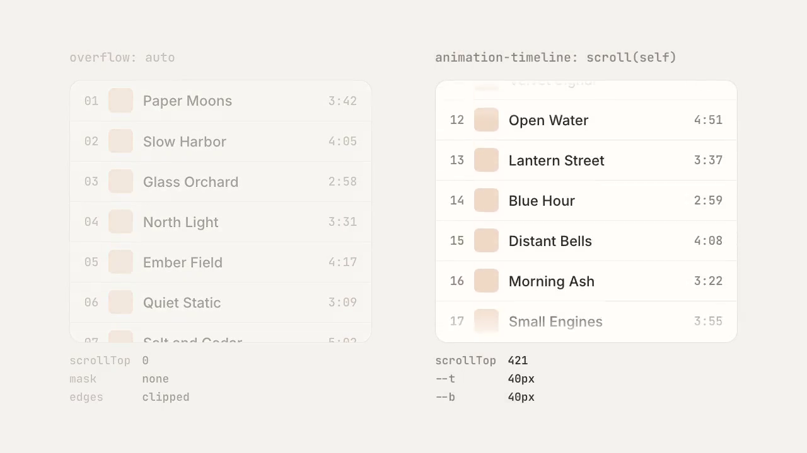
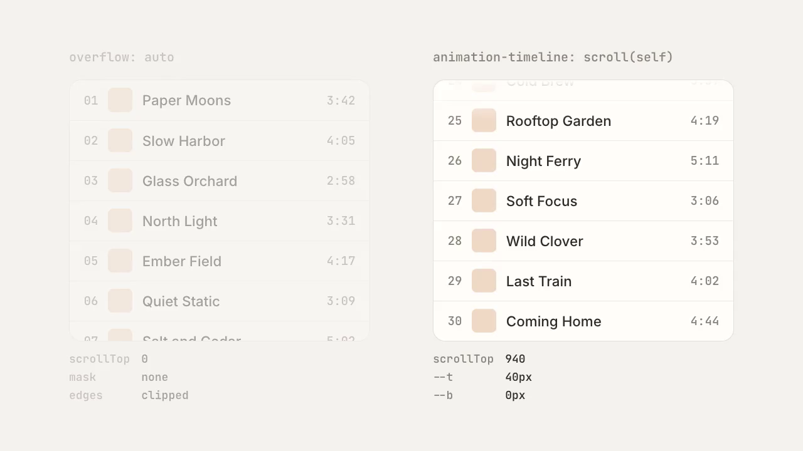

## 問題

固定高度的列表超出容器時，硬切最後一行只呈現裁切邊界，讀者未必知道還能往哪個方向捲動。

## 做法

官方貼文建議用漸變傳達「這裡可以捲動」。附帶的 8.4 秒影片左右並排同一份曲目示例：左側標示 `overflow: auto`、`mask none` 與 `edges clipped`；右側標示 `animation-timeline: scroll(self)`，下方即時列出 `scrollTop`、`--t` 與 `--b`。畫面上的曲名、編號與時長是示例內容，來源未指明實際音樂產品，也未證明程式與影片一致，故列為 concept。

*0 秒：兩欄都在頂端；右側頂部不淡出（--t 0px），底部淡出（--b 40px），左側則直接裁斷第七行。*

*5 秒：右側 scrollTop 為 421，上下漸變均為 40px，中央曲目保持清楚；左側作為淡化的對照。*

*6 秒：右側 scrollTop 為 940，頂部仍淡出 40px、底部降為 0px，最後一行 Coming Home 完整可見。*

觸發是捲動右側列表；變化是上下邊緣的淡出範圍隨位置改變；抵達底端時移除下緣淡出。影片尾段再捲回較上方位置；不是完成後永久停在底端。本卡沒有操作原示例，也沒有以影片文字推定目前瀏覽器支援。

## 為什麼有效（推論）

淡出可暗示內容延續到容器外；只有仍可捲動的方向保留漸變，可能比固定雙邊遮罩更能區分「還有內容」與「已到底」。這是視覺推論，沒有可發現性或閱讀效率數據。

## 借鑑要點

- **適合**：固定高度的側欄、曲目列表、選項清單與獨立捲動面板。
- **不適合**：內容未溢出的短清單，或淡出會遮住關鍵操作、錯誤與金額的介面。
- **移植時注意**：先偵測真實溢出，再依可捲方向顯示漸變；首尾項抵達邊界時應完整可讀。漸變層不要攔截點按，保留鍵盤與可見焦點，並在目標瀏覽器驗證回退；40px 是示例數值，不是通用規格。
- **精確查重**：[008 響應式 Wiki](../kubai-999-008-responsive-wiki/case.md)也提到目錄邊緣漸變，但主要流程是跨裝置章節導覽；本例獨立演示捲動起點／中段／終點的雙邊遮罩，不是同一作品或同一來源，故另建卡片，不新增系列期號。

## 來源與查證

2026-11-24 使用指定 `fetch.py` 直接讀取官方 X 頁，核對作者、完整文字、發布毫秒時間與影片 `2123254824951300096`。下載官方 video.twimg.com 素材，檢視每秒取樣及三張原尺寸保留影格；素材無帳號、私訊或通知。只保留三張 PNG，不保留原片；沒有部署、互動、相容性或效能測試。
