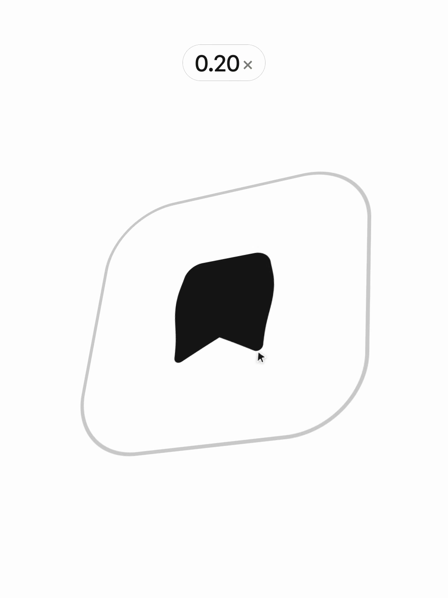
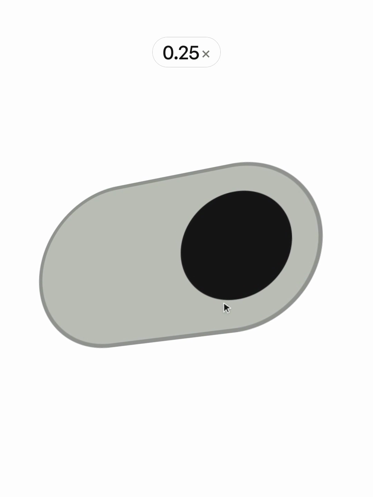
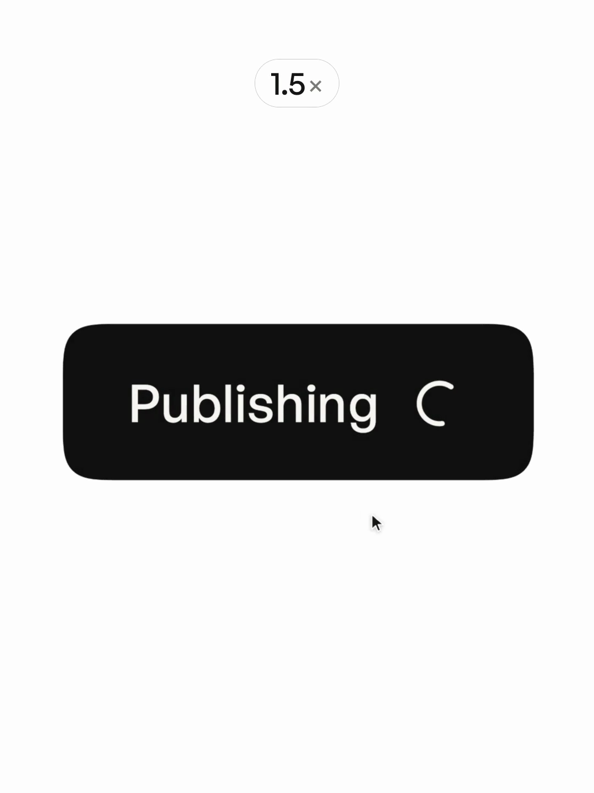
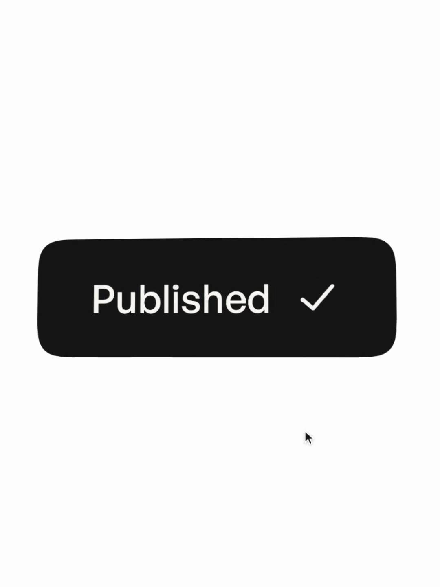
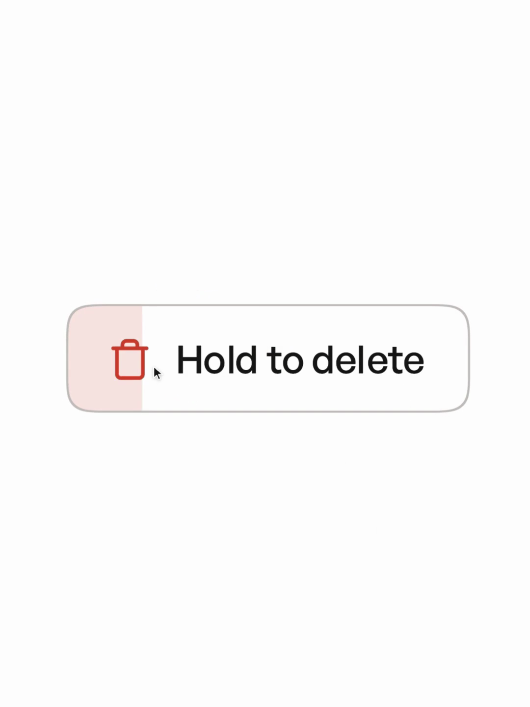
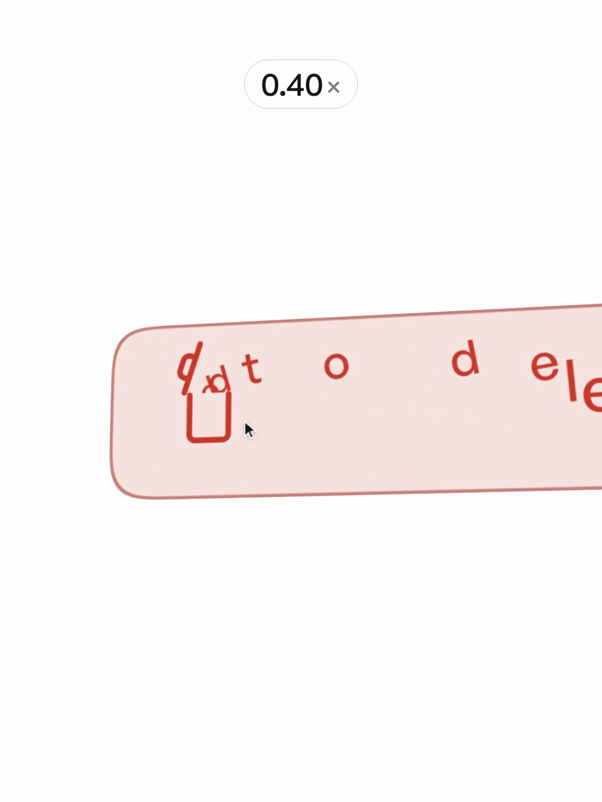

## 問題

按下、等待、完成與長按確認如果只有一個靜態外觀，使用者難以區分目前的操作階段。如何讓微動效與狀態有明確關係？

## 做法

[官方貼文](https://x.com/Kubai087/status/2122537848721309741)稱影片把 UI 微動效放慢數倍。實際附片長 52.033 秒，是多種控件的展示剪輯；片尾可見「Essentials」「UI primitives by Kabarza」。這些字樣不是已上線產品或作者身分的獨立驗證，因此按概念示範收錄。畫面倍率並不一致，也包含高於 1× 的片段，不能拿全片秒數推算正式動畫時長。

*3 秒：書籤放大示範中，黑色圖形與外側圓角框一起傾斜，頂端標示 0.20×。*

- 書籤段從列表中的 Saved 項目切到放大圖；指標靠近控件時可見圖示輪廓與外框變形。剪輯沒有證明列表計數或資料儲存已更新，不能僅憑形變判定收藏成功。

*8.5 秒：開關的黑色圓形滑塊位於軌道右側，軌道帶淡綠色，頂端標示 0.25×。*

- 開關段可見滑塊由左向右移動，外框及圓形也有拉伸；結束位置與軌道顏色共同提示狀態，不只靠彈性動作表意。

*9.8 秒：黑色按鈕顯示 Publishing 與圓弧等待圖示，該幀標示 1.5×。*

*10.9 秒：同一按鈕變成 Published 與勾號，結果仍留在原操作位置。*

- 發布段依序顯示 Publish 與箭頭、Publishing 與等待圖示、Published 與勾號；文案及圖示在同一容器內交替，等待與完成使用不同訊號。這是展示狀態，沒有真實發布請求的證據。

*14.4 秒：Hold to delete 按鈕左側開始出現淡紅填色，垃圾桶圖示在左，文字仍完整。*

*16 秒：淡紅填色覆蓋按鈕，文字拆散、上浮，垃圾桶圖示形狀亦改變，頂端標示 0.40×。*

- 長按段由帶文字的描邊按鈕開始，紅色區域向右擴展；後段文字逐字分離並消失。影片沒有展示中途放手能否取消，也不能由終態推定資料已被刪除。

## 為什麼有效（推論）

- 讓形變附著在原控件上，可能維持操作與回饋的位置關係；發布段另以文案、等待圖示和勾號交代語義，比單獨晃動按鈕更有解釋力。
- 長按填色可能幫助預期確認進度，但文字消散只是表現手法，無法取代取消、失敗及復原流程。沒有使用者研究證明這些動效提高效率。

## 借鑑要點

- **適合**：可切換控件、原地提交與等待完成、需要持續按壓確認的動作。
- **不適合**：將每次高頻操作都做成長動畫，或用好看的形變掩蓋尚未完成的網路請求。
- **移植時注意**：以真實狀態機驅動文案及圖示；補齊取消、失敗、重試及鍵盤操作。長按需提供替代確認方式；reduced-motion 保留清楚的靜態狀態。另用正常速度驗證，勿把慢放倍率或本卡時間戳當成實作時長。
