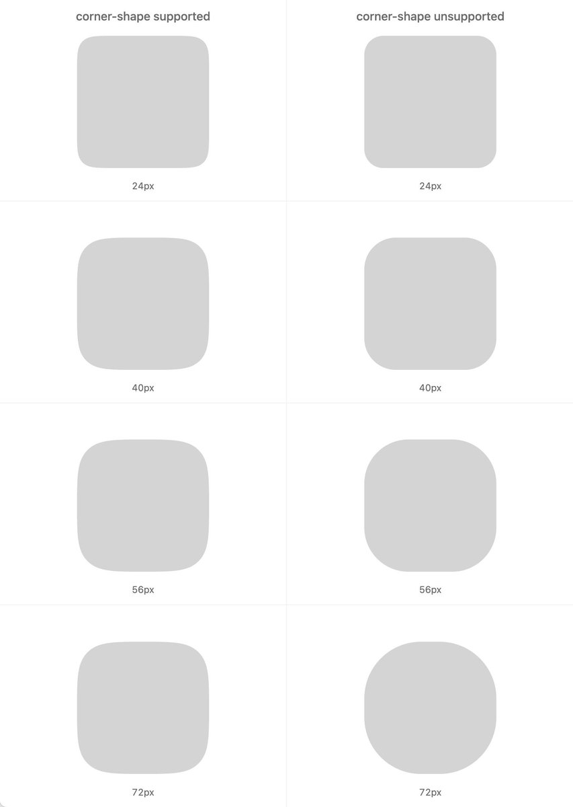

## 問題

相同半徑配上不同超橢圓參數，圓角看起來未必一樣大；在沒有對應形狀支援的環境中退回普通圓角，也可能產生明顯落差。

## 做法

*左右欄標示支援與不支援 corner-shape，逐列比較四組名義半徑的輪廓。*

原作者陳述：MrWillCom 以 Chimeling 的圓角為例，展示 Sass mixin；輸入回退用的半徑，再指定 squircle 或 superellipse 數值，由 mixin 換算形狀對應半徑。後續回覆進一步說明希望讓回退前後的光學尺寸接近，並附程式截圖，兩帖都由 Kubai 轉發。圖中程式先設定普通圓角，再於支援條件內套用形狀及調整後半徑。本卡僅記錄來源方法，未編譯或驗證目前瀏覽器的支援情況。

## 為什麼有效（推論）

收錄者推論：先以普通圓角定義可接受的基準，再逐步增強形狀，可能比直接共用同一數值更容易維持視覺尺寸。對照圖提供比較方式，但不能證明所有參數與尺寸都光學等價。

## 借鑑要點

- **適合**：需要跨環境維持相近圓角感受的網頁元件。
- **不適合**：要求每個像素輪廓完全相同的圖形。
- **移植時注意**：在實際元件尺寸、邊框與巢狀容器中測試；另驗證回退結果，不沿用發文當時的相容性假設。

原帖：[MrWillCom 的方法展示](https://x.com/MrWillCom/status/2114705204662641038)、[補充解釋與程式](https://x.com/MrWillCom/status/2115480421677109688)、[Kubai 分享回覆](https://x.com/Kubai087/status/2115482110681292998)、[Kubai 分享展示](https://x.com/Kubai087/status/2115482538282246176)。
