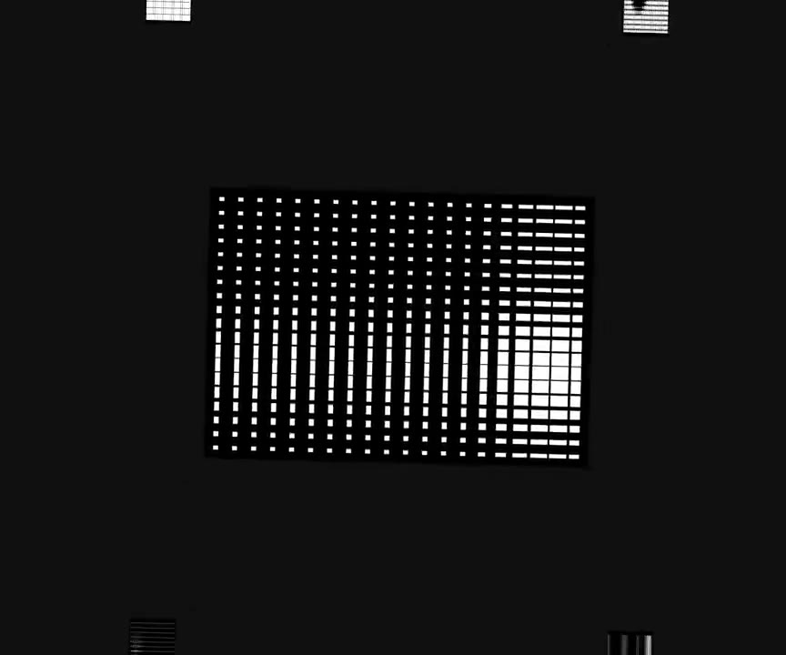
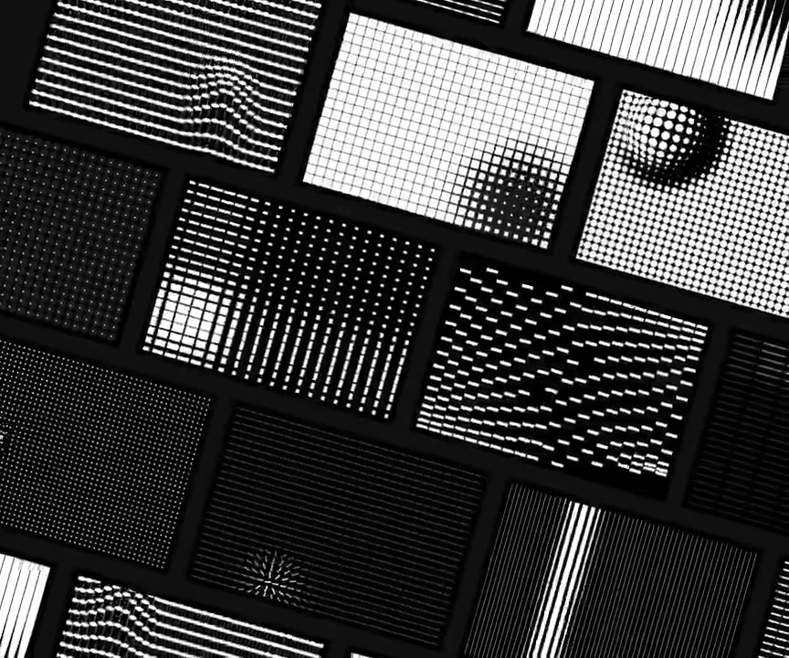

## 問題

品牌紋理移到不同卡片或背景後，原本的明暗與色彩未必合適。選材時需要分清紋理本身的結構，以及後續疊色才能產生的效果。

## 做法

Kubai 於 2026-10-30 評論：處理好填色與混合模式，就能將紋理用在卡片或背景。這是他的移植建議，不是紋理製作者的操作規格。

被引用的 @texturesdev 原帖介紹 Textures 品牌紋理庫，宣稱可複製到專案或網站、每週更新並可免費開始；這些是發布時陳述。原作者影片展示黑白點陣、方格、條紋及波紋的多種排列，但沒有交代 Kubai 所指的混合模式、透明度或填色數值。

*3.36 秒：黑底上的白色點格形成局部伸展與疏密變化。*

*6.347 秒：多張黑白網格、條紋與點陣紋理並列展示。*

[@texturesdev 原帖的本地影片](01-source.mp4)（8.96 秒）。

## 為什麼有效（推論）

收錄者推論：將紋理輪廓與品牌填色分開調整，可讓同一素材在不同表面保留結構特色；是否仍能清楚閱讀，取決於疊色後的實際對比，不能由宣傳片推定。

## 借鑑要點

- **適合**：品牌背景、展示卡片與內容較少的視覺區塊。
- **不適合**：直接把高頻紋理鋪在密集文字或小型控制項後方。
- **移植時注意**：記錄填色、透明度及圖層順序，對照明暗背景與縮放結果；先確認文字對比，再決定紋理強度與授權是否符合用途。

原帖：[Kubai 移植建議](https://x.com/Kubai087/status/2115972477109379521)、[Textures 原始介紹](https://x.com/texturesdev/status/2115805869917315570)。
