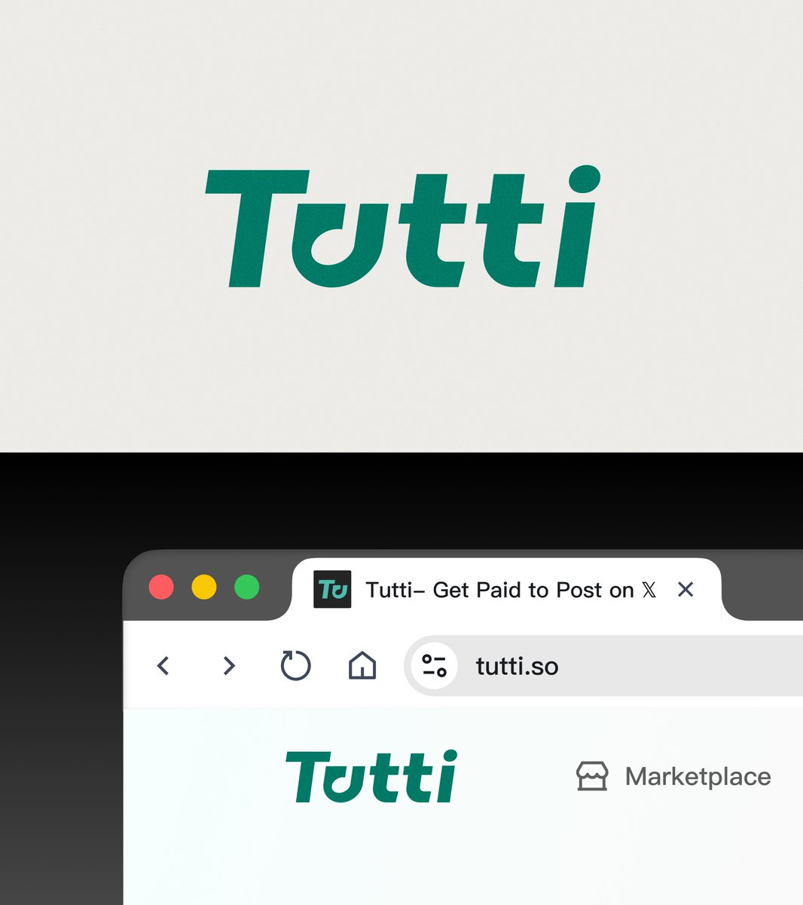
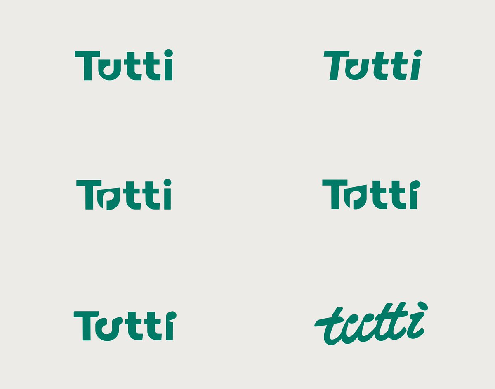

## 問題

品牌字標需要同時放進網站頁首與瀏覽器分頁；完整名稱縮小後，如何保留與大字標相同的識別線索？

## 做法

*綠色粗體字標放在淺底上，分頁圖示則使用縮短的字形組合。*

*六組字標並排比較直立、傾斜、字母內部空間與手寫輪廓。*

原作者陳述：Kubai 為 Tutti 製作的 Logo 在發文時已上線數月，此帖回顧過程探索。圖中完整字標採傾斜筆畫，將 u 的內部留白做出特殊輪廓；網站頁首沿用相同字形，小圖示保留開頭字母組合。這些探索不是六個已上線版本，也未提供逐案淘汰理由。

## 為什麼有效（推論）

收錄者推論：先固定筆畫重量與辨識特徵，再調整字標長度，可讓分頁與頁首形成連續的品牌印象。並排呈現變體也便於分辨字形結構與單純換色的差異；來源沒有辨識率測試。

## 借鑑要點

- **適合**：同時需要完整字標與小型網站圖示的品牌。
- **不適合**：必須逐字清楚辨讀、不能使用縮寫的識別場景。
- **移植時注意**：另測實際分頁尺寸、單色與深淺背景，確認內部留白不會黏合；不要只以大圖展示判斷可讀性。
