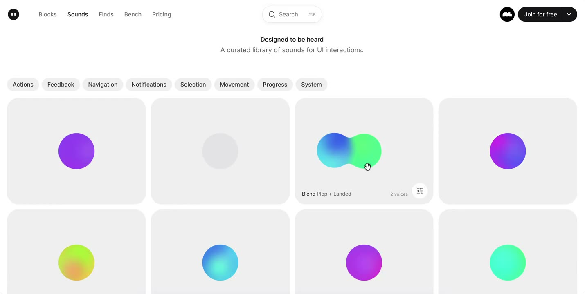
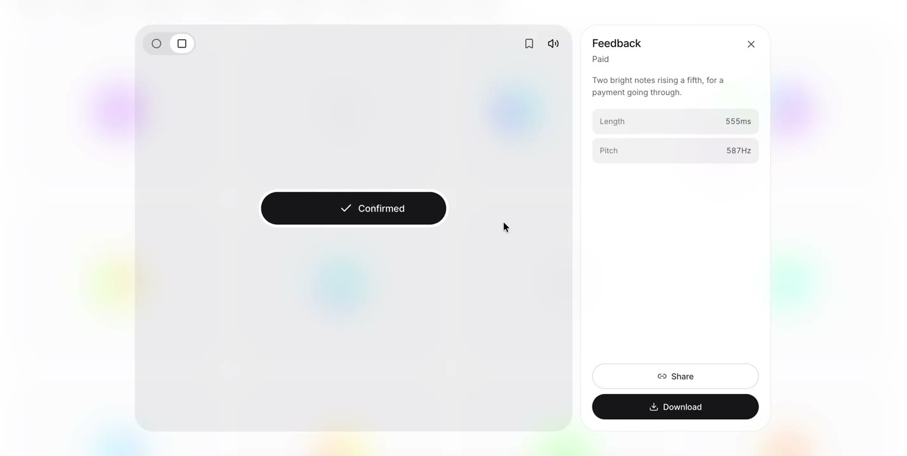

## 問題

操作回饋除了畫面，也可考慮聲音；但挑選素材時，僅知道音效名稱，未必能判斷它適合確認、移動或其他互動。

## 做法

Kubai 於 2026-10-25 以「為五感而設計」評論 @cabralorenzo 的聲音資源帖。原作者主張 UI 聲音值得重視，並稱有 130 多個聲音可交給 AI agent 使用；數量與可用性依該原帖陳述，資源並非 Kubai 原作。

被引用影片以網格陳列素材，頁面有 Actions、Feedback、Navigation 等分類；詳情區將視覺互動示例和下載入口並置。本卡未逐項聆聽，因此不描述音色、響度或與動作同步的精確時點。

*9.338 秒：分類列下方以網格呈現素材，每格搭配彩色圖形。*

*31.748 秒：Feedback 詳情畫面顯示確認按鈕與下載入口。*

[@cabralorenzo 原帖的本地影片](01-source.mp4)（約 44.82 秒）。

## 為什麼有效（推論）

收錄者推論：依操作情境分類，可能比只按音效名稱查找更容易選出候選素材；把互動預覽放在旁邊，也方便討論回饋要表達的狀態。

## 借鑑要點

- **適合**：探索成功、失敗或操作完成時的輔助回饋。
- **不適合**：讓聲音成為唯一狀態訊號，或每次高頻操作都播放。
- **移植時注意**：以真實觸發頻率試聽，提供靜音與音量控制，保留文字或視覺回饋；採用前另核對素材授權。

原帖：[Kubai 評論](https://x.com/Kubai087/status/2114211561539834226)、[聲音資源原作者](https://x.com/cabralorenzo/status/2113999703767691322)。
