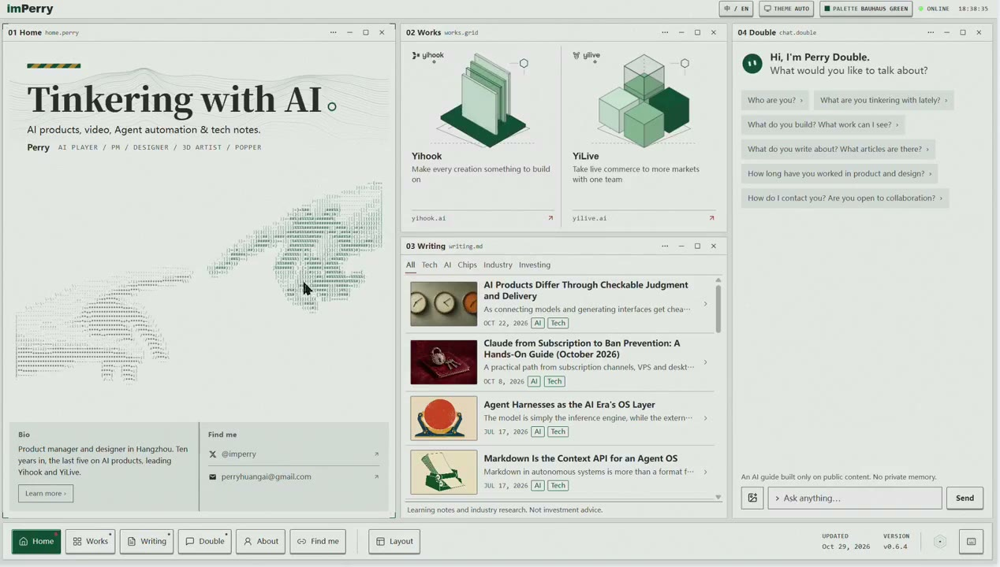

## 問題

首頁需要呈現手指等複雜動作時，直接以程式碼繪製，未必能得到想要的姿態與節奏。ASCII 風格仍需要先有清楚的動作來源，不能只靠字元排列補足。

## 做法

@imperry 於 2026-10-29 分享個人站首頁的調整流程：參考 Kubai 的 ASCII 技巧，與 Claude 討論後先生成影片，再基於影片製作 ASCII 動畫；此前曾讓 Gemini 直接畫手。作者認為新版更生動，尤其手指動作改善明顯，這是個人比較，沒有提供對照測試或轉換參數。

Kubai 隨後引用並稱讚設計感，沒有宣稱製作這個首頁。來源也連到其第 003 期技巧帖；本卡聚焦 imperry 的製作流程，不延伸原文中的聊天與檢索架構。

*3.396 秒：首頁左欄的大型標題下方可見兩個相向的手形字元圖案。*

*14.263 秒：同一首頁左欄的手形輪廓與較早截幀有所變化，其餘欄位仍並列。*

[@imperry 原帖的本地影片](01-source.mp4)（約 16.30 秒）。

[第 003 期技法的參考影片](02-source.mp4)來自 Kubai，與 imperry 的首頁成品分開保存。

## 為什麼有效（推論）

收錄者推論：先處理姿態和時間變化，再做字元化，可以把動作設計與風格轉換分開調整；效果仍取決於原片和取樣，不能推定影片來源必然優於程式生成。

## 借鑑要點

- **適合**：需要保留具體動作輪廓的首頁裝飾或品牌動畫。
- **不適合**：把手形裝飾當成可直接操作的控制項。
- **移植時注意**：先檢查輪廓，再比較字元密度、更新頻率與循環接點；提供靜態或減少動態效果版本，避免搶走主要內容的閱讀注意。

原帖：[imperry 流程與作品](https://x.com/imperry/status/2115766055541055884)、[Kubai 稱讚引用](https://x.com/Kubai087/status/2115766256913785271)、[被引用的第 003 期技巧](https://x.com/Kubai087/status/2115091203465290087)。
