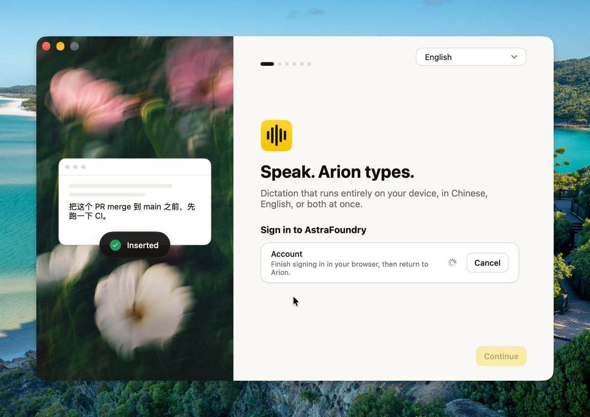

## 問題

語音輸入的介面需要交代文字是否已插入，也可能涉及帳戶登入等前置狀態。若操作結果、等待原因與可採取的動作不清楚，使用者就難以判斷下一步。

## 做法

Kubai 於 2026-11-04 稱讚一款輸入法的介面、互動與官網風格；這是分享者觀點。被引的 @Stv_Lynn 原帖在封包中只有短鏈結，沒有設計署名。產品名依本帖附圖的 Arion 字樣記錄，未據此驗證上線狀態。

本帖附圖確有 Arion 字樣：左側以模糊花朵背景襯托中英混合文字示例，底下顯示綠勾與「Inserted」；右側有步驟標記、語言選擇、帳戶登入等待說明、旋轉指示及 Cancel，Continue 呈淡色。它是同一張展示圖，不能據此確定各狀態的觸發順序或按鈕是否可點。

*左側呈現插入完成提示，右側呈現帳戶等待與取消入口；圖中不同區域不視為連續操作紀錄。*

## 為什麼有效（推論）

收錄者推論：結果用簡短確認提示，等待則附原因與可取消入口，可能幫助區分已完成和仍需處理的事情。來源沒有轉錄準確率或任務完成測試。

## 借鑑要點

- **適合**：檢查輸入工具的成功提示與登入等待文案。
- **不適合**：由展示圖推定錄音、轉錄、登入或離線能力已獲驗證。
- **移植時注意**：分別定義錄音、處理、插入、失敗與取消狀態；驗證焦點與目的輸入欄，並讓等待結束後的下一步清楚可辨。

原帖：[Kubai 評論與附圖](https://x.com/Kubai087/status/2117824641385505133)、[被引原帖](https://x.com/Stv_Lynn/status/2117664837216141482)。
