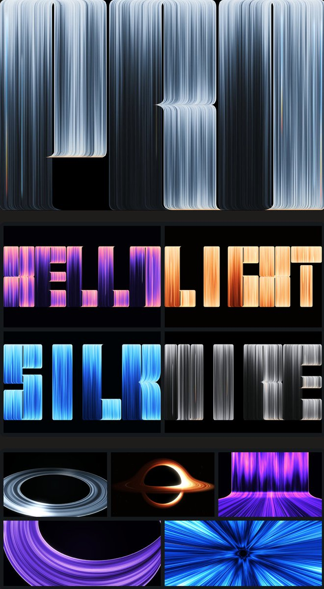

## 問題

光線字母背景若只是固定圖片，更換品牌文字與配色便需要重新製作；設計探索也難以比較參數變化。

## 做法

*黑底上的字母由密集亮線形成，展示板另列不同配色文字與環狀光線效果。*

原作者陳述：Kubai 回覆推薦，表示此專案已開源，也歡迎透過 issue 提出效果需求。被引用的 geekbb 原帖將它介紹為 WebGL 即時重現光線字母壁紙的專案，聲稱可換字母、調配色、開放參數並嵌入網站首屏。這些能力歸屬 geekbb 的介紹，附圖也來自 geekbb。原帖的網址資料已核對至 [kubai087/pro-threads](https://github.com/kubai087/pro-threads)；本次未檢查程式碼、API、效能與瀏覽器支援。

## 為什麼有效（推論）

收錄者推論：把文字與色彩拆成可調輸入，可能讓同一視覺語言延伸到不同品牌。並排展示多種輸出，可幫助比較亮線密度、輪廓與色彩，而非只挑單張壁紙。

## 借鑑要點

- **適合**：品牌字母展示與可調的活動首屏背景。
- **不適合**：必須靠背景承載關鍵正文的頁面。
- **移植時注意**：先確認倉庫、授權與嵌入接口，再測目標裝置；疊上標題後需重查文字對比與靜態備案。

原帖：[Kubai 的開源說明](https://x.com/Kubai087/status/2116879049255731385)、[geekbb 的推薦與效果圖](https://x.com/geekbb/status/2116861961795494088)。
