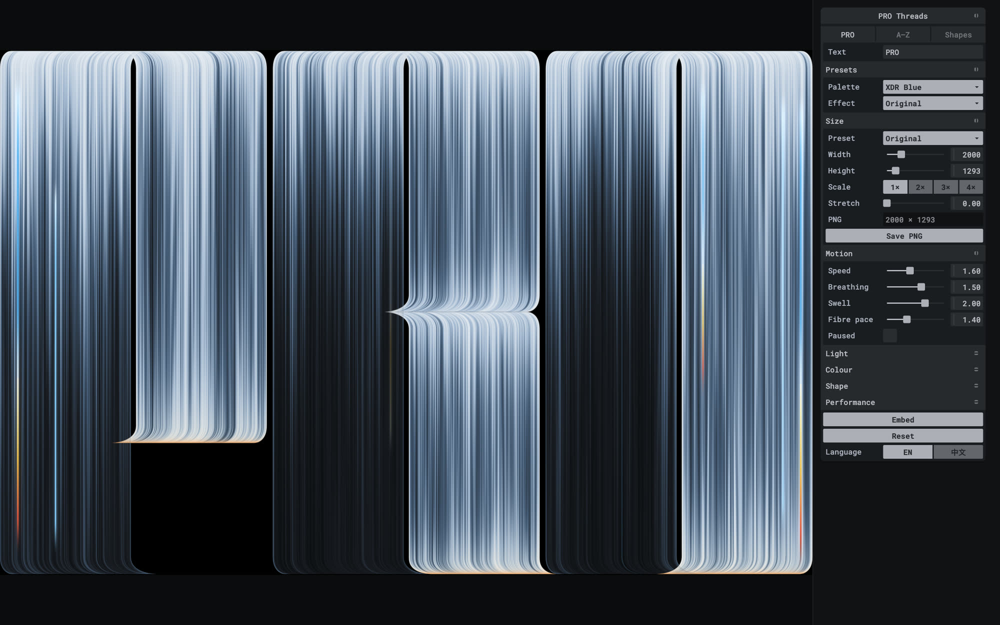
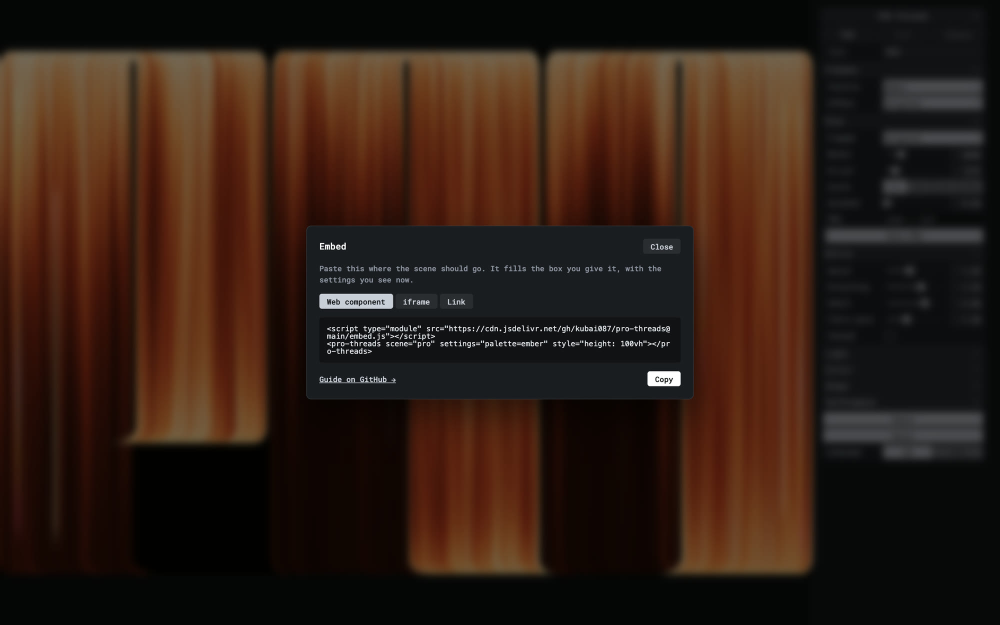

## 問題

光線字母背景若只是固定圖片，更換品牌文字與配色便需要重新製作；設計探索也難以比較參數變化。

## 做法

*黑底上的字母由密集亮線形成，展示板另列不同配色文字與環狀光線效果。*

原作者陳述：Kubai 回覆推薦，表示此專案已開源，也歡迎透過 issue 提出效果需求。被引用的 geekbb 原帖將它介紹為 WebGL 即時重現光線字母壁紙的專案，聲稱可換字母、調配色、開放參數並嵌入網站首屏。這些能力歸屬 geekbb 的介紹，附圖也來自 geekbb。原帖的網址資料已核對至 [kubai087/pro-threads](https://github.com/kubai087/pro-threads)；本次未檢查程式碼、API、效能與瀏覽器支援。

## 為什麼有效（推論）

收錄者推論：把文字與色彩拆成可調輸入，可能讓同一視覺語言延伸到不同品牌。並排展示多種輸出，可幫助比較亮線密度、輪廓與色彩，而非只挑單張壁紙。

## 借鑑要點

- **適合**：品牌字母展示與可調的活動首屏背景。
- **不適合**：必須靠背景承載關鍵正文的頁面。
- **移植時注意**：先確認倉庫、授權與嵌入接口，再測目標裝置；疊上標題後需重查文字對比與靜態備案。

原帖：[Kubai 的開源說明](https://x.com/Kubai087/status/2116879049255731385)、[geekbb 的推薦與效果圖](https://x.com/geekbb/status/2116861961795494088)。

## 開源倉庫、參數面板與嵌入降級設計（2026-11-12 補齊）

經核對公開倉庫 [`kubai087/pro-threads`](https://github.com/kubai087/pro-threads)（MIT 授權）與[線上示範](https://www.kubai.design/pro-threads/)、[首屏場景示範](https://www.kubai.design/pro-threads/hero/)，其互動面板與網頁嵌入機制具體做法如下：

*官方倉庫示範圖：左側即時繪製 PRO 光絲字體，右側固定深色摺疊面板，分設模式切換、預設配色、輸出尺寸與動態滑桿，底部提供 Embed、Reset 與中英切換。*

*官方倉庫示範圖：點擊 Embed 後彈出居中對話框，提供 Web component、iframe 與 Link 三種分頁，程式碼已自動寫入當前配色與場景設定。*

- **模式分組與即時像素預覽**：右側窄面板頂部以分段按鈕切換 `PRO`（最多 10 個字母的自訂單詞）、`A–Z`（整張字母表）與 `Shapes`（圓環、黑洞、廣角透視、莫比烏斯環、隧道 5 種首屏 3D 場景）；`Size` 區支援桌面與手機預設、`Stretch` 拉伸比例及 `1×–4×` 倍率，並在 `Save PNG` 按鈕上方直接顯示最終輸出像素（分塊渲染最高支援單邊 `16384px`）。次要的 `Light`、`Colour`、`Shape`、`Performance` 預設收合，降低初次操作負擔。
- **網址即狀態與預填嵌入碼**：所有面板調整即時同步至網址查詢參數（支援 `?lang=zh` 切換中文），重新整理或分享連結即可重現同一畫面；點擊底部 `Embed` 會把當前參數自動填入 `<pro-threads>` Web Component、`iframe`（`embed=1` 自動隱藏面板與快捷鍵）或分享連結，一鍵複製即可貼入目標網站。
- **裝飾背景的無障礙、效能與降級保護**：`<pro-threads>` 以延遲載入的內部 `iframe` 隔離樣式與腳本，完成首幀繪製後才淡入以避免白閃；預設對螢幕閱讀器隱藏且不進入 `Tab` 焦點順序；滾出視窗或系統開啟 `prefers-reduced-motion` 時停止動態；無 WebGL 2 時退回靜態圖或深色背景、GPU context 丟失後自動重載，且同一頁超過 4 個實例時會在離開視窗 10 秒後卸載遠端實例，避免耗盡瀏覽器 WebGL 上下文上限。
