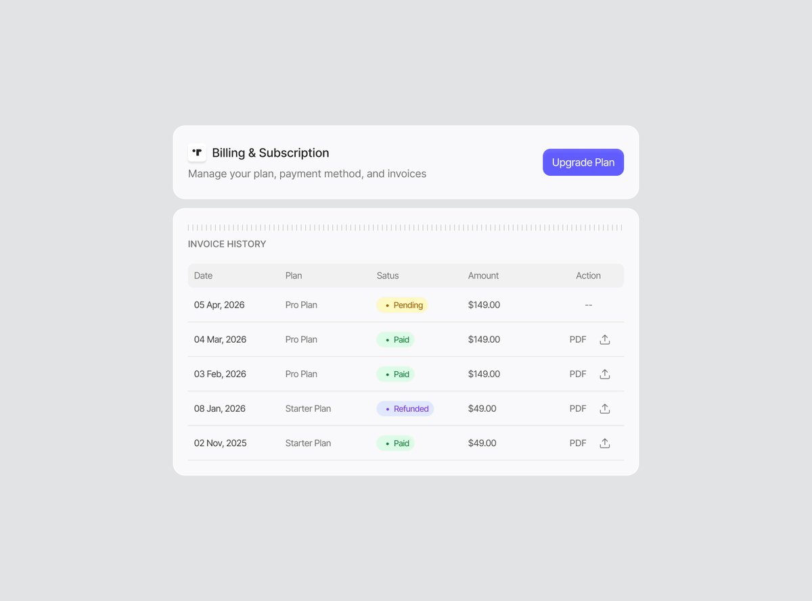
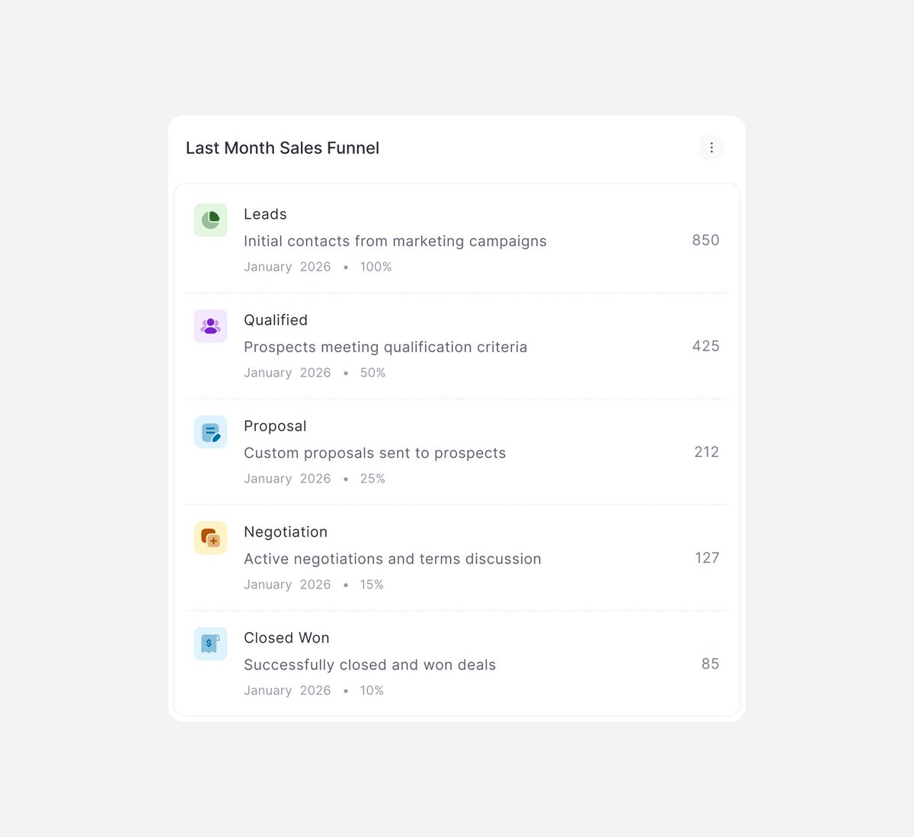
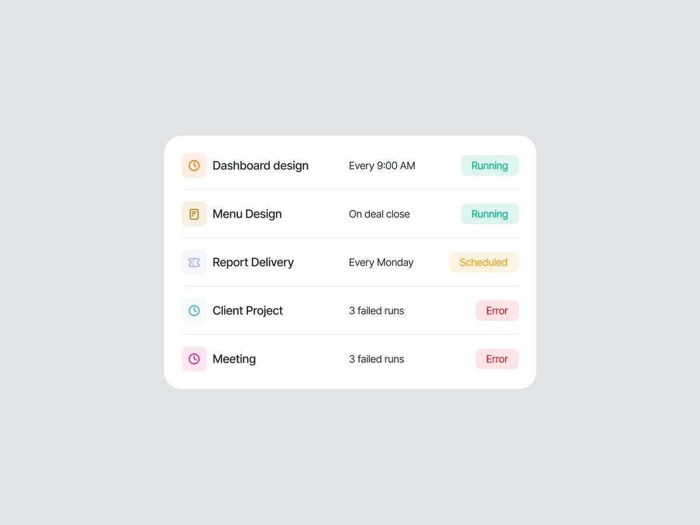

## 問題

帳單、銷售階段、排程與會議資訊各自不同，但都需要讓人快速找到名稱、數字、時間與狀態。若每列任意擺放，資料增加後就難以對照。

## 做法

Zahra 於 2026-10-28 發布四張 UI 元件作品，Kubai 隔日轉發。原帖只簡述為元件設計，沒有交代所屬產品、程式碼或上線狀態；以下是靜態畫面的觀察，不代表互動已實作。

帳單以固定欄位排列日期、方案、狀態、金額及動作；銷售階段逐列放圖標、名稱、說明、期間與百分比，數量對齊右側。排程列把名稱、觸發描述與狀態分欄，狀態同時有底色和 Running、Scheduled、Error 等文字。行事曆則先列一週日期，以紫色標出選中日，下方接會議與參與者區。圖中數字都是作品示例，不能當真實業務指標。

*帳單表格以文字標明 Pending、Paid、Refunded，金額與動作各有固定欄位。*

*每個階段都有名稱、說明與比例，右側數量沿同一位置排列。*

*每列左側是圖標與名稱，中間描述時間或失敗次數，右側是文字狀態標記。*

*上方日期列用紫色標示選中日，下方會議卡列出時間、會議入口與參與者圖像。*

## 為什麼有效（推論）

收錄者推論：固定欄位可支援逐列比較，狀態加文字也能避免只靠顏色。畫面沒有展示排序、載入、空白或錯誤恢復，因此不能視為完整元件規格。

## 借鑑要點

- **適合**：帳務清單、排程監看與資訊量適中的概覽卡片。
- **不適合**：未確認資料結構就直接套用欄數與狀態名稱。
- **移植時注意**：以長名稱、不同貨幣、翻譯與窄版測試欄位；再補鍵盤操作、動作名稱、空狀態及狀態轉換，別把純展示圖當作驗收完成。

來源：[Zahra 原帖](https://x.com/zahragr8r/status/2115350578415165566)、[Kubai 轉發](https://x.com/Kubai087/status/2115684054339403939)。
