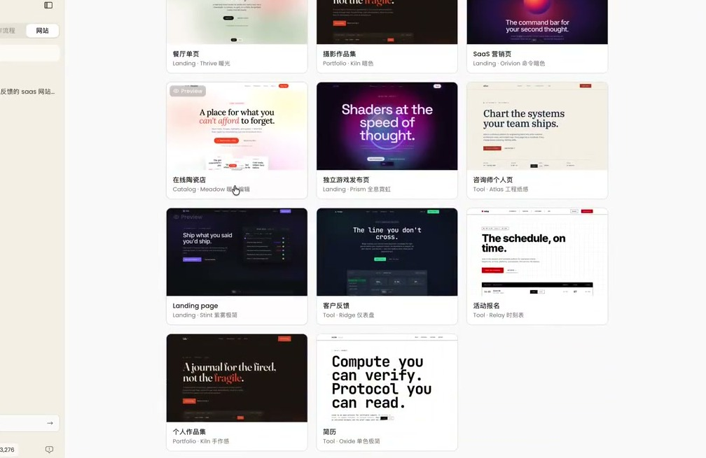
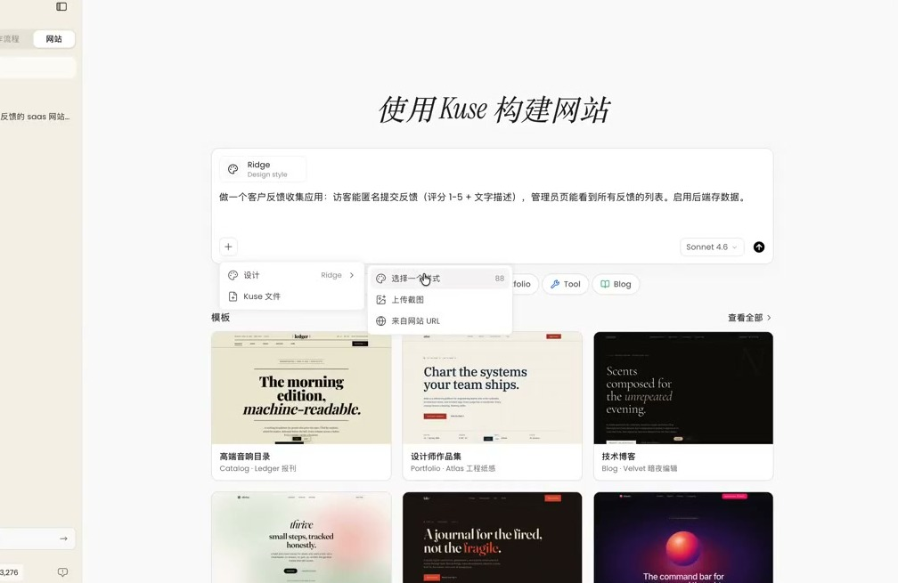
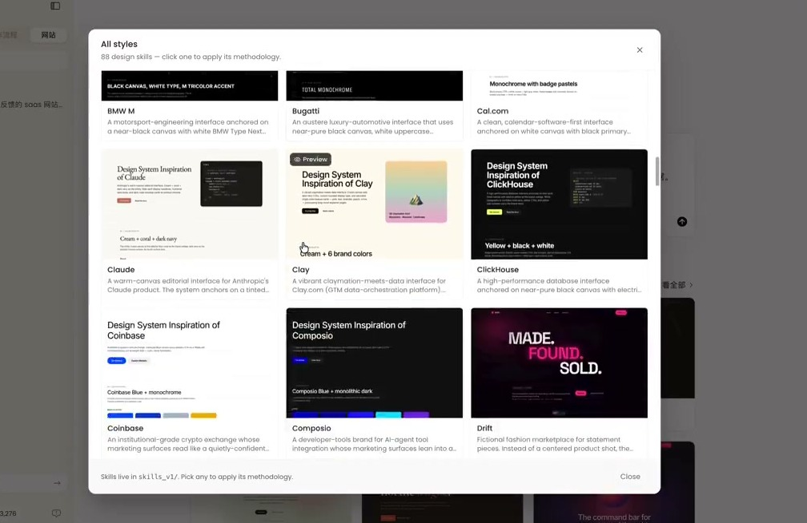
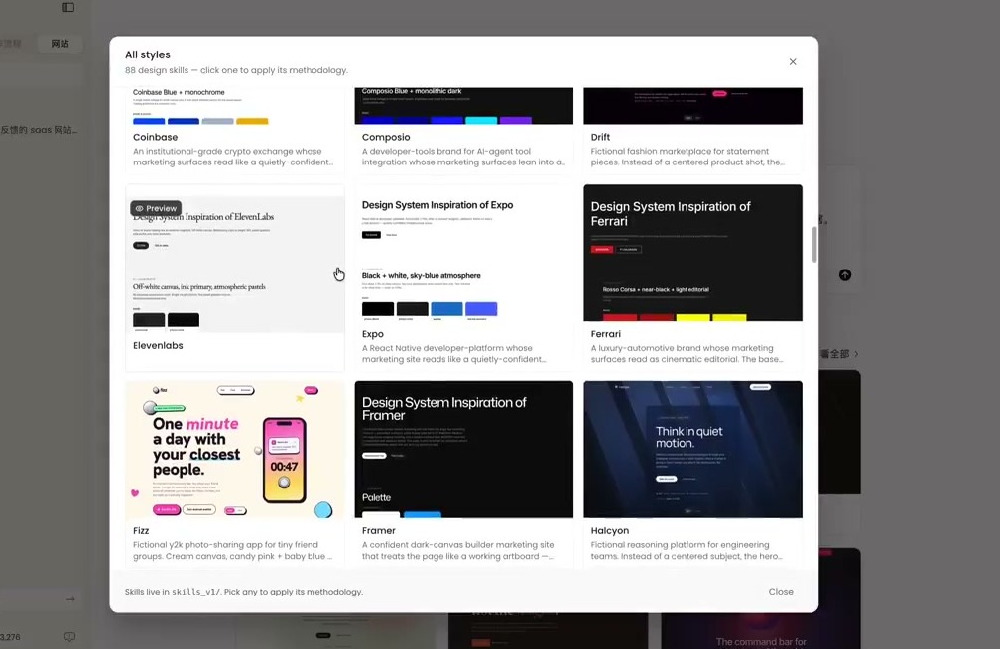

## 問題

使用者開始生成網站時，需要先表達希望採用的視覺方向。

## 做法

- 原帖描述網站生成模組同時提供內建模板與風格樣式選擇。
- 作者推測背後與 design.md 有關，這不是已確認的產品實作，因此不將其當成觀察事實。

### 已檢視的素材

*模板畫廊用縮圖並排展示不同頁面構圖。*

*生成頁保留描述輸入與模板入口。*

*彈層列出更多視覺風格卡片。*

*畫廊內同時可見明暗與字體比例不同的候選。*

## 為什麼有效（推論）

把選擇模板和選擇風格分開，可能讓頁面用途與視覺偏好各自被表達。

## 借鑑要點

- **適合**：網站生成器首次建立流程。
- **不適合**：需要從零定義品牌策略的委託。
- **移植時注意**：模板名稱應交代用途；風格預覽應顯示同一份內容，避免內容差異干擾比較。

## 來源與核實

- [原帖](https://x.com/dingyi/status/2064557479611256865)：已取得 X 公開頁面內嵌原始 Tweet / NoteTweet 資料，按相同 status ID 核對正文。
- 本卡的「做法」依原帖文字與已檢視素材撰寫；沒有執行產品功能驗收，效果解讀列為推論。
