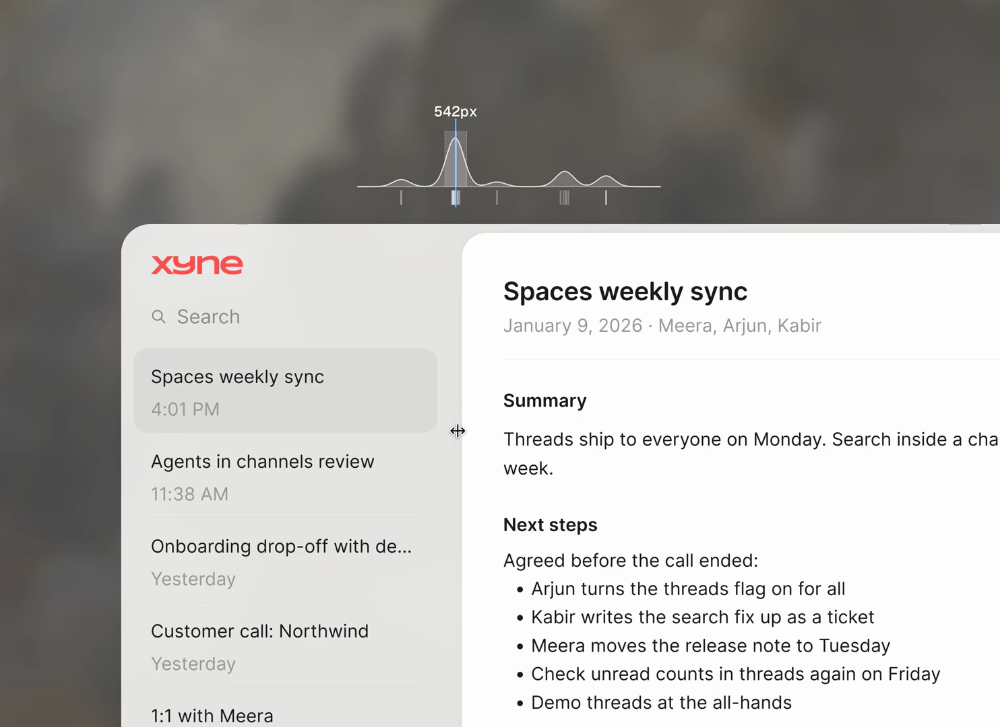
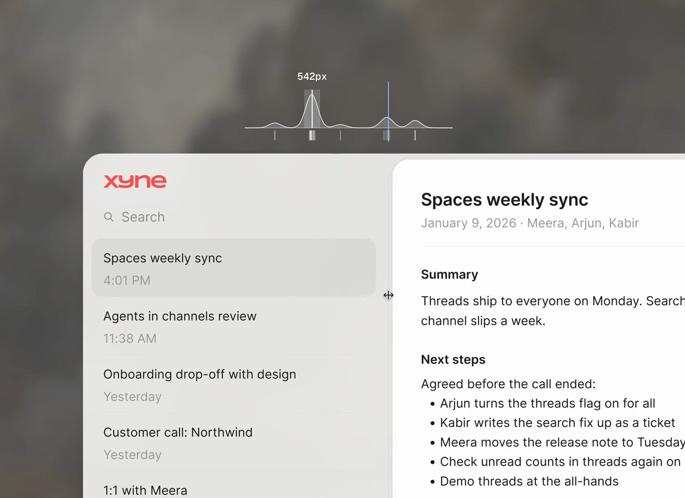
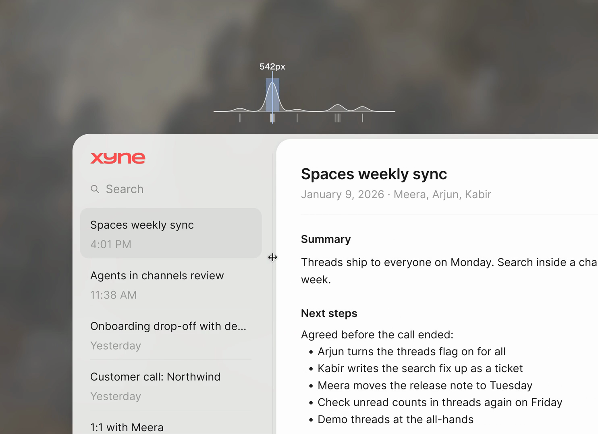
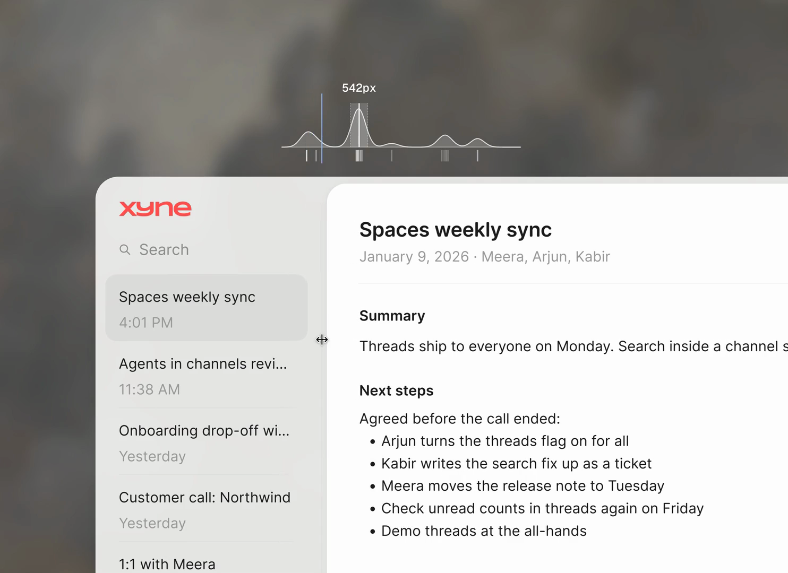

## 問題

使用者暫時調整側欄後，想回到慣用寬度，卻必須反覆對齊；固定吸附點又可能妨礙附近幾個像素的精細調整。

## 做法

*0.53 秒：左側清單與右側文件共用可拖曳分隔線，上方曲線標示寬度落點。*

*1.59 秒：側欄拉寬後，文件起點向右移動，上方新增落點。*

*4.76 秒：側欄回到圖上最高峰附近，峰值區域以色塊標記。*

*6.87 秒：側欄再次變窄，示範不只維持單一固定寬度。*

**影片觀察**：拖曳分隔線 → 左右欄寬同步改變、上方落點分布更新 → 側欄停在新的寬度。這是作者的互動示例，不據此判定已用於 xyne 正式產品。

**原作者文章／示例碼說明**：每次放開記錄寬度，以相近落點疊成峰；權重每五次拖曳減半，按拖曳次數而非經過天數衰減。約三次近期相近落點才形成吸附，既有吸附點在吸附區內保持穩定。拖近時邊緣吸住，停一下可解除並繼續微調；方向鍵不吸附。文章將其包成 react-resizable-panels v4 的 `useSnapPoint`。lencx 整理另列 2 秒合併、300ms 解鎖、權重 2.5 與 10px 區間；這些屬轉述的示例參數，本卡不當作影片量測結果。

## 為什麼有效（推論）

由常用落點推定寬度可能減少重複對齊；停留解鎖則保留精確控制。沒有使用者測試證明節省時間，上方曲線是教學可視化，不必搬進正式工作台。

## 借鑑要點

- **適合**：文件、郵件與 IDE 的可調整分欄。
- **不適合**：固定欄寬或每次工作情境差異很大、沒有穩定慣用值的頁面。
- **移植時注意**：保留鍵盤微調；明確定義最小／最大寬度、樣本清除與偏好保存方式；勿把拖曳中暫時經過的位置都當偏好。

## 來源與核對範圍

[lencx 貼文](https://x.com/lencx_/status/2121414357041160456)的官方快取含[imharshin 原帖](https://x.com/imharshin/status/2121278262278242802)及官方影片網址；影片已下載檢視。[作者原文](https://imharsh.in/snappy-resizable-panels)由貼文短網址解析並以 HTTP 直接取得，核對章節與互動說明。未執行示例程式。
