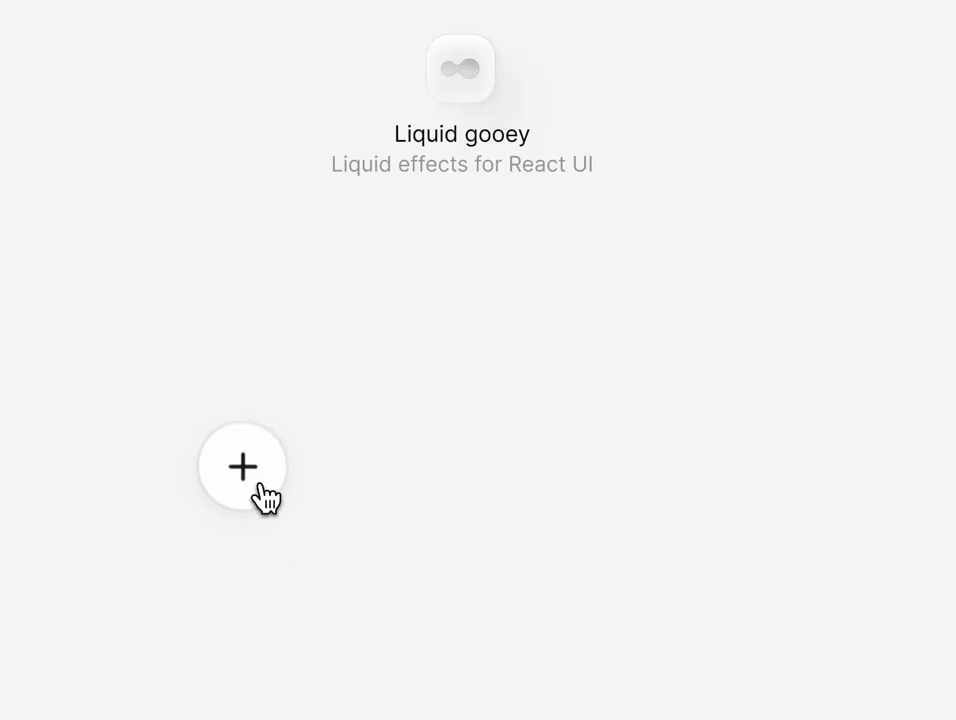
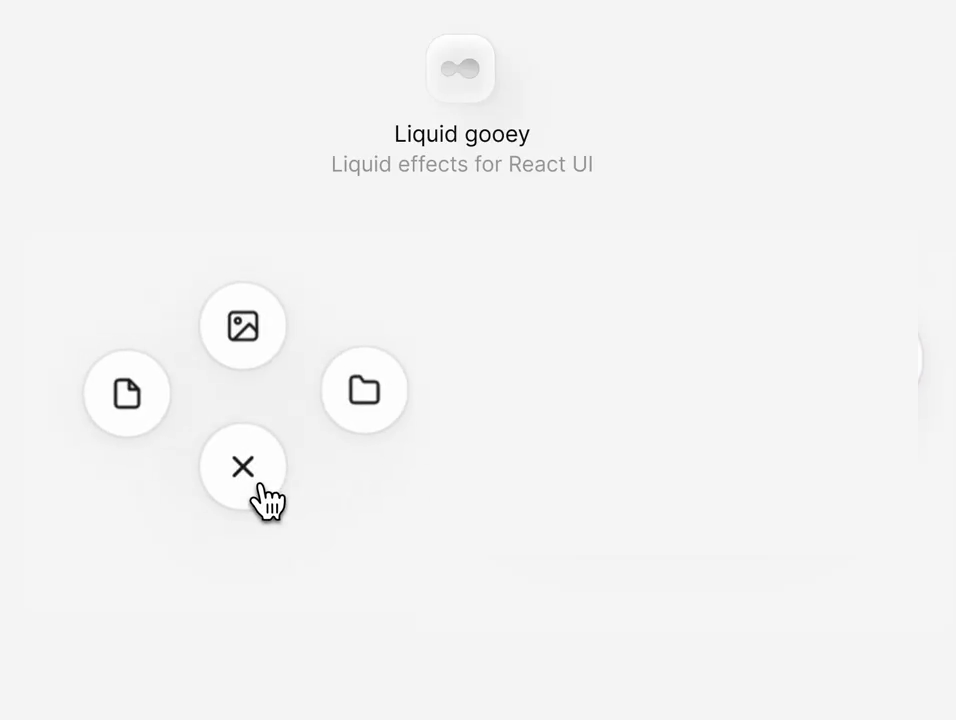
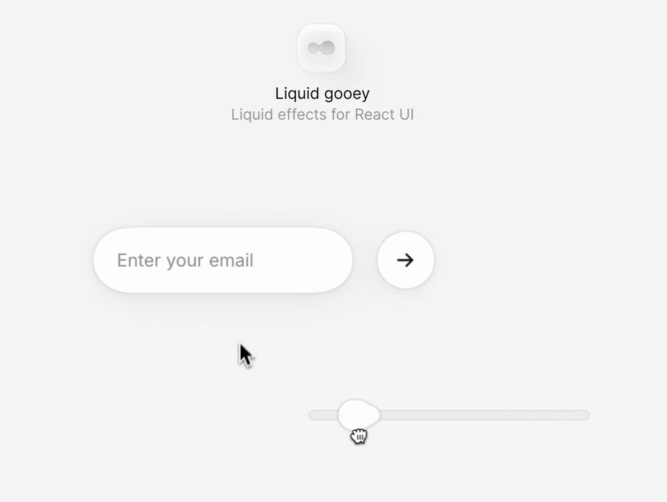
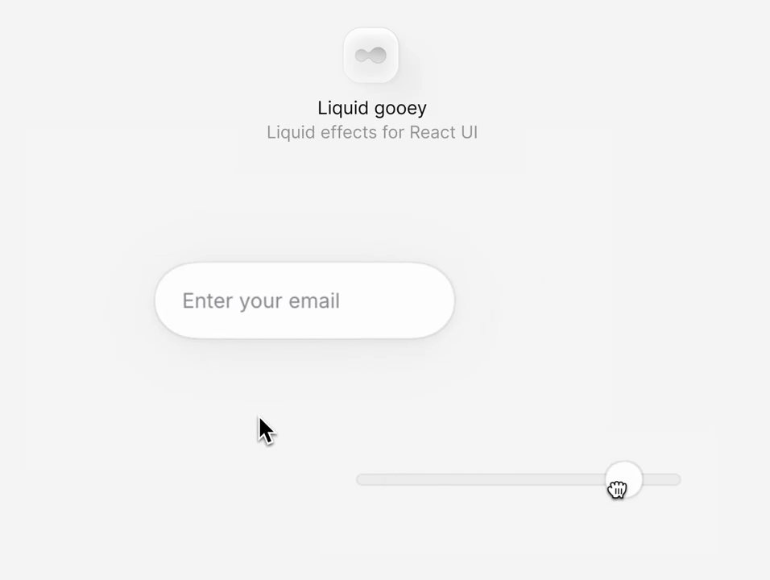

## 問題

浮動動作與輸入控件展開時，新增元素容易看起來憑空出現，讓使用者失去它與觸發按鈕的關係。

## 做法

*圓形選單觸發；含人物頭像的 Share 區已遮除。*

*展開後的選單以多個圓形動作包圍關閉控制；Share 區已遮除。*

*輸入框旁出現獨立的箭頭動作。*

*滑軌控制項位置改變，輸入框仍在原位。*

*影片末段再次呈現展開選單；Share 區已遮除。*

- 官方貼文所附影片的畫面標為 Liquid gooey；加號控制項旁可出現文件、圖片與資料夾等圓形動作，展開後原觸發位置改為關閉圖標。
- 另一組是膠囊形 Share 控件，參與者頭像與延伸圓形區塊共同形成外輪廓；文字與圖標保持在各自清楚的內容層。
- 影片後段切換到 email 輸入框與滑軌；觸發／移動後，圓形控制項的位置及它與主容器的連接狀態改變。保留影格只作關鍵狀態參考，不據此推定濾鏡或 Spring 的實作。
- 原貼文是轉介；媒體原始來源為 @AdhamDannaway 的 2092620833009332620。文字中的「解決文字發虛」是轉介者主張，本次沒有執行程式驗證。

## 為什麼有效（推論）

輪廓先保持接近，再分成獨立控制項，可能把動作選單表達成原按鈕的延伸；固定文字層則有助於避免材質效果干擾閱讀。

## 借鑑要點

- **適合**：少量次要動作、分享控件與可選的輕量微互動。
- **不適合**：密集資料工具、主要表單驗證，或必須即時精確操作的控制。
- **移植時注意**：讓命中範圍在整個動畫中保持穩定；鍵盤可直接開啟選單並移動焦點。提供 reduced-motion 版本，先測試低效能裝置再決定模糊和陰影強度。

## 來源與核對範圍

- [Delroy715 原文](https://x.com/Delroy715/status/2092864376290291765)（發布：2026-08-27T06:38:45+00:00）。

已核對 X 公開原文的嵌入式 Tweet／NoteTweet 資料及本卡所列原始素材。`kind: concept` 表示本次僅確認公開展示／設計方法，沒有把示範等同正式上線或端到端驗證。
