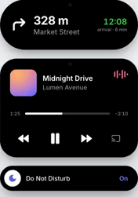
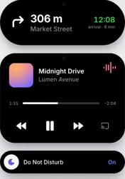

## 問題

導航、播放與其他持續活動需要在很小的區域呈現變化；若每次更新都改布局，會增加重新尋找資訊的負擔。

## 做法

*導航膠囊顯示 350 m、道路名稱與抵達時間，下方音樂卡維持封面、曲名、進度及播放控制。*

*中段距離變為 328 m，文字和控制項仍留在原本位置。*

*末段距離變為 306 m，音樂卡與勿擾狀態條仍維持相同尺寸和位置。*

- 原帖只寫「Widgets - Live Activity」，沒有指定產品；應視為概念展示，不推定為已上線功能。
- 約 12 秒影片以多個黑色圓角元件並排；本卡裁切中間一欄，去除原展示中的通話人像、姓名與車牌等資訊。
- 導航在左側保留轉彎箭頭，中間用較大字級放剩餘距離，下方放道路名稱；右側綠色文字呈現時間與抵達資訊。
- 音樂卡把封面與曲名放上排，進度放中排，上一首、暫停、下一首與投放圖標放下排；下方另外以細膠囊顯示勿擾狀態。
- **動效過程**：影片開始即處於活動中，未呈現啟動操作；距離持續由 350 m 下降至 306 m，其餘元件保持占位。末尾回到起始數值形成循環，未展示真正完成或取消。
- 來源：[作者原帖](https://x.com/abu_uiuxdesign/status/2124798197008867685)。來源發現於 X-2026-11-24.md，原始來源欄為「点赞」。

## 為什麼有效（推論）

- 固定箭頭、數字與時間的位置，可能讓重複查看時更容易直接找到變化值。
- 大小兩種卡片分開承載控制與簡單狀態，可避免把所有活動都塞入同一種密度；影片沒有可用性測試證據。

## 借鑑要點

- **適合**：導航、計時、播放等持續更新且有明確主值的狀態。
- **不適合**：需要閱讀長文、處理多步錯誤或比較大量資料的工作。
- **移植時注意**：先固定主值與輔助值的槽位，再定更新頻率；補上完成、逾時、離線與取消狀態。實際 iOS Live Activity 的空間與可用控制須另行驗證，不能直接照概念圖推定系統能力。
