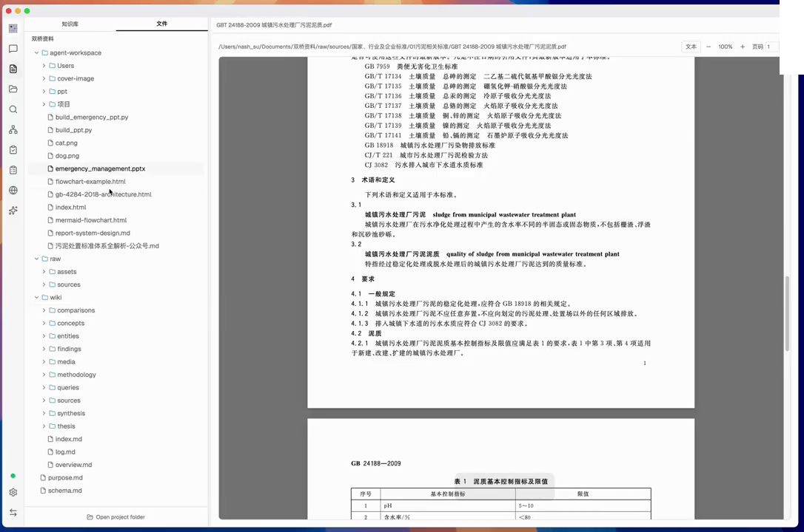
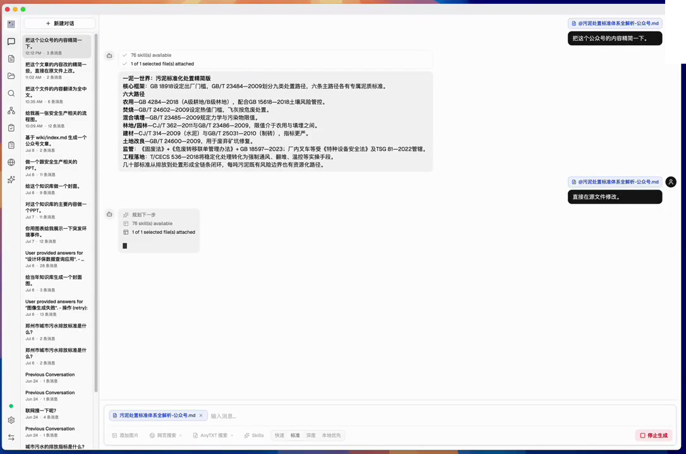
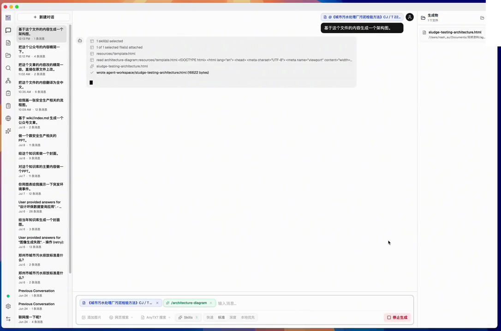
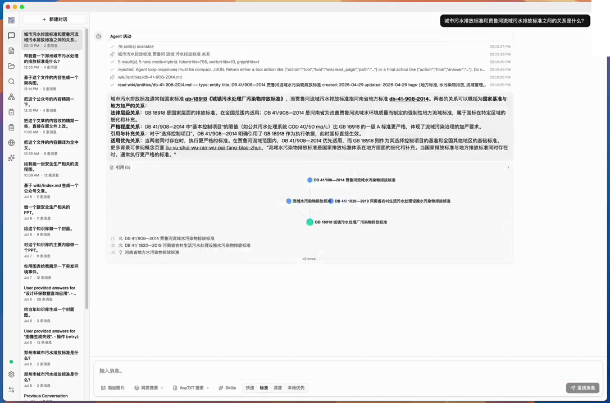

## 問題

對知識庫提問時，使用者需要知道正在操作哪份檔案、使用哪個技能，以及回答依據從哪裡來。

## 做法

*檔案樹旁呈現文件預覽。*

*聊天主區仍保留檔案導覽。*

*輸入處的範圍項與右側參考區可同時看見。*

*結果或文件內容回到主閱讀區。*

- 影片從左側檔案樹與主區文件預覽開始，之後切到聊天內容；檔案導覽在兩種狀態中都被保留。
- 作者說明可用 @ 檔案與 /skill 選擇技能；後段畫面在輸入區附近呈現多個小型選取項，回答旁有獨立的右側參考區。
- 觸發是選擇檔案／技能後提出對話，變化是主區轉為問題與回答，後段出現文件內容或結果預覽。這只核實演示中的 UI，沒有驗證引用正確性或檔案寫入。

## 為什麼有效（推論）

把作用範圍留在輸入處，可能減少「這次是在問全庫還是單一文件」的歧義；引用預覽也能讓使用者在對話內開始檢查依據。

## 借鑑要點

- **適合**：個人知識庫、文件 Agent 和有可選技能的編輯工具。
- **不適合**：沒有可識別檔案範圍的普通聊天，或引用來源不允許使用者存取的資料庫。
- **移植時注意**：檔案與技能標籤可移除且有清楚作用範圍；修改檔案前顯示差異。引用要能回到原文位置，並分開「相關」和「直接支持回答」的來源。

## 來源與核對範圍

- [nash_su 原文](https://x.com/nash_su/status/2075488090374955181)（發布：2026-07-10T07:51:36+00:00）。

已核對 X 公開原文的嵌入式 Tweet／NoteTweet 資料及本卡所列原始素材。`kind: concept` 表示本次僅確認公開展示／設計方法，沒有把示範等同正式上線或端到端驗證。
