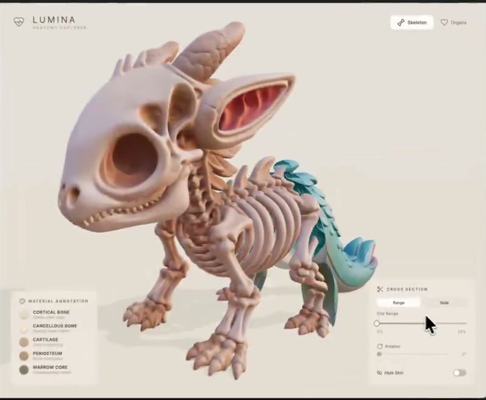
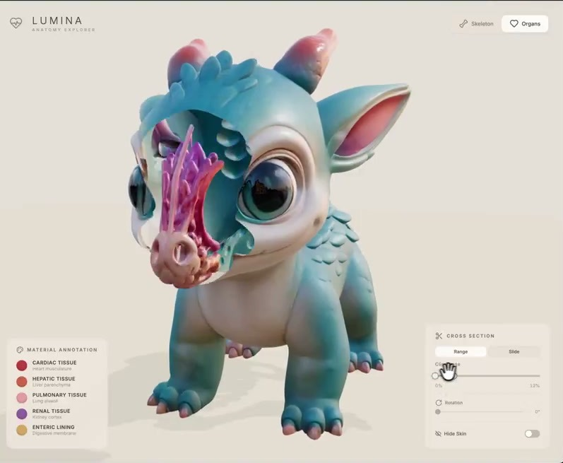
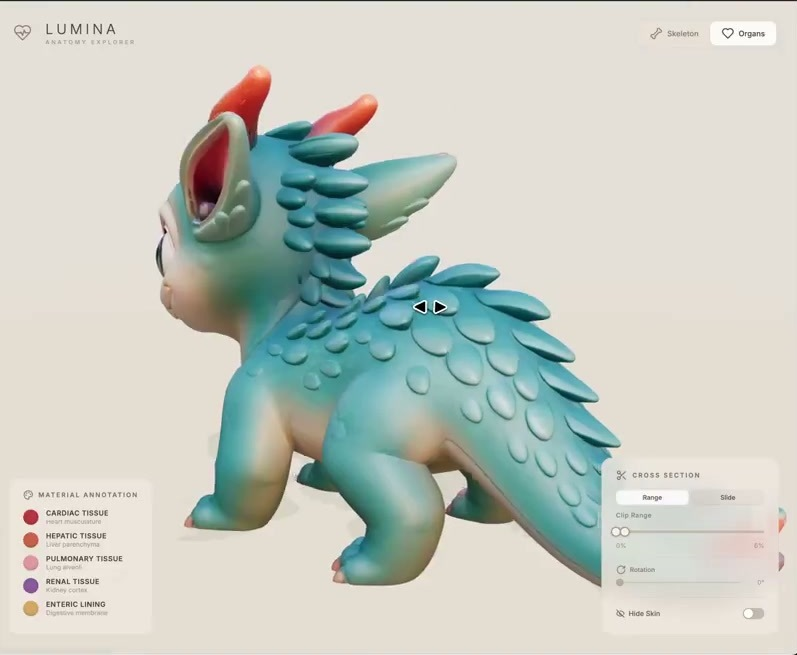
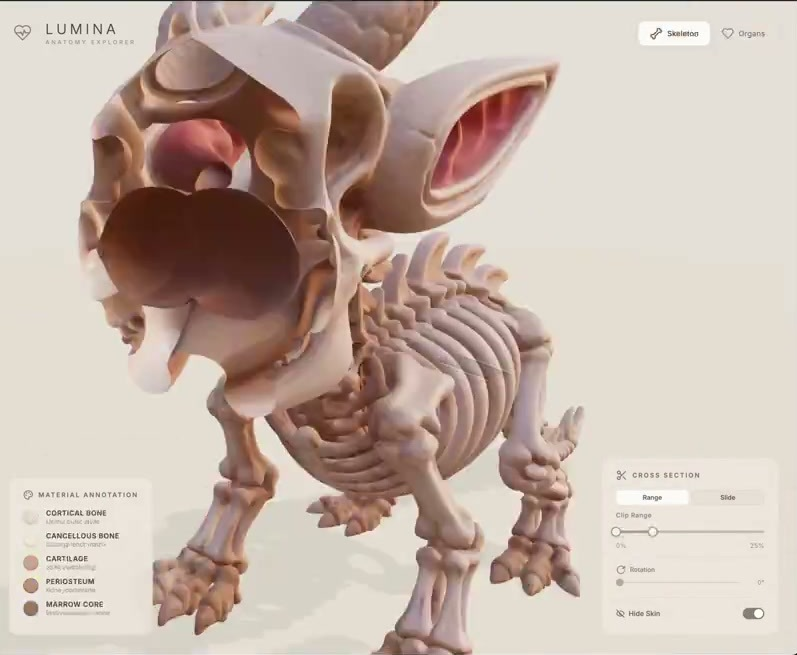

## 問題

探索生物內部構造時，如何把外觀、骨骼和器官放在同一個可比較視角？

## 做法

- 畫面中央始終是同一隻幻想生物，右上方可切換 Skeleton／Organs，左下方列出目前模式的色彩圖例。
- 右下角 Cross Section 面板有範圍和滑桿；影片中模型的外皮與內部構造在同一主體上改變，並可轉向側後方。
- 觸發順序是切換構造模式或調整剖面，中央呈現對應內部，再旋轉觀察；作者說明圖像、程式及模型由生成工具建立，非解剖資料認證。

*骨骼模式保留生物外形局部，左下圖例對應構造。*

*器官模式改變模型可見內部，右下保留剖面控制。*

*旋轉後從側後方觀察同一生物。*

*剖面與放大後可見頭部骨骼，控制面板仍在固定位置。*

## 為什麼有效（推論）

固定主體、只改可見層，可能幫助使用者建立內外構造關係；圖例把顏色與名稱接起來，但不保證教育正確性。

## 借鑑要點

- **適合**：科普互動、幻想生物設定與結構展示原型。
- **不適合**：診斷、醫療訓練或需要精準解剖尺度的教材。
- **移植時注意**：對每一層提供文字替代與重設視角；把生成模型的非實證性清楚標示，滑桿須支援鍵盤與數值定位。

## 來源與核對範圍

- [原帖 2053879878693380346](https://x.com/gaborpribek/status/2053879878693380346)：已核對 X 官方公開 HTML 內嵌的同 ID Tweet／NoteTweet 正文；發佈時間為 2026-05-11T16:48:16+00:00。
- 已下載並檢視原始媒體；影片僅保留關鍵影格，沒有保存原始影片。媒體出處與擷取時間見本目錄 `evidence.json`。
- 本卡只把貼文文字、附圖與錄影可確認的內容列為觀察；未執行產品驗收，效果解讀列為推論。
