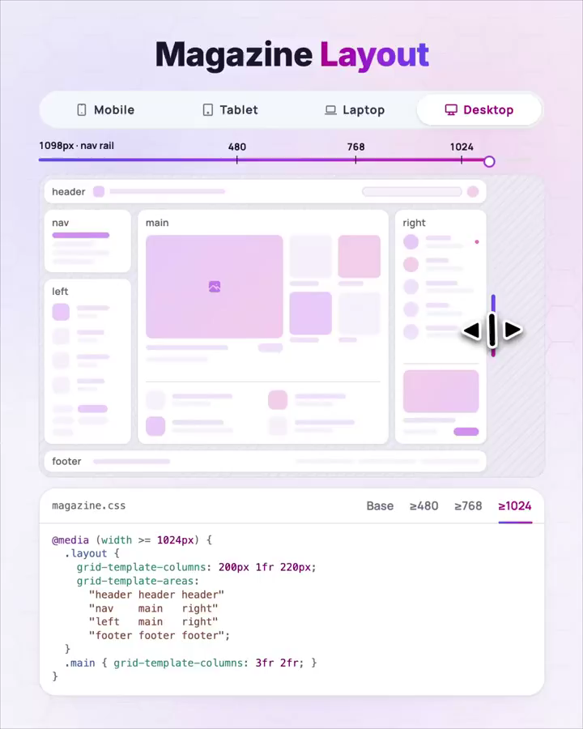
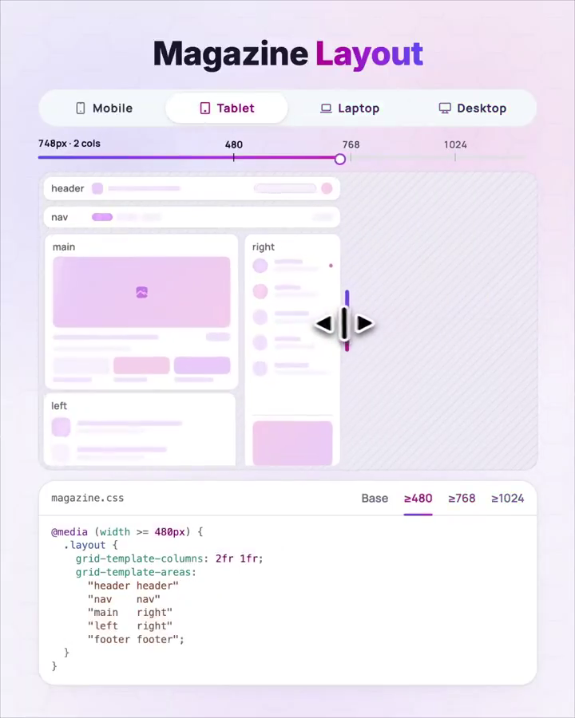
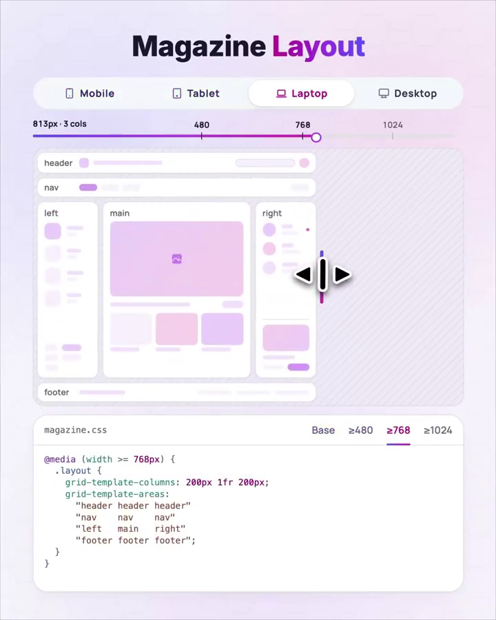

## 問題

設計者需要知道版面縮窄後哪些區域重排，而非只看幾張互不相連的成品截圖。

## 做法

*0 秒：Desktop 狀態左右側欄圍繞中央主內容，下方顯示區域配置程式。*

*2.5 秒：Tablet 狀態減少欄位，次要區塊移到主內容下方。*

*5 秒：Laptop 狀態重新展開主內容與右欄，斷點列及 CSS 同屏。*

示範拖動寬度控制 → 上方裝置標籤與版面改變 → 下方 grid 區域程式對應更新。Header、main、left、right、footer 使用命名區塊，紫色線框使版面關係比真實內容更容易比較。

## 為什麼有效（推論）

命名區域與即時縮放對照可能讓跨斷點變化更容易討論；這不是實際內容長度或可讀性測試。

## 借鑑要點

- **適合**：響應式骨架教學、與 Agent 討論資訊區域順序。
- **不適合**：用固定假內容的骨架直接取代真實版面驗收。
- **移植時注意**：用真實長標題、縮放字體和鍵盤順序驗證；視覺重排也須維持合理閱讀順序。

## 來源與核對範圍

[David Mráz (@davidm_ml) 原帖](https://x.com/davidm_ml/status/2125604256593879377)，發布：`2026-11-25T14:55:21+00:00`。2026-11-27 核對官方 X 頁內嵌完整文字及媒體；各影片保留三張影格，未保存原始影片。
