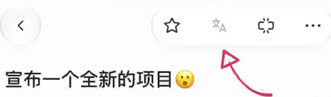
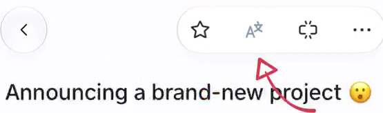
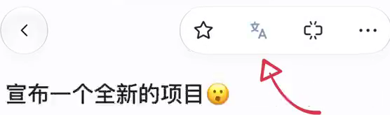

## 問題

在郵件閱讀中切換原文與翻譯時，如何保留操作脈絡，並讓語言狀態的變化可被察覺？

## 做法

- 原作者影片展示同一郵件在英文與中文間切換，頂部操作圖示的相對順序延續，標題和正文隨之替換；本卡只保存工具列與標題，不保存寄件人、收件資訊或郵件正文。
- 影片前段同時有手機樣機的取景放大與模糊，後段在放大視野中反覆切換文字；不能把所有縮放、模糊都歸因於產品內的轉場實作。
- 圖中紅色箭頭指向頂部語言控制；它是作者展示標註，不是已驗證的產品元件或可及性標記。

*0秒：英文標題與頂部工具列；寄件者與正文已裁除。*

*0.7秒：展示取景放大過程中的模糊畫面，不推定為產品特效。*

*1.3秒：工具列下顯示中文標題；紅箭頭是影片標註。*

*2.7秒：放大視野中再次顯示英文標題，工具列相對順序延續。*

*4秒：同一閱讀區回到中文標題；未驗證翻譯品質。*

## 為什麼有效（推論）

沿用同一閱讀區與操作列，可能減少比對原文時重新定位的成本；實際上還需要明確的語言狀態與載入／失敗說明，不能只靠微動效或圖示顏色。

## 借鑑要點

- **適合**：郵件、文章或需要反覆比對語言的閱讀介面。
- **不適合**：以短片推定翻譯準確率、處理速度或正式發布狀態。
- **移植時注意**：明確標示原文／譯文，保存合理閱讀位置，處理長譯文、重試及讀屏通知；另外分開驗證產品轉場與展示影片的鏡頭效果。

## 來源與核對範圍

- [Zayn原帖](https://x.com/ZaynHao/status/2125595627811975676)：官方正文、作者、時間與6.766秒影片已核對；作者文字表示更新尚未發布。沒有將同作者其他郵件產品名稱移植到本卡。
- [Kubai問題](https://x.com/Kubai087/status/2125599807125561658)由 X-2026-11-27.md 的「点赞、收藏」發現。問答頁同時提供上述影片與[Zayn直接答覆](https://x.com/ZaynHao/status/2125602052151881730)，答覆的reply-to ID指向Kubai問題；問題至影片的直接欄位未返回，保留映射缺漏。
- 作者答覆提及 Minshot 的錄屏加設備外殼、縮放與匯出流程；這只記錄素材製作說明，本次沒有安裝、錄屏或測試 Minshot。
- 原影片以每0.5秒抽樣檢視，保留五張設計區裁圖；沒有保存完整影片、郵件正文、身份資訊或提示詞。來源、裁切及雜湊見 `evidence.json`。
