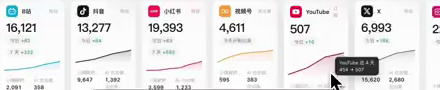

## 問題

同一份內容在多個平台發布後，創作者需要同時查看單期表現、各平台的變化，以及內容的發布日期；這三種問題需要不同的閱讀尺度。

## 做法

以下為原作者影片的抽樣觀察，並非實際操作測試。影片依序展示儀表板、平台卡片與日曆；抽樣不足以確認每次切頁的觸發方式或動畫。只保留介面裁圖，移除講者人像與影片章節列。

*約 30 秒：單期內容摘要在左，粉絲總數與柱狀趨勢在中，文字分析在右。*

- 儀表板上半部把單期內容的標題、平台標記與數值摘要放在一起；中間以大字總數帶出時間圖表，右欄提供文字分析。三個區塊以淺色圓角卡片分隔。
- 大字數值與圖表共置，讓總量與變化趨勢可以一起閱讀；畫面中的數字只代表影片當時的展示，不作成效證據。

*約 90 秒：多個平台以同寬卡片橫向排列，各自顯示圖標、數值與小型趨勢線。*

- 平台卡片使用一致的資訊順序，依靠平台圖標及不同顏色的趨勢線區別來源。
- 這一影格可見其中一條趨勢線附近的深色浮動標籤；不據單一影格推定完整懸停規則。

*約 190 秒：「日曆」頁以月視圖排列內容縮圖和標題，頁面頂部保留分頁導覽。*

- 日曆用日期格承載內容縮圖、標題與小字資訊，將發布節奏放回時間位置；與儀表板的數值比較分成不同頁面。
- 日曆下方有不同顏色的圖例；本版本小字不足以可靠辨識全部狀態，因此不補寫其名稱或切換行為。

作者在原文另稱：Agent 準備各平台文案、外掛填寫上傳頁、使用者自行點擊發布，麥田再回收連結與資料。這是作者陳述；本卡抽樣沒有驗證發布流程，亦沒有驗證其「七個平台」的完整支援範圍。

## 為什麼有效（推論）

- 把單期摘要、平台比較、日期排程分層呈現，可能減少在一張總表裡混合不同尺度的閱讀負擔。
- 同構的平台卡片可能方便橫向掃視，但只有指標定義及時間範圍一致時，數值比較才有意義；本次未查驗這些定義。

## 借鑑要點

- **適合**：同內容跨平台發布、需要兼顧每期回顧與發布節奏的創作者工作台。
- **不適合**：直接用不同平台的原始數值排名，或把展示數據當作工具帶來的增長成果。
- **移植時注意**：先統一時間範圍、更新時間與指標口徑；為同步失敗及無資料設計明確狀態。這些是移植建議，並非本影片已展示的功能。

## 來源與驗證

- [作者原帖](https://x.com/czzzzzzJ_/status/2122267555133821359)：從 X 官方 HTML 核對同 ID Tweet 與 NoteTweet 正文、作者、影片及發布時間。其編輯鏈的初始 ID 為 `2122266691207827824`，不另作案例。
- [原帖引用的長文入口](https://x.com/czzzzzzJ_/status/2122266042491642027)：本次只取得標題與預覽，未以未讀全文補寫介面細節。
- 於 2026-11-17 收錄；影片約 521.6 秒，只存三張經檢視的關鍵影格裁圖，不保存原始影片。
