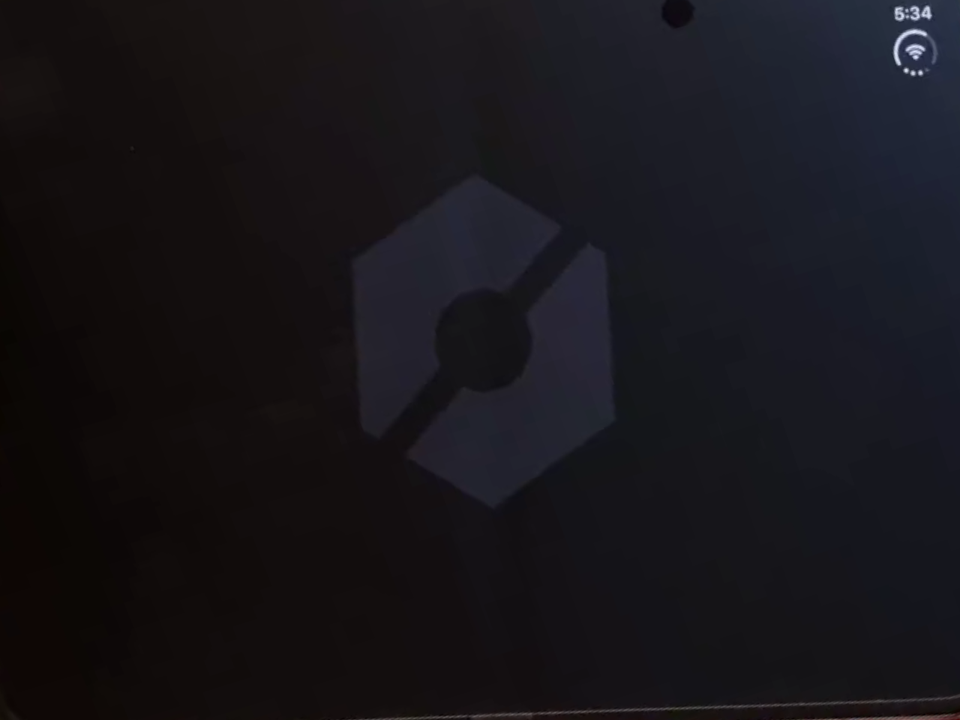
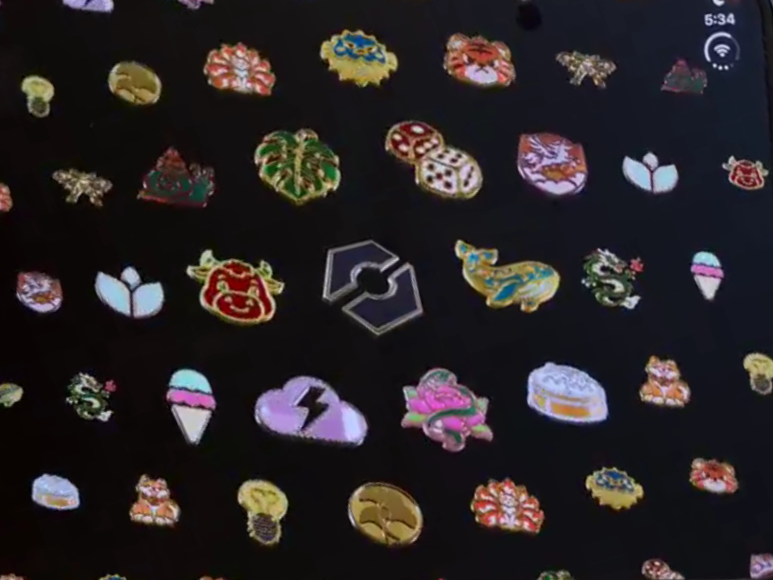
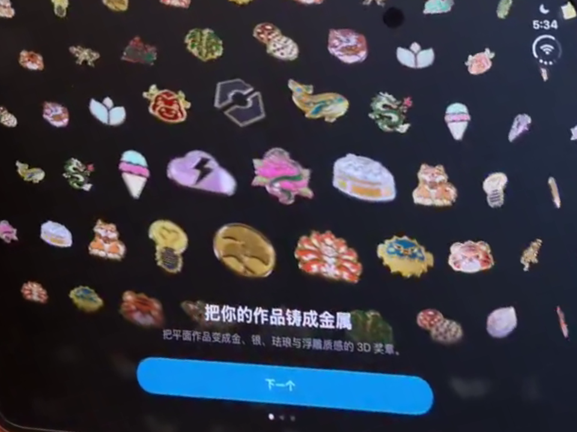
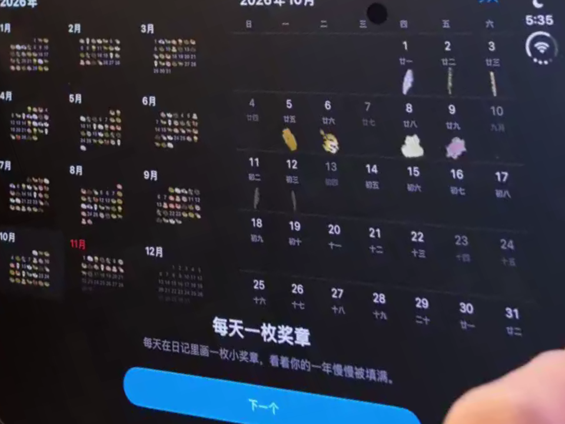
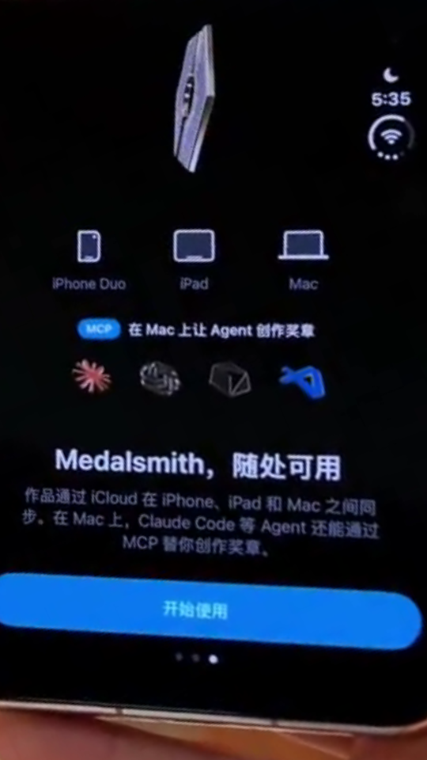

## 問題

如何在首次使用時，把 3D 徽章製作、日常收藏與跨裝置使用這幾種用途介紹給使用者？Medalsmith 的作者影片以實機展示引導頁，先呈現徽章成品，再介紹日曆與裝置能力。

## 做法

- **來源與版本**：[最初版本](https://x.com/cats_juice/status/2122276769772572759)發布於 **2026-11-16 10:33:06 UTC**；[後續版本](https://x.com/cats_juice/status/2122287437405929859)發布於 **2026-11-16 11:15:29 UTC**，補充開發與上架致謝。2026-11-18 重新取得兩版官方貼文及 syndication 資料，兩者均附約 32.7 秒影片；成功下載後續版本的官方 720p 影片。
- **開場 → 展示**：0 秒為深色底與中央幾何標誌；5 秒時畫面已鋪滿多行彩色徽章。後續取樣中徽章位置與外觀有所變化；未確認動畫觸發條件，不據此宣稱有重力或手勢控制。
- **第一個介紹頁**：17 秒顯示「把你的作品鑄成金屬」，下方為短說明、寬版藍色「下一個」按鈕與三個分頁圓點。徽章展示佔主要面積，文字與操作集中於底部。
- **日曆頁**：24 秒顯示「每天一枚獎章」；左側為全年月份縮圖，右側為單月日期格，部分日期放有徽章。底部仍有藍色「下一個」。影片中可見手指操作，但取樣不足以確認每次點擊與轉場的精確對應。
- **最後介紹頁**：31 秒轉為直向，顯示「Medalsmith，隨處可用」、裝置圖示、iCloud 同步與 Mac Agent／MCP 創作介紹；底部按鈕改為「開始使用」，第三個圓點高亮。這是引導的完成入口，影片未展示按下後的主介面；介紹文案不等於功能已實測。
- **影像邊界**：共檢視 0、5、11、17、24、31 秒六個影格，保留其中五張。素材由實機拍攝畫面裁取螢幕並校正透視，非原生截圖；保留拍攝模糊、局部手指遮擋與日曆頁底部不完整的限制。未保留原始影片。

0 秒：深色開場中央只有幾何標誌。

5 秒：彩色立體徽章以多行排列鋪滿畫面，中央保留品牌圖形。

17 秒：徽章展示下方依序放置標題、說明、「下一個」與分頁圓點。

24 秒：全年縮圖與單月日期並排，以日期中的徽章呈現收藏方式；底部按鈕局部超出拍攝範圍。

31 秒：直向畫面介紹裝置、iCloud 與 MCP，並以「開始使用」作為引導出口。

## 為什麼有效（推論）

- 先展示可製作的成品，再說明日常收藏情境，可能讓使用者更容易理解抽象的 3D 工具用途；未取得啟用或轉換成效資料。
- 相同底部操作位置與三個圓點提供進度線索；最後把「下一個」換成「開始使用」，可區分閱讀介紹與進入產品的意圖。

## 借鑑要點

- **適合**：成品外觀本身有吸引力，且需要介紹創作、收藏等不同用途的工具。
- **可移植做法**：先用成品建立預期；每頁保留一個主題、短說明與單一主要操作；最後一頁明確命名進入產品的動作。
- **不適合直接照搬**：純工具或急需完成任務的場景，不宜只因視覺效果就加入較長開場。此影片不能證明實際開場等待時間。
- **移植時調整**：另行設計略過、減少動態效果及長文案排版；影片未核實這些能力。跨裝置與 Agent 能力只有在產品確實支援時才寫入介紹。
