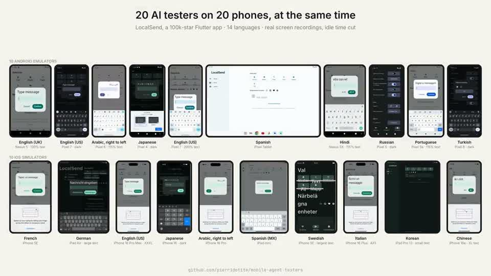
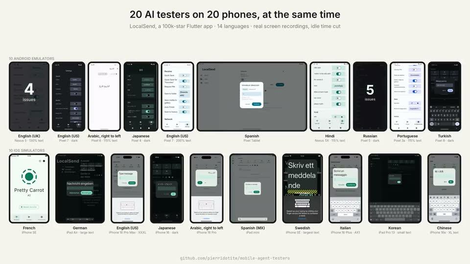
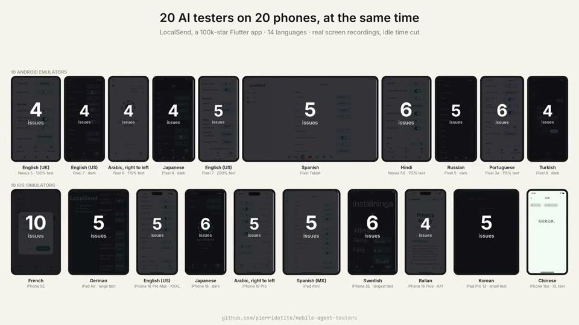

## 問題

比較多種螢幕、語言與字級時，如何避免把單一裝置的成功當成全部通過？

## 做法

- 影片以兩列裝置畫面呈現同一通訊任務；每台下方標示語言與裝置條件。
- 部分小螢幕及放大字級畫面仍顯示訊息輸入框，另一些畫面出現過大的文字或被截斷的控制項。
- 隨時間推進，各裝置進入不同畫面；這是並列測試示範，不能視為已同步到同一步或已證實全部問題。

*兩列裝置在訊息輸入階段並列，下面以語言和裝置條件區分。*

*相同展示中，小螢幕與大字條件呈現不同的可視內容。*

*各裝置畫面疊加問題數量彙總，保留語言與裝置標籤；數字為作者報告，未經本次獨立重現。*

## 為什麼有效（推論）

把環境條件貼在畫面旁，可能讓差異更容易定位；但仍需個別重現與問題證據。

## 借鑑要點

- **適合**：多語、多字級或多裝置的驗收報告展示。
- **不適合**：用並列錄影或作者統計直接取代可重複測試。
- **移植時注意**：每個問題再附單獨步驟、預期與實際結果；不引用未獨立核實的費用、速度和問題數。

## 來源與核對範圍

- 影片頁腳標示原始專案倉庫 [pierridotite/mobile-agent-testers](https://github.com/pierridotite/mobile-agent-testers)。2026-11-23 主線獨立開啟官方 GitHub 倉庫，確認 README 嵌入 LocalSend 執行影片並標示專案歸屬；此處採用該一手來源核驗結果。`author` 記錄專案維護者 pierridotite；GitHub_Daily 是 X 發布／傳播來源，不據此認定其為專案作者，也不推定影片創作者身分。

- [傳播來源 2124442800930591106](https://x.com/GitHub_Daily/status/2124442800930591106)：已讀官方 SSR 同 ID 正文與 NoteTweet（如有），發佈時間 2026-11-22T10:00:08+00:00。
- 已逐張檢視官方影片抽樣影格；僅留三張裁切畫面，未保存原始影片、完整提示詞或私人帳號。示範不等於功能或成效驗收。
