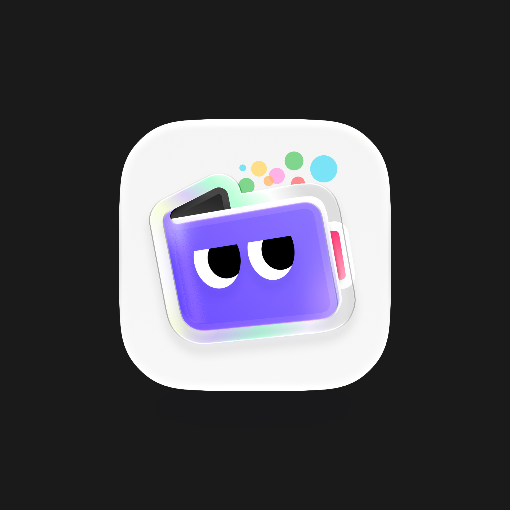
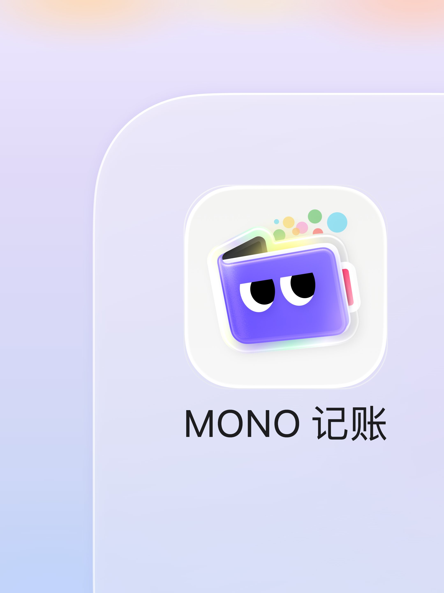
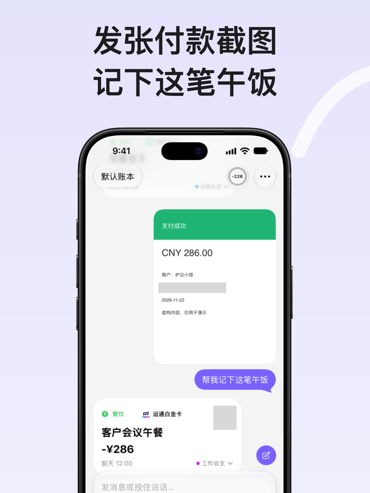

## 問題

如何用圖示表達記帳的用途與性格，並讓自然語言或付款截圖產生的帳目保留可核對的欄位？

## 做法

*紫色錢包前片有一對黑白眼睛，後方露出深色卡片與側邊粉色標籤，上方散落彩色圓點。*

- 圖示以錢包輪廓表達用途，以眼睛形成角色；紫色前片、白色後片與灰色投影分出前後層次，輪廓邊緣帶淡彩高光。這是原帖的靜態作品圖，不是動效或小尺寸辨識測試。

*被引用原帖第一張圖把同款錢包角色置於淡紫色背景，下方標示產品名稱。*

*紫色訊息氣泡描述早餐 11 元與交通 6 元，下方分別呈現兩張白色帳目卡；灰塊為本次移除的頭像。*

- 原帖第二張圖在同一對話流中保留原始句子，下面分列餐飲與交通帳目。每張卡將分類及支付方式置頂，項目名與負數金額放大，日期時間與帳本置底；分類同時有圖示和文字，並非只靠顏色。
- 頂部可見預設帳本入口、圓形數值與更多按鈕；底部輸入框提示可發訊息或按住說話。靜態圖不能確認圓形數值的計算口徑、語音實際操作或卡片是否可編輯。

*上方付款示例顯示 286 元，中間有記錄午飯的請求，下方帳目卡呈現餐飲、支付方式、金額與工作收支帳本；頭像及付款卡資訊已遮蓋。*

- 第三張圖保留截圖輸入、文字請求與結構化結果的上下文，便於對照金額與分類。付款示例本身標註為虛構演示；沒有展示辨識過程、成功儲存或錯誤修正，不能把版面展示當成解析準確率證據。

## 為什麼有效（推論）

- 錢包輪廓與眼睛可能兼顧用途線索和角色記憶點；紫色主色也連接圖示與訊息氣泡。高光與多層細節在小尺寸是否仍有效，需要另測。
- 把原始輸入與分筆結果留在同一流中，可能方便核對一段話是否漏記或拆錯；帳目卡的固定欄位順序有利逐筆比較，但本次沒有使用數據支持效率提升。

## 借鑑要點

- **適合**：生活記錄、自然語言輸入與需要回看輸入依據的結構化資料工具；角色圖示適合具有親和語氣的消費產品。
- **不適合**：需要多欄批次核帳、嚴格審批或高密度資料輸入時，單一對話流未必足夠。
- **移植時注意**：明確區分解析預覽與已儲存，提供金額、支付方式、帳本及日期的修正入口；測試同句多筆、重複截圖和辨識失敗。圖示應另檢查小尺寸與深淺背景，不直接複製角色造型。

## 來源與核對範圍

- [Kubai 圖示分享 2125262235161526327](https://x.com/Kubai087/status/2125262235161526327)：2026-11-24T16:16:16+00:00，附一張圖，引用下列產品帖；作者文字表示這是其喜愛的作品之一。
- [產品作者原帖 2125249215597347162](https://x.com/ivensliao007/status/2125249215597347162)：2026-11-24T15:24:32+00:00，附三張圖。文字另提語音與週期帳單，本卡不把未展示的流程當成觀察。
- 依指定的最新官方 X 原始資料核對正文、時間、引用關係與媒體，四張官方原圖均已下載並逐張檢視；來源與素材雜湊見 `evidence.json`。素材沒有帳號或真實姓名；仍移除帳目頭像及示例付款卡資訊。
- 本卡與既有 Mono Charts 圖表庫無關，查重後另建；沒有安裝、操作或驗收產品。
