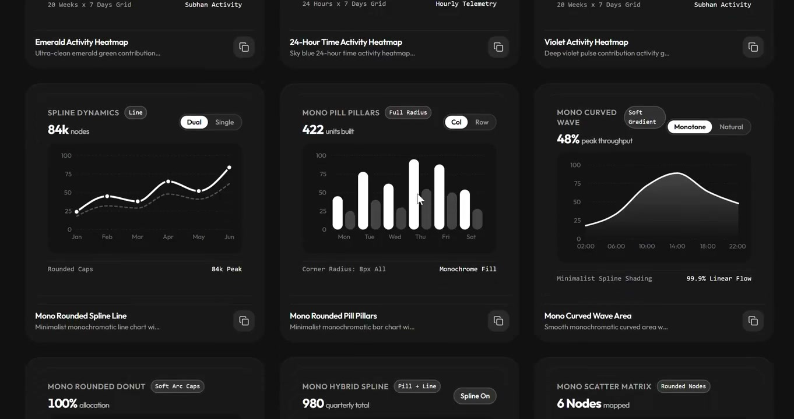
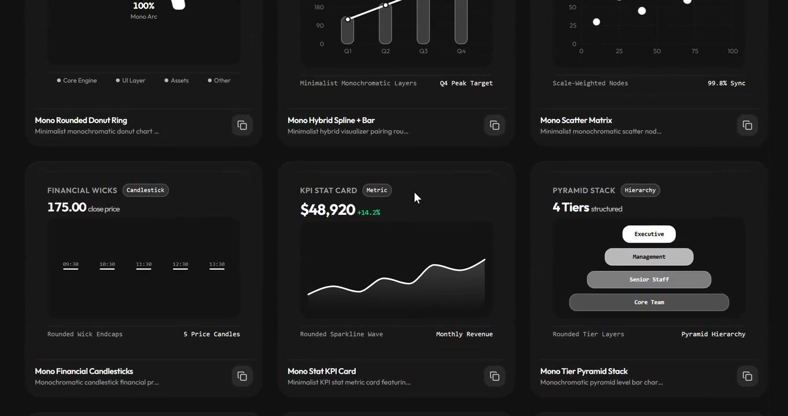
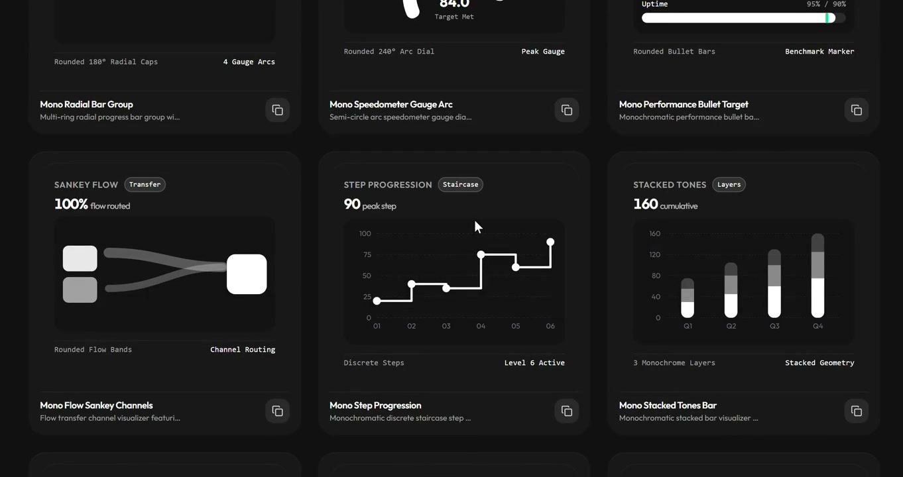
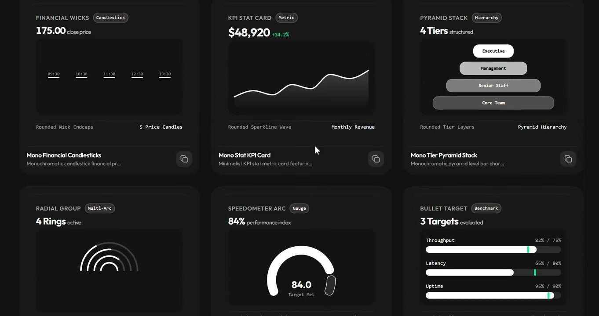

## 問題

評估圖表元件時，如何讓人同時看見圖形、代表的數值與可採用的實作入口？

## 做法

- 影片中的元件畫廊採深色多欄卡片，每張卡頂部有指標名和數值，中間是圖表，底部有樣式名稱及複製圖示。
- 示例包含折線、長條、面積、圓環、散點、階梯線與目標條；卡片內使用白灰層次區分資料系列，部分以文字或小標記補充語義。
- 錄影由上向下瀏覽不同圖表，再回到 KPI 與儀表區。原帖稱元件可互動及以 CLI 加入；本次未執行套件，不推定所有圖都已有 hover、鍵盤與真實資料支援。

*折線、長條與面積圖各置於附摘要的獨立卡片。*

*KPI、金融與層級示例沿用相同卡片結構。*

*階梯圖及堆疊長條讓形狀與資料類型可一起比較。*

*回到指標和目標條區，每張卡仍保留名稱與複製出口。*

## 為什麼有效（推論）

將摘要和圖表保持在同一卡中，可能方便比較「哪種圖適合哪種指標」，複製入口則縮短參考到採用的路徑。

## 借鑑要點

- **適合**：儀表板元件選型與小型指標卡。
- **不適合**：需要高精度讀值、密集多系列或嚴格報表輸出的科學圖表。
- **移植時注意**：補齊單位、座標和資料表替代；單色需保留可辨識的線型與標籤。動畫不應掩蓋零值、缺值或變更幅度。

## 來源與核對範圍

- [原帖 2088599468698751328](https://x.com/SubhanHQ/status/2088599468698751328)：已核對 X 官方公開 HTML 內嵌的同 ID Tweet／NoteTweet 正文；發佈時間為 2026-08-15T12:11:32+00:00。
- 已下載並檢視原始媒體；影片僅保留關鍵影格，沒有保存原始影片。媒體出處與擷取時間見本目錄 `evidence.json`。
- 本卡只把貼文文字、附圖與錄影可確認的內容列為觀察；未執行產品驗收，效果解讀列為推論。
