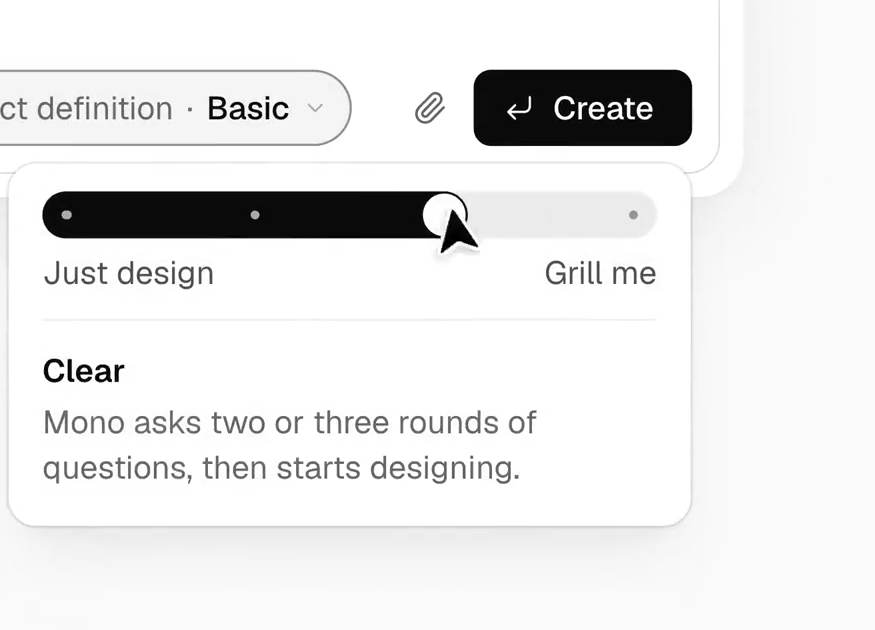
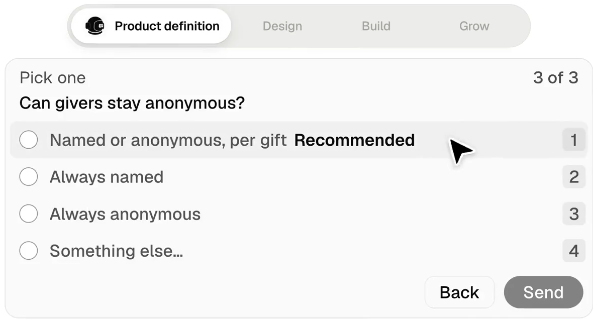
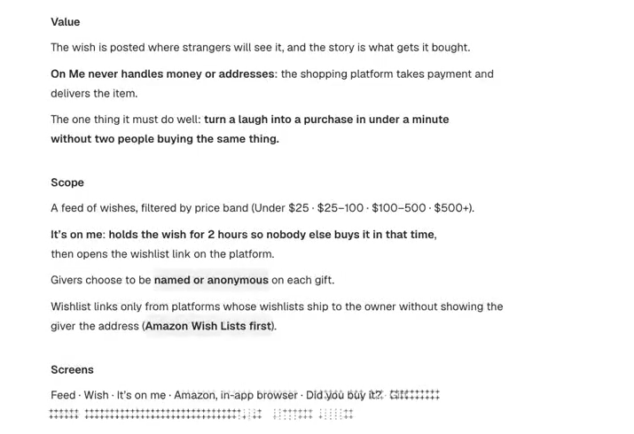
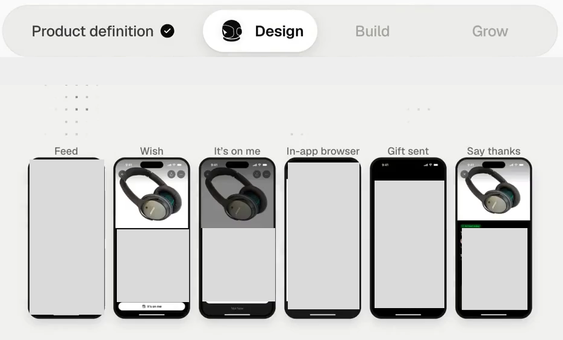
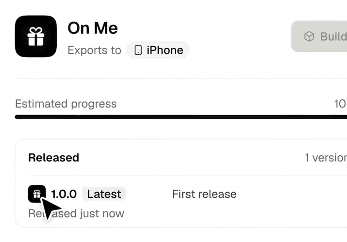
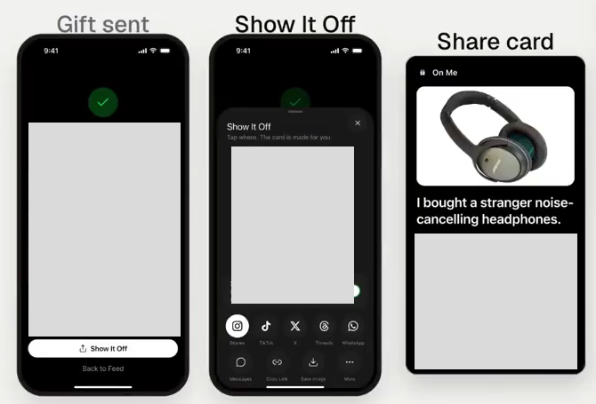

## 問題

業務擁有者把構想交給 AI 時，仍需確定產品規則、審閱需求、檢查畫面，並接續構建與後續改動。這支示範把這些交接放進同一工作區，而不只展示最終生成的介面。

## 做法

以下是親自檢視來源影片後的畫面觀察，不代表已實際操作服務。頂部依序排列 **Product definition → Design → Build → Grow**；當前階段以白色膠囊突出，前面階段出現勾號。

*約 20 秒：產品定義設定以 Just design 至 Grill me 的刻度呈現提問深度，說明區顯示 Clear 與提問輪數。*

- 初始建立區有 Platform、Design、Product definition 設定與 Create；影片展示平台、設計風格的選單，再進入產品定義深度設定。畫面中的 Basic 是控制列文字，浮層當下則顯示 Clear 與「兩至三輪問題後開始設計」的說明，不能據此推定兩者已同步保存。

*約 30 秒：第三題詢問送禮者能否匿名，列出四個單選答案、Recommended、數字提示及 Back／Send。*

- 建立後進入分題選擇流程；題目包括願望來源、避免重複購買與匿名規則。每題提供具體選項與 Something else，右上角標示題序（此圖為 3 of 3）。影片沒有證明數字提示可實際用鍵盤操作。

*約 35 秒：PRD 右側文件區以 Value、Scope、Screens 分段，將產品價值、業務限制及畫面清單放在同一份文件。*

- 完整畫面是左側對話、右側 PRD.md。回覆選擇題後，左側出現 Writing PRD.md 狀態，右側逐步呈現文件；例如限制重複購買的保留時間、匿名選擇與願望清單來源。存圖僅保留文件區，不保留完整輸入提示詞。

*約 45 秒：Design 畫布橫排 Feed、Wish、It’s on me、In-app browser、Gift sent、Say thanks 六個流程節點；預覽內姓名與敘事區已遮蔽。*

- 從文件接到 Canvas，畫面先出現少量手機稿，再擴展為多個畫面及深淺配色。以具名流程節點排列畫面，讓同一旅程的前後狀態可並看；不是單張美術展示。

*約 55 秒：Build 面板顯示 Exports to iPhone、Estimated progress，以及 Released 下的 1.0.0／Latest／First release；右側文字受原影片取景截斷。*

- 進入 Build 後，畫布旁出現構建面板，後續影片展示進度完成狀態與手機預覽。**影片中的完成進度（100%）和 Released 只是可見演示狀態；本次沒有執行構建、安裝或發布，也未取得構建產物或日誌。**

*約 75 秒：Grow 的新增流程並排 Gift sent、Show It Off 與 Share card，保留分享按鈕及平台選項，遮蔽姓名、帳號、頭像與敘事。*

- 後段由新增分享需求觸發變更：對話區先顯示 Updating PRD.md to 1.1.0，隨後記錄新增 Show It Off 與分享卡片畫面。這是從既有版本回到文件與設計的迭代示範；沒有驗證分享實際送出或外部平台連通。

### 來源與證據範圍

- [原帖：Yilin0x，2124918404234826226](https://x.com/Yilin0x/status/2124918404234826226)；[轉發：Kubai087，2124924634999222670](https://x.com/Kubai087/status/2124924634999222670)。官方原始資料中的發布者是 Yilin0x，Kubai087 是轉發者，不能將轉發者當成產品設計者。實際介面與影片創作者未確認，因此 author 留空。
- [來源官網 monofactory.ai](https://monofactory.ai) 由官方原帖的展開網址確認；本次網頁讀取失敗，沒有用官網內容補足影片未展示的能力。
- 原帖 UTC 發布日期為 2026-11-23；收錄日期為 2026-11-25。官方媒體資料標示影片 95.253 秒，本機容器探測為 95.296 秒；時間點採影片定位近似值。
- 僅保存六張裁切／遮蔽影格，不保存完整影片、完整提示詞或畫面人物識別資訊。發布文案是來源說法，不是實測證據；未驗證真實產品使用，故維持 concept。

## 為什麼有效（推論）

- 把含糊構想拆成有限選項，可能降低回答門檻；Recommended 能提供起點，但也可能讓人忽略業務例外。
- PRD、畫布和階段條共用工作區，可能減少重新交代上下文的成本；影片本身不能證明文件與構建結果始終一致。
- Grow 先更新需求再補畫面，提供可借鑑的變更回路；是否真正保留既有功能、資料與部署狀態，仍需實測。

## 借鑑要點

- **適合**：AI 輔助產品定義、以需求文件連接多畫面設計、需要持續追加功能的建立工具。
- **不適合**：把示範進度當成可交付保證；具有支付、身分或資料風險的流程，不能只靠推薦選項決定規則。
- **移植時注意**：每題保留自訂答案與返回入口；PRD 明列已確認規則及例外；設計稿按旅程節點排列。構建成功須連到可核驗的產物、日誌與驗收結果；版本更新需明示變更範圍，不能只靠勾號或百分比宣告完成。
