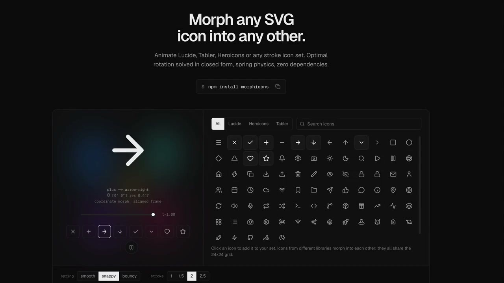
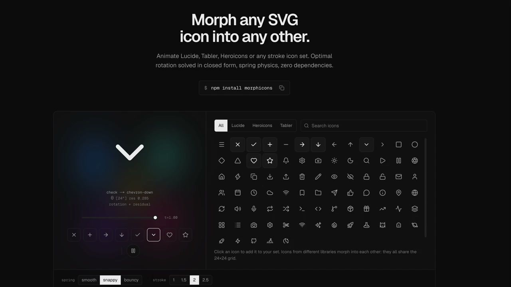
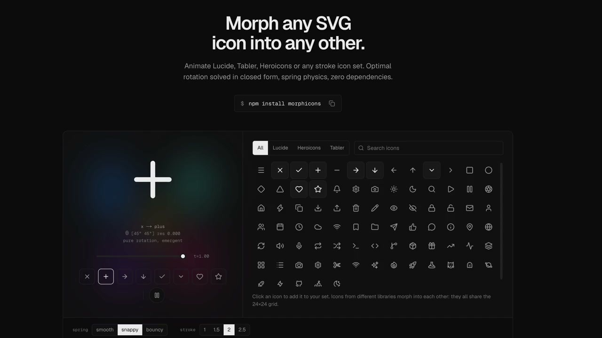
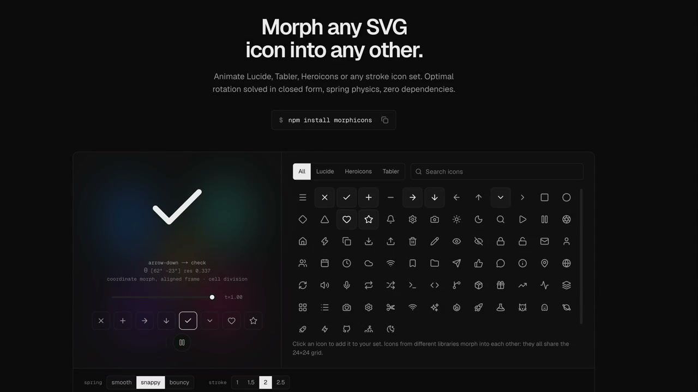

## 問題

圖標代表的狀態改變時，如何預覽過渡而不是只比較兩張互不相干的靜態圖？

## 做法

- 示例頁左側是放大圖標預覽，右側有圖標集合切換、搜尋與多行圖標，左下方另列一排常用目標圖標。
- 影片中在同一預覽位置依次出現箭頭、向下折線、加號與勾號；下方有彈性風格和速度選項，當前選項以底色反白。
- 觸發是選擇目標圖標，預覽輪廓隨之改變並落在相同中心。原帖宣稱無依賴且約 7KB，本次未檢查套件體積或路徑演算法。

*箭頭顯示於放大預覽，右側提供可搜尋的圖標網格。*

*目標改變後，預覽呈現向下折線。*

*加號保持同一中心，便於比較形狀變化。*

*勾號作為另一終點，下方仍可切換動態參數。*

## 為什麼有效（推論）

同一位置的輪廓變化可能讓使用者把前後視為同一控制項的狀態；並排預覽參數可幫助選擇動態強度。

## 借鑑要點

- **適合**：播放／暫停、展開／收合或提交完成等成對狀態。
- **不適合**：毫無語義關係的圖標任意輪播。
- **移植時注意**：動畫不能取代 accessible name 與持久狀態；處理快速重複切換、減少動態效果和不同筆畫粗細。

## 來源與核對範圍

- [原帖 2088990558622474511](https://x.com/midudev/status/2088990558622474511)：已核對 X 官方公開 HTML 內嵌的同 ID Tweet／NoteTweet 正文；發佈時間為 2026-08-16T14:05:35+00:00。
- 已下載並檢視原始媒體；影片僅保留關鍵影格，沒有保存原始影片。媒體出處與擷取時間見本目錄 `evidence.json`。
- 本卡只把貼文文字、附圖與錄影可確認的內容列為觀察；未執行產品驗收，效果解讀列為推論。
