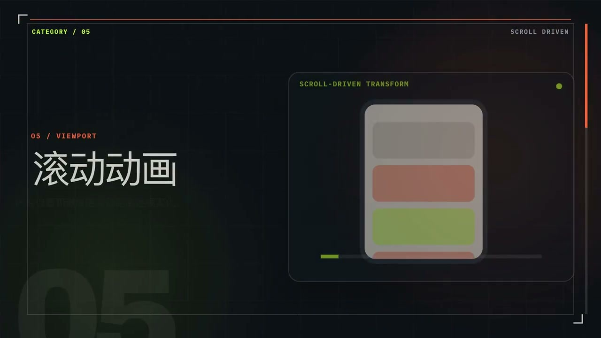
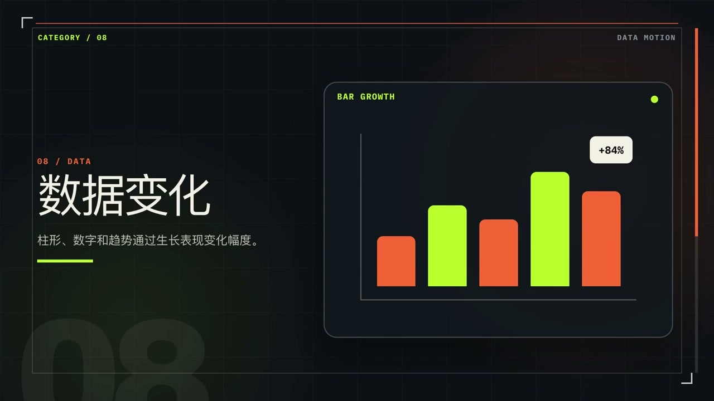
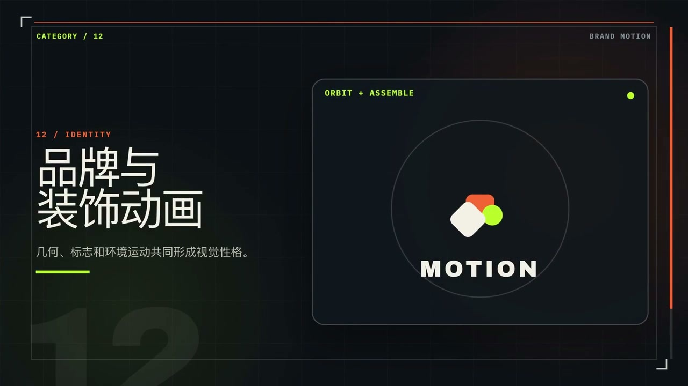

## 問題

向 Agent 描述動效時，如何把模糊的「滑進來、有點彈」轉成可共同討論的參考？

## 做法

- 每一段固定採左側中文情境標題、短說明，右側元件示範及英文名稱；角落保留分類序號。
- 抽取片段包含 Push Slide 的詳情頁推入、Scroll-driven Transform 的內容堆疊、Bar Growth 長條和 Orbit + Assemble 幾何圖形組合。
- 影片順序由不同類別逐段切換；這是術語解說，不是同一產品的完整使用旅程，也未給出每個動效的時長與曲線參數。

*Push Slide 把頁面切換情境與詳情頁推入示例並列。*

*Scroll-driven Transform 對應滾動與內容層疊變化。*

*Bar Growth 用柱高與數值表示資料變化。*

*Orbit + Assemble 展示幾何圖形圍繞並組合的品牌動效。*

## 為什麼有效（推論）

把操作情境與具體名稱綁在同一畫面，可能讓討論者較容易找到共同指稱；名稱仍不足以完整描述觸發與結束規則。

## 借鑑要點

- **適合**：團隊溝通、Agent 提示與動效需求整理。
- **不適合**：直接把詞彙清單當成全站都要加入的效果清單。
- **移植時注意**：每次選用還要補觸發、方向、持續時間、可打斷行為及 reduced-motion；一個名字不保證各實作相同。

## 來源與核對範圍

- [原帖 2075764484027932963](https://x.com/shao__meng/status/2075764484027932963)：已核對 X 官方公開 HTML 內嵌的同 ID Tweet／NoteTweet 正文；發佈時間為 2026-07-11T02:09:53+00:00。
- 已下載並檢視原始媒體；影片僅保留關鍵影格，沒有保存原始影片。媒體出處與擷取時間見本目錄 `evidence.json`。
- 本卡只把貼文文字、附圖與錄影可確認的內容列為觀察；未執行產品驗收，效果解讀列為推論。
