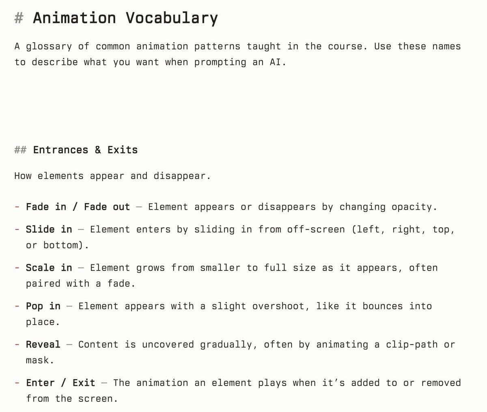
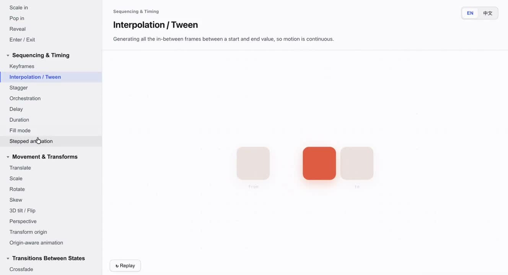
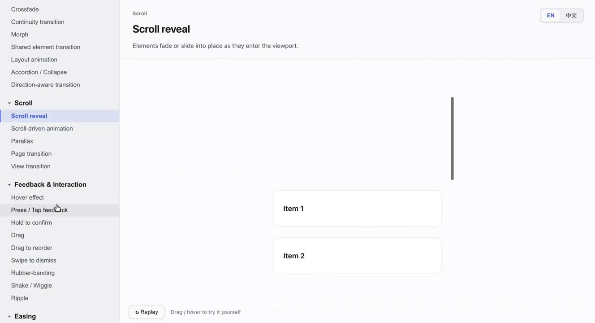
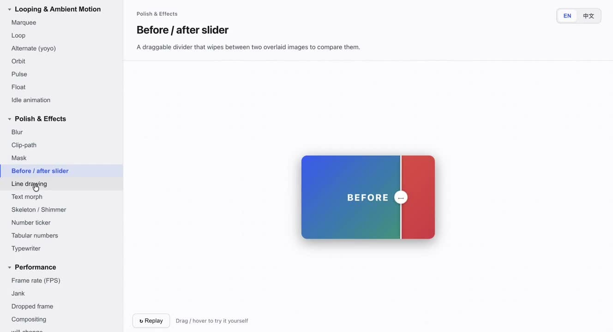

## 問題

設計者能看出想要的動效，卻只能向 AI 說「順一點」。

## 做法

- 原帖引用 Emil Kowalski 的詞彙表，直接舉出列表 stagger、方向感知、空間一致性、crossfade 與 layout animation。
- 使用者先看詞彙的效果，再以相同名稱描述動效需求。詞彙只是起點，原帖未提供統一時長或曲線。

### 已檢視的素材

*詞彙頁用編號、術語和簡短定義建立共用描述方式。*

## 為什麼有效（推論）

共用名稱可縮短對行為的描述，但只有補上觸發與結束狀態，才足以成為實作約束。

## 借鑑要點

- **適合**：動效需求溝通。
- **不適合**：以術語堆疊取代任務目標。
- **移植時注意**：每個術語搭配觸發、目標物件、取消和 reduced-motion 規則。

## 來源與核實

- [原帖](https://x.com/vikingmute/status/2061618080934252630)：已取得 X 公開頁面內嵌原始 Tweet / NoteTweet 資料，按相同 status ID 核對正文。
- 本卡的「做法」依原帖文字與已檢視素材撰寫；沒有執行產品功能驗收，效果解讀列為推論。
- 原帖內引用來源：https://x.com/emilkowalski/status/2061426518333571576。

- 同批協調合併來源：[原帖](https://x.com/Saccc_c/status/2064206181778731228)，發布時間：2026-06-09T04:41:19+00:00。

補充方法：轉述者另製雙語預覽站，讓術語與可見效果對照。影片可見插值、捲動揭露與前後比較滑桿的獨立範例。

*插值範例將色塊狀態並排。*

*Scroll reveal 範例將內容沿閱讀方向展開。*

*前後比較範例把拖曳把手放在兩個狀態之間。*
