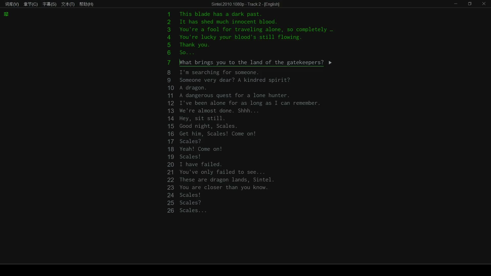
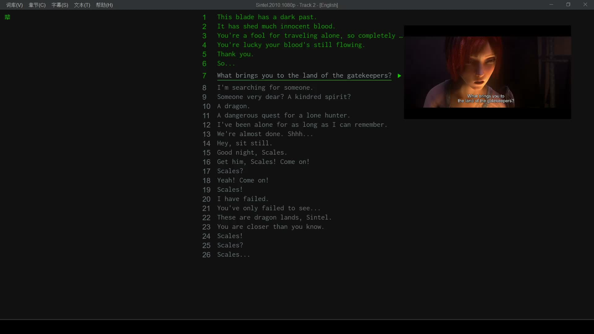
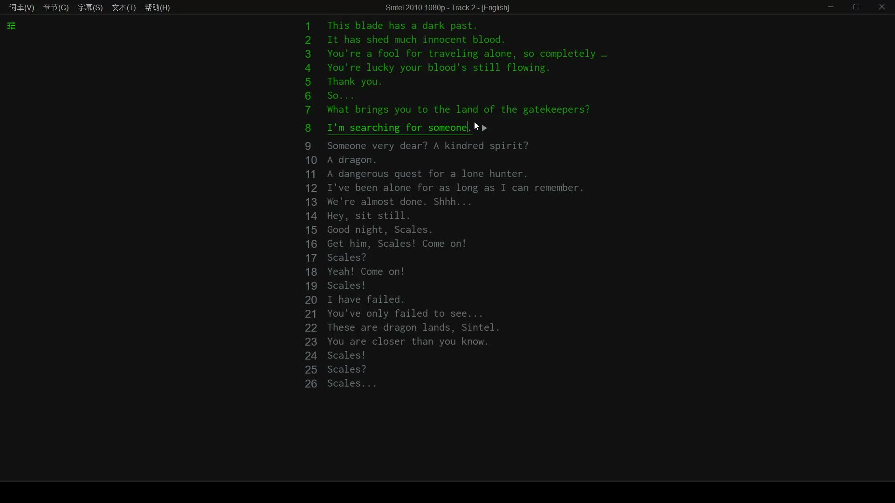

## 問題

背單詞時想回到原本語境，往往需要離開練習再手動找影片時間點。

## 做法

*官方字幕瀏覽器影片約 1.8 秒：編號字幕行在同一列表內展開，當前區段以綠色文字區別。*

*約 5.3 秒：字幕列表旁出現對應影片小窗，仍可保留文字上下文。*

*約 26.6 秒：繼續在列表內切換練習位置，不用離開字幕頁。*

**觀察**：原帖附圖只是功能 README，不能當實際查詞操作證據。另從官方 README 取得「字幕瀏覽器」示範，看到列表、目前區段與影片小窗；保留三張影格，這是較早的官方示範，不冒充原帖當日版本。

**官方文件說明**：[README](https://github.com/tangshimin/MuJing)列出拼寫、字幕抄寫、聽寫、片段快捷鍵及播放器互動字幕。原帖的「更難忘記」與彈幕成效是個人推薦，本卡不當作研究結果。

## 為什麼有效（推論）

讓字幕文字和片段回放保持鄰近，可能降低找語境的操作成本；已知語境也可為詞彙回想提供線索。

## 借鑑要點

- **適合**：使用自有影片或字幕的語言學習。
- **不適合**：只想連續看影片、不能容忍練習中斷的模式。
- **移植時注意**：分清觀看與練習模式；快捷鍵提示應可查詢，保留重播範圍與字幕來源。

## 來源與核對範圍

- [原帖 2094123047125197036](https://x.com/GYLQ520/status/2094123047125197036)：已核對 X 官方公開頁面內嵌 Tweet／NoteTweet 快取。
- [官方字幕瀏覽器示範](https://user-images.githubusercontent.com/16540656/174944474-e5947df9-c8ed-4546-9c67-057fe52c2d51.mp4)已下載檢視、抽取影格；README 的另一段沉浸式學習影片回傳 404，因此沒有對那段畫面下判斷。
- 本卡根據來源文字與已檢視媒體記錄，沒有執行產品功能驗收；作者成效宣稱不視為獨立測試。
