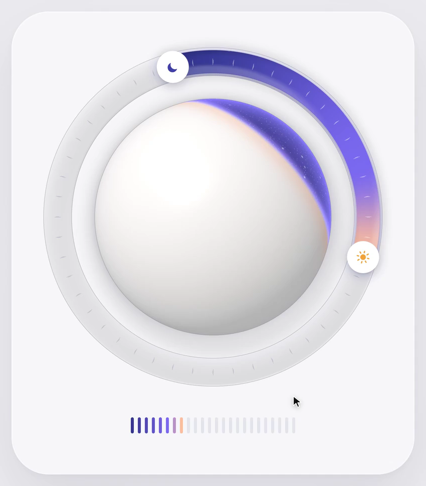
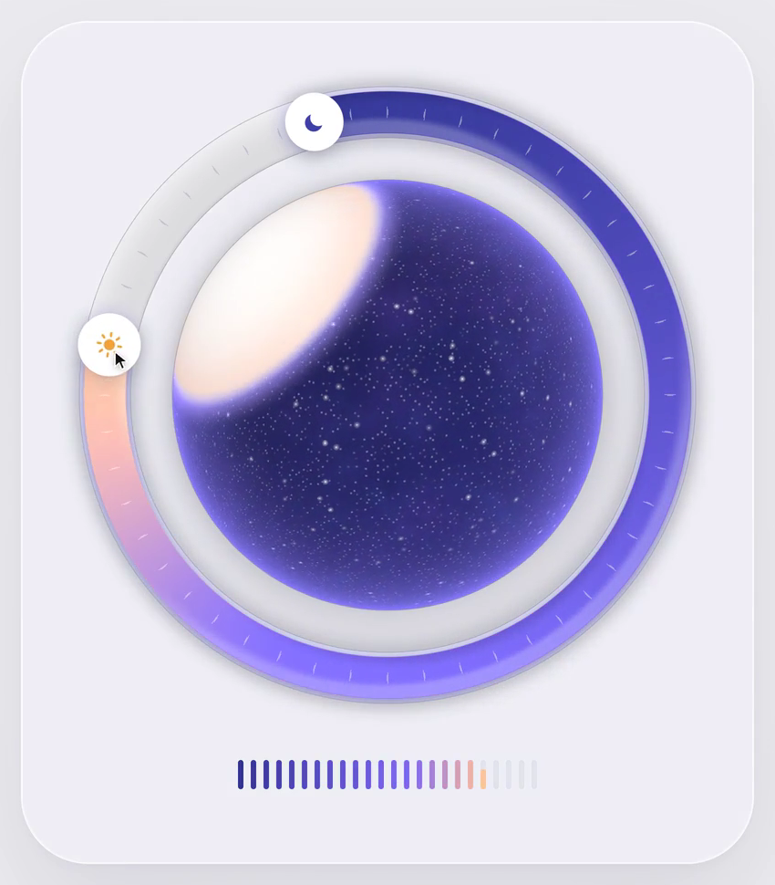
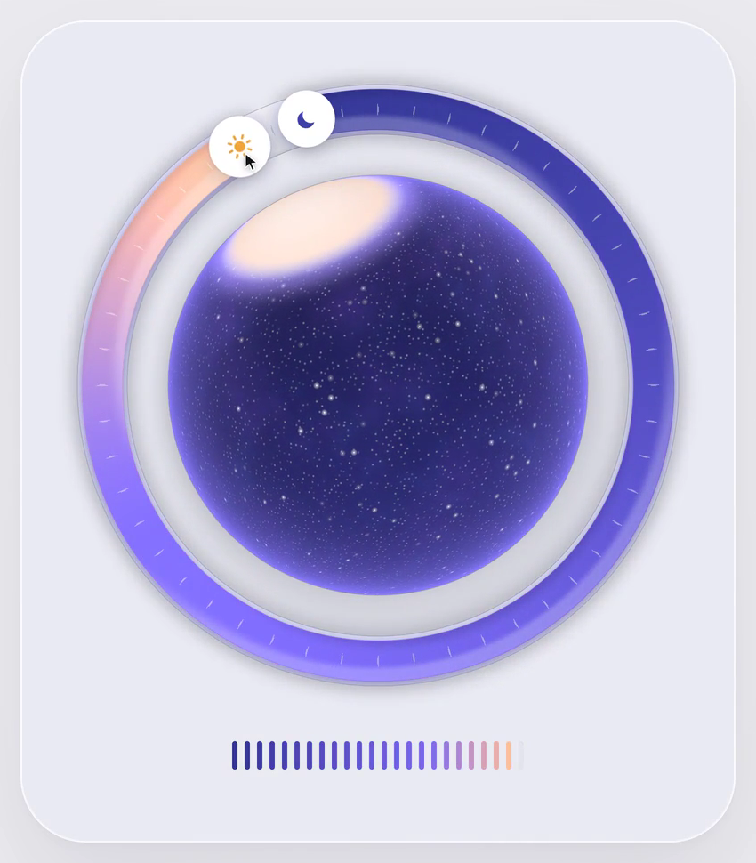
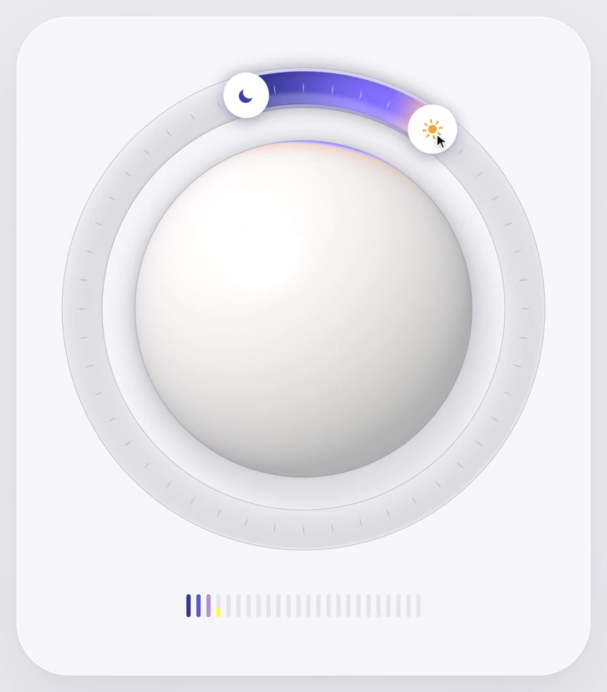
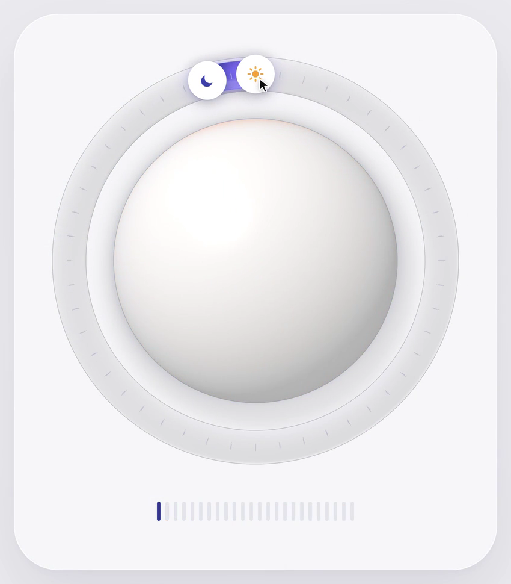

## 問題

切換明暗外觀時，如何把抽象的模式變化轉成可跟隨拖曳、即時看見的視覺回饋？這段示範用環形控制與中央球體呈現日夜比例，而非只在兩個圖示間瞬間切換。

## 做法

*0.0 秒：淺色圓角卡片內有中央球體、帶細刻度的環形軌道，以及下方短柱狀刻度列。*

*2.1 秒：游標位於太陽把手，太陽沿圓環移向左側，球體大部分變成紫色星點夜面，僅左上保留亮面。*

*2.8 秒：太陽接近上方的月亮標記，紫色環帶幾乎繞滿一圈，球體只剩一小塊亮面。*

*4.9 秒：太陽移回右上方，紫色環帶縮短，中央球體回到大面積亮面。*

*5.6 秒：太陽與月亮標記接近，軌道大多恢復淺色，球體呈白色，下方僅剩少數有色短柱。*

- **觸發**：影片中的游標跟著太陽圓形把手沿軌道移動；月亮標記在這段操作中維持於左上方。
- **變化**：太陽沿環移動時，有色弧段長度、中央球體的明暗分界，以及下方有色刻度數量同步改變；夜面帶有細小星點，邊界有暖色暈光。
- **結束狀態**：示範先到大面積夜面，再返回白色球體，之後重複拖曳。這只能證明影片所示的連動，未證明整個應用程式的主題已切換。
- 卡片以柔和陰影分出凹槽、軌道和把手；畫面沒有明暗模式文字標籤或數值。
- [原始發文](https://x.com/seanaiux/status/2122038172087726134)發布於 **2026-11-15 18:45:00 UTC**；[Kubai 引用](https://x.com/Kubai087/status/2122198949612417440)發布於 **2026-11-16 05:23:52 UTC**。作者的[同串回覆](https://x.com/seanaiux/status/2122038172389617765)連向 [Night Dial 模板](https://uberdesigner.ai/t/night-dial)；模板名稱取自該連結，未另驗證模板執行。

## 為什麼有效（推論）

- 把把手位置、弧段與球體明暗綁在同一個變化上，可能讓使用者在拖曳過程理解「夜色正在增加」，不必等待操作結束。
- 太陽、月亮與晨昏邊界提供一致的日夜隱喻；但沒有文字與明確二態終點，仍可能無法立即判斷目前是哪個模式。沒有可用性測試或效率數據支持成效。

## 借鑑要點

- **適合**：可連續調整的情境氛圍、燈光或具有展示目的的主題預覽。
- **不適合**：需要快速確認開／關狀態、空間狹小或高頻操作的設定列；圓形拖曳不宜直接取代簡單開關。
- **移植時注意**：若產品實際只有明／暗兩態，補上模式文字與明確吸附終點；另提供鍵盤與直接點選操作。減少動態效果時保留可讀的最終狀態，別只靠色彩與動畫傳達結果。這些是移植建議，並非影片已展示的功能。
