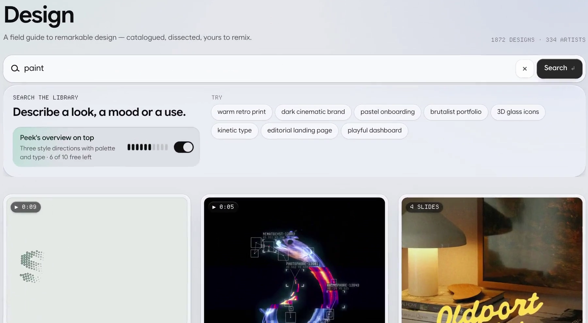
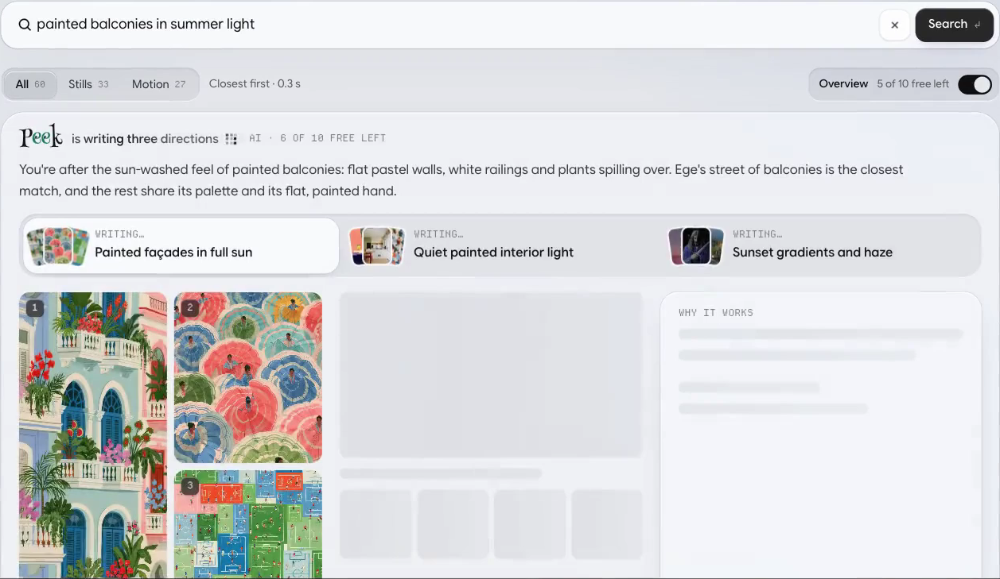
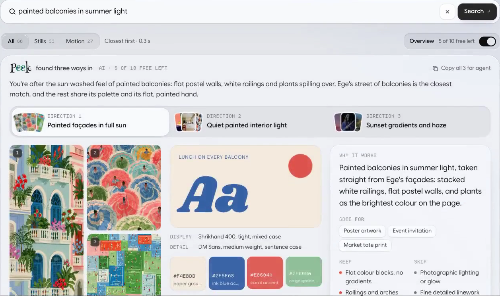
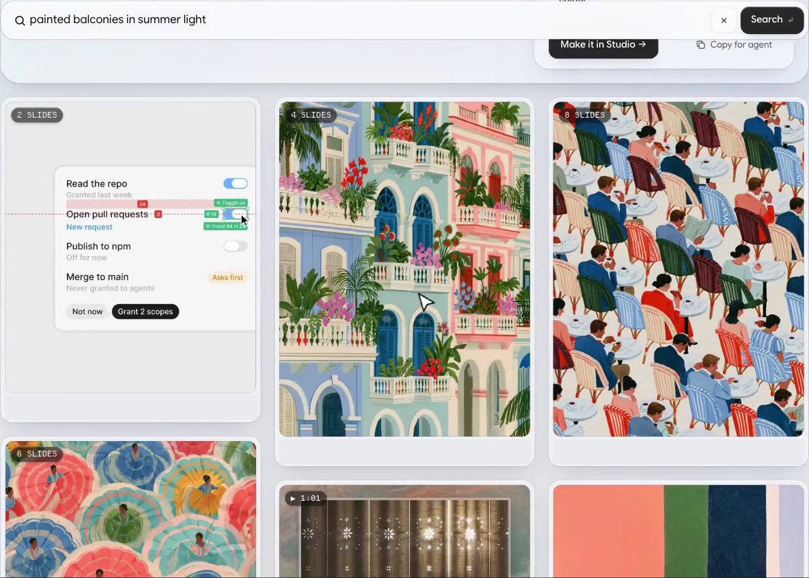
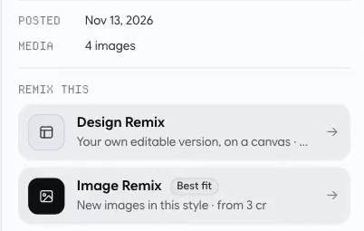
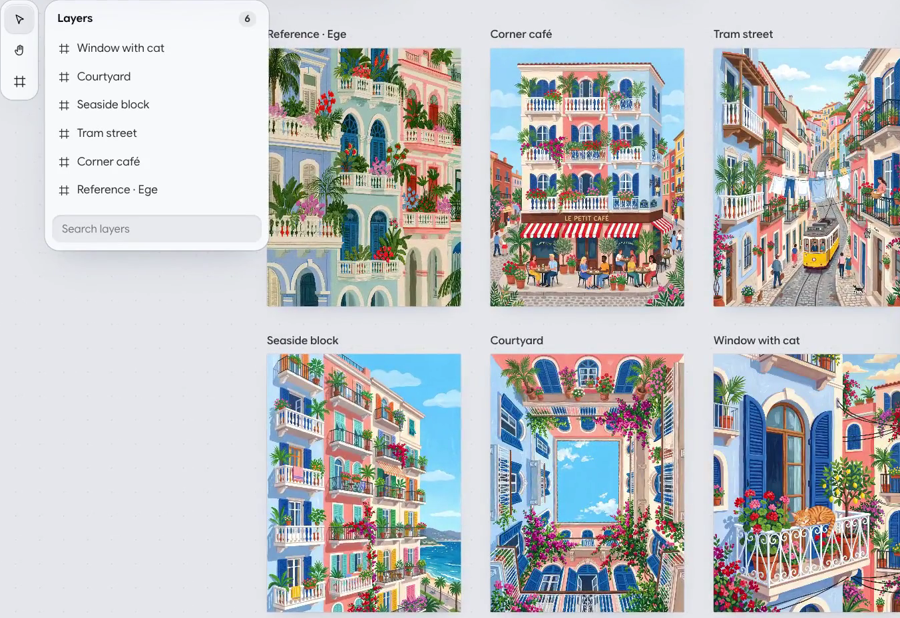

## 問題

找設計參考的人通常只能說出氣氛或使用情境，還無法指定字體與色碼；拿到一堆縮圖後，仍需要整理成可以採用的設計方向。

## 做法

影格已裁去周邊帳號、完整生成提示與素材網址，結果網格的三處作者姓名與頭像列已遮除；遮罩不是原介面元素。

### 1. 先描述外觀、氣氛或用途（影片約 8 秒）

*寬搜尋列下方放風格範例與 Overview 開關，下半部仍可瀏覽作品卡片。*

- 主內容以 Design 標題、橫向搜尋列及三欄作品卡片排列；搜尋列右側有清除與 Search。
- 說明以外觀、氣氛、用途提示輸入方式；旁邊用短標籤提供復古印刷、電影感品牌、柔色 onboarding 等例子。
- Overview 開關旁說明會給三個方向、配色與字體，並顯示免費次數。這是影片中的介面文案，不代表目前費率或額度政策。

### 2. 保留結果，再逐步補上方向（約 12 秒）

*搜尋結果上方的分析區顯示正在撰寫三個方向，參考圖已出現，字體與解讀區仍是骨架。*

- 示範輸入夏日陽光下的彩繪陽台意象；結果列有 All、Stills、Motion 及數量，右側保留 Overview 開關。
- 分析區位於作品列表上方，先出現需求摘要與三個方向名稱，再補內容；本影格可見「is writing three directions」及 WRITING 狀態。
- 影片的剪接與倍速無法證明真實等待時間；列表上的耗時數字也只作介面觀察。

### 3. 用參考圖、字體、配色與取捨共同說明方向（約 13.3 秒）

*三個方向橫排，選中方向下方以參考拼圖、字體色票及解讀三區並置。*

- 三個方向分別描述日照立面、安靜室內光與夕陽漸層；第一個方向有選中底色。
- 左側參考圖帶編號，中間是 Aa 字體樣張、Display／Detail 字體說明與四色色票；右側依序是 Why it works、Good for、Keep、Skip。
- Good for 使用短標籤列出海報、邀請卡等用途；Keep／Skip 以兩欄指出保留平塗色塊、欄杆拱形，以及避開攝影光影等特徵。
- 區塊另有複製給 agent 的入口。影片可見其存在，未驗證複製內容或成功狀態。

### 4. 回到作品，區分兩種再製目的（約 14–15 秒）

*搜尋列仍固定在上方，三欄作品卡片以大圖呈現，角落標示多圖張數或影片長度；三處作者姓名與頭像列已遮除。*

- 畫面往下捲到作品卡片，接著開啟陽台插畫的浮層詳情；浮層左側是大圖、右側是資料與操作。

*詳情的局部操作區上下排列 Design Remix 與 Image Remix，後者帶 Best fit 標記與起始 credits 說明。*

- Design Remix 的說明指向可編輯畫布版本；Image Remix 指向同風格新圖，並附 Best fit。
- 詳情另有作者來源資訊，但截圖裁掉頭像與帳號，也不保存下方完整生成提示及素材網址。本卡不把作者作品列為 NoaX 的原創設計。

### 5. 參考圖與生成結果留在同一畫布（約 25.5 秒）

*畫布左側列出六個 Layers，右方以兩排並置一張原始參考與五張不同場景結果。*

- 後續示範進入 Studio：原圖標為 Reference，生成結果分別命名咖啡館、電車街道、海邊街區、庭院與有貓的窗戶。
- Layers 有對應名稱與搜尋列；生成過程中先出現空白佔位，之後填入圖像。最後一格顯示五個場景都已有圖片。
- 右側 agent 面板在原片呈現參考、進度與完成訊息；因含完整生成提示，留存影格只保留畫布與圖層。看見生成圖片不等於已驗證可編輯節點、下載、持久保存或本地 MCP 執行。

## 為什麼有效（推論）

- 三個方向讓使用者先比較語意與取捨，再選字體配色，可能降低只靠縮圖猜風格的負擔；沒有使用者研究或成效數據。
- 把參考圖、可見規則與後續產物放在同一條路徑，可能減少把靈感轉成 brief 時遺漏條件。
- Keep／Skip 能把「喜歡這個感覺」轉成可討論的限制；內容是產品生成的解讀，不是參考作品作者認可的設計原則。

## 借鑑要點

- **適合**：設計素材庫、風格探索與需要把搜尋結果接到創作工具的產品。
- **不適合**：要求精確原作溯源、授權判定或可重現生成結果的工作；AI 解讀與風格相似不提供這些保證。
- **移植時注意**：先保留搜尋結果，再漸進補分析；每個方向保留原作連結、選中狀態、字體與色票，以及可採用／應避開的條件。把文字分析、圖片生成與可編輯頁面分成清楚入口；錯誤、取消、無結果、費用確認與權利資訊需要另行設計，原片未展示。

## 來源與觀察邊界

- [NoaX 原帖](https://x.com/noahatwhere/status/2123587178110517679)：2026-11-20 01:20:12 UTC，即洛杉磯 2026-11-19 17:20:12；使用原帖附帶的 29.568 秒影片，保存六張關鍵影格。
- [Kubai 分享](https://x.com/Kubai087/status/2123596371504893959)：2026-11-20 01:56:44 UTC，即洛杉磯 2026-11-19 17:56:44。分享頁的 RT 作者與截斷正文吻合，且同頁包含該原帖；資料未提供直接 retweet-target 欄位，因此對應屬交叉支持，並非直接欄位證明。
- [公開產品首頁](https://peekdesign.space)：2026-11-20 可讀到搜尋、Overview、三方向與 Remix 入口，足以支持產品存在；完整流程仍以作者剪輯示範為觀察證據，未做產品功能驗收。
- 同作者 [launch 原帖](https://x.com/noahatwhere/status/2122971477964456294) 為 2026-11-18 08:33:37 UTC；[Kubai 引用](https://x.com/Kubai087/status/2123233060766503249) 為 2026-11-19 01:53:04 UTC，資料有明確 quoted_tweet_results 對應。其影片主要是宣傳拼貼與示意改版，沒有足夠可確認的操作流程，不另建 launch 卡，也不拿它補寫已驗證能力。
