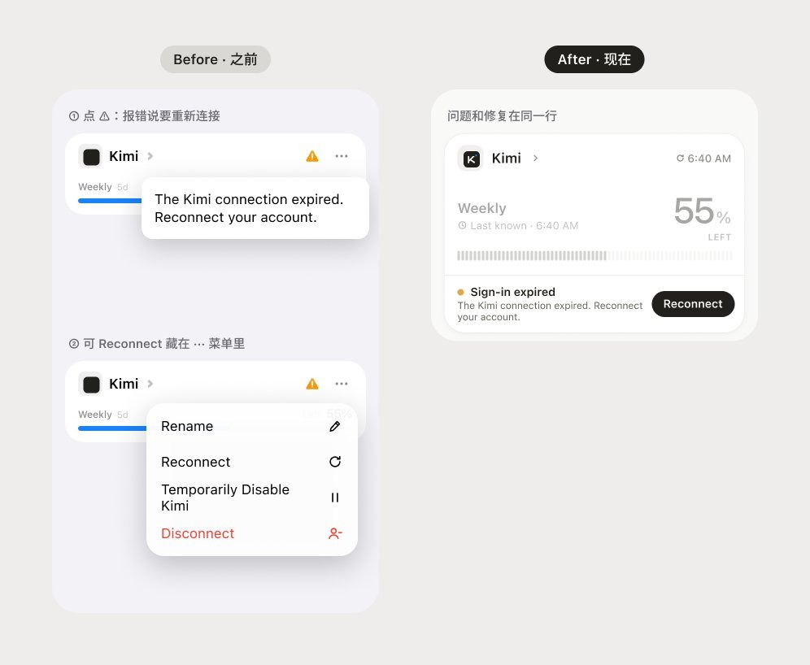
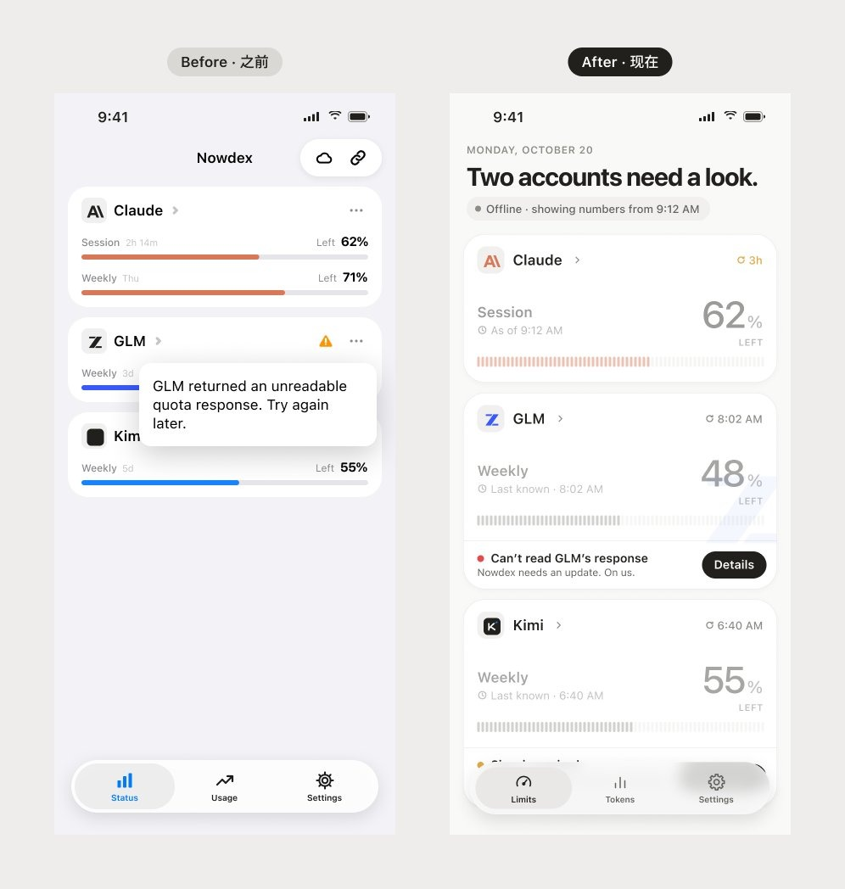
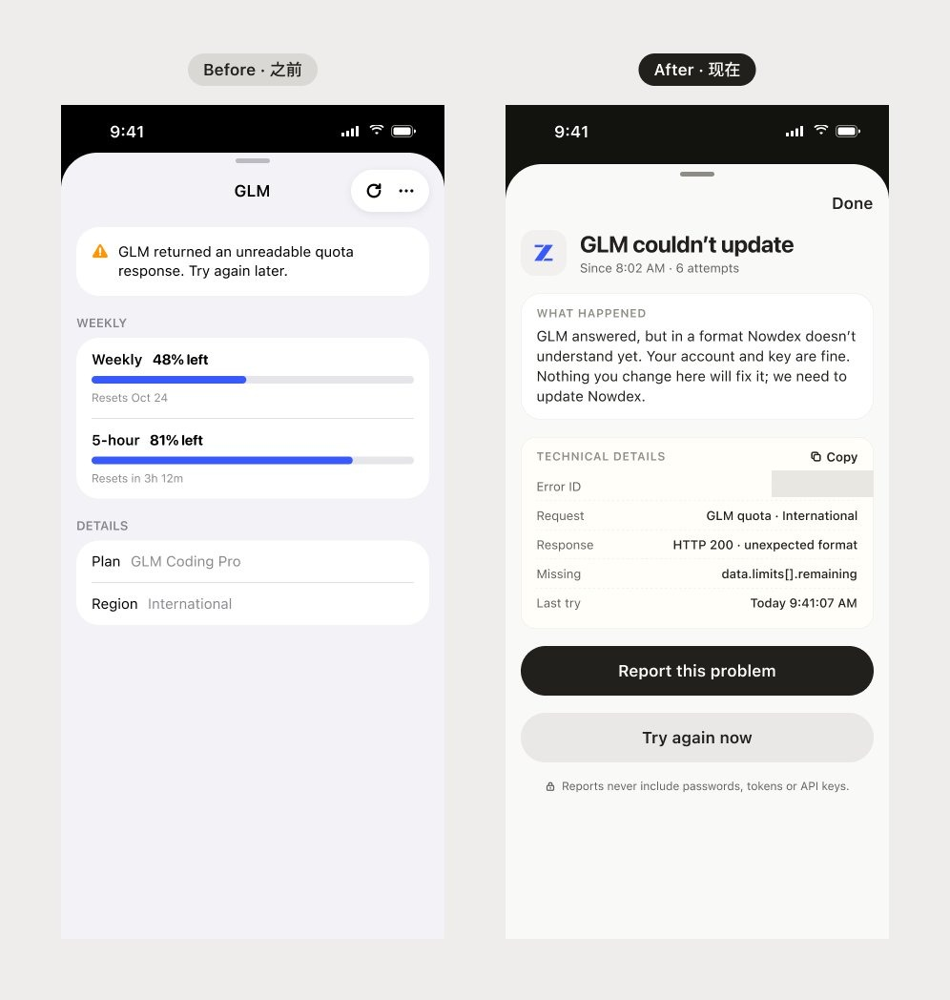

## 問題

帳戶狀態異常時，使用者只知道出錯，卻需要翻選單找重新連線，也可能反覆重試一個自己無法修復的問題。

## 做法

*連線過期與 Reconnect 從氣泡／選單改為卡內同一列。*

*列表先指出需要處理的帳戶，再顯示各卡片狀態。*

*錯誤詳情分成原因、技術資料、回報與重試；範例錯誤識別碼已遮蔽。*

- Before 圖將 Kimi 連線過期放在警告氣泡，Reconnect 藏在更多選單；After 圖把 Sign-in expired、原因和 Reconnect 放在卡片底部同一列。
- 列表改版以 Two accounts need a look 作為狀態摘要，讓需要處理的帳戶先被看見；卡內保留最後已知數值與時間，避免把舊資料當成新資料。
- GLM 錯誤頁先用自然語言解釋格式不相容、帳戶與 key 沒問題，再分開放技術詳情與 Copy；下方以 Report this problem 為主要動作，Try again now 為次要動作。
- 報告入口旁寫明不包含密碼、token 或 API key；這是圖中的承諾文案，未實測上報內容。原帖是作者的改版思考與對照圖，未證明全部已上線。

## 為什麼有效（推論）

- 把可修復問題的下一步就地提供，可能減少搜尋；對產品方才能修復的錯誤則應清楚交代責任，避免讓使用者徒勞重試。

## 借鑑要點

- **適合**：帳戶連線、外部服務同步與資料格式錯誤。
- **不適合**：沒有可用回報管道卻只放一個不會送達的支援按鈕。
- **移植時注意**：依錯誤責任區分重新授權、稍後重試與回報；舊資料必須標示時間，技術詳情需先去識別化。

## 來源與核實範圍

- [@randyloop 原帖](https://x.com/randyloop/status/2113095497003282861)；發表時間：2026-10-22T02:30:00+00:00。
- 依原帖文字與本次實際檢視的素材整理；未操作產品驗證功能。`date` 為收錄日期；原帖發表日期另記於 `published_at`。
