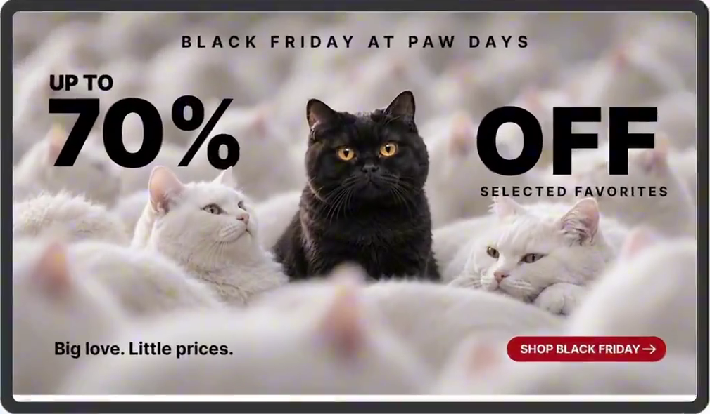
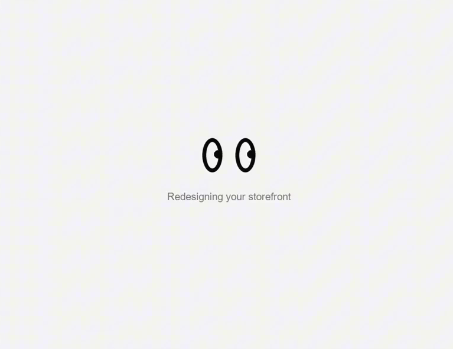
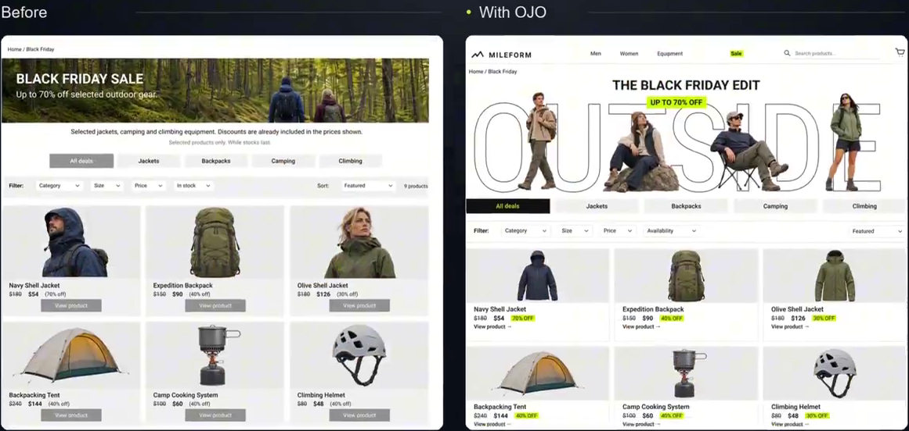
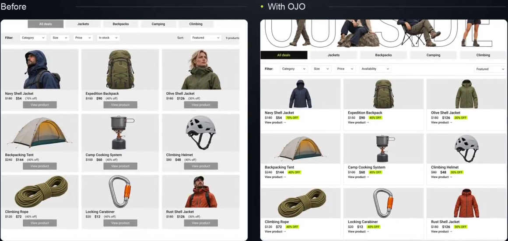

## 問題

多個設計 Agent 合作時，使用者如何知道誰在工作、產出了什麼，以及原型適用哪種裝置？

## 做法

- 發表影片的輸入區在任務文字上方標示 Prototyping Team 與使用的 skills 數；下方仍保留模式和模型選擇。
- 後續畫面在團隊標籤下顯示 OJO Coffee 的需求文件及草圖，再轉到 Prototype 預覽。
- 預覽的裝置選單列出 Mobile、Tablet、Desktop，當前 Desktop 帶勾號。這些都是官方宣傳影片中的展示，未實際建立團隊或編輯畫布。

*任務輸入保留團隊標籤、技能數與模式入口。*

*團隊下方呈現需求文件與草圖，建立中間產物。*

*裝置選單清楚列出 Mobile、Tablet、Desktop，當前選項有勾號。*

## 為什麼有效（推論）

讓執行者、需求文件和成果預覽有可見接點，可能降低多 Agent 工作的黑箱感；skills 數量本身不代表品質或完成度。

## 借鑑要點

- **適合**：從需求整理連到原型的設計工作台。
- **不適合**：不需多階段產出、只有一個固定任務的簡單工具。
- **移植時注意**：團隊與技能標籤應可展開核對；為文件、原型和最終實作分別標示狀態，裝置選單需真實反映佈局能力。

## 來源與核對範圍

- [原帖 2089731834095489430](https://x.com/OJOaidesign/status/2089731834095489430)：已核對 X 官方公開 HTML 內嵌的同 ID Tweet／NoteTweet 正文；發佈時間為 2026-08-18T15:11:09+00:00。
- 已下載並檢視原始媒體；影片僅保留關鍵影格，沒有保存原始影片。媒體出處與擷取時間見本目錄 `evidence.json`。
- 本卡只把貼文文字、附圖與錄影可確認的內容列為觀察；未執行產品驗收，效果解讀列為推論。

## 2026-11-25 補充：從編碼 Agent 進入原型與改版預覽

[OJO 插件原帖](https://x.com/OJOaidesign/status/2125243729644748812)發布於 **2026-11-24T15:02:44+00:00**，[Kubai RT](https://x.com/Kubai087/status/2125256598100840537)作為發現來源。作者展示將插件連到編碼 Agent，並以寵物商店新頁與戶外商店改版示範。本卡沿用「需求→設計→原型」流程，補充入口和結果對照；沒有安裝插件或建立任何專案。

### 做法（影片觀察）

- 影片先在編碼 Agent 中輸入需求，回覆中有可開啟的 OJO 成果連結；之後切至商店原型及改版示範。中間是剪輯，不能由成功文案推定所有資料已寫入或工具確實完成。
- 改版等待畫面在內容區顯示雙眼標誌與 Redesigning your storefront；接著轉到 Before／With OJO 雙欄。
- 對照頁保留商品類別與網格角色，但右側改用大字主視覺、選中分類黑底、螢光色折扣標記；商品圖與文案也有變動，並非只更換樣式的控制實驗。

*16秒：寵物商店原型首屏以角色照片與促銷CTA構成，並非已驗收的營運商店。*

*28秒：改版中的內容區呈現標誌與狀態文字，周圍帳戶及專案側欄已裁除。*

*32秒：兩個版本並列，對照主視覺、分類與商品網格；示範商品和價格不作真實銷售資訊。*

*34秒：後段保留雙欄，集中比較商品卡及折扣呈現。*

### 為什麼有效（推論）與借鑑邊界

讓需求入口與成果預覽相接，可能減少切換工具後失去上下文；保留相近商品分類則有助比較改版前後的資訊層級。適合原型審閱與多工具設計交付；不宜據影片宣稱生成速度、轉換率或外部Agent權限已驗證。移植時應記錄專案連結、產物版本與執行狀態，分開核對視覺改版和真實功能。

官方原帖正文、作者、時間及43.49秒影片已讀；全片每兩秒抽樣，四張保留影格再逐張檢視，來源與時間見 `evidence-2026-11-25.json`。不保存本次完整影片或完整輸入提示；既有歷史素材維持不變。
