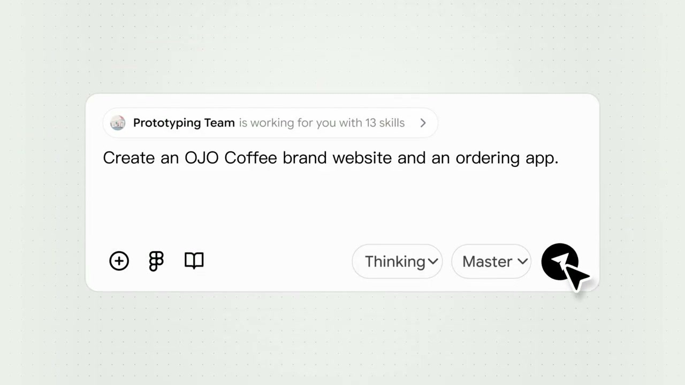
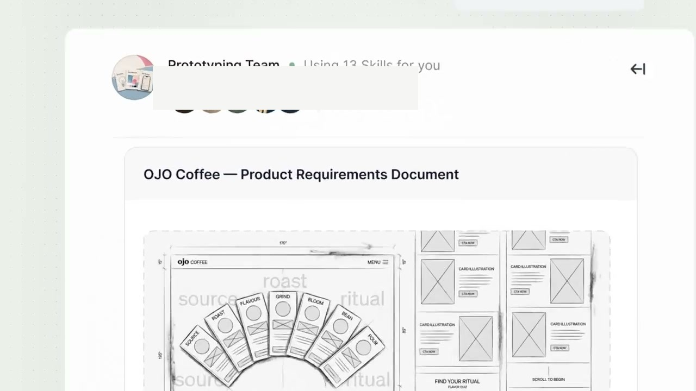
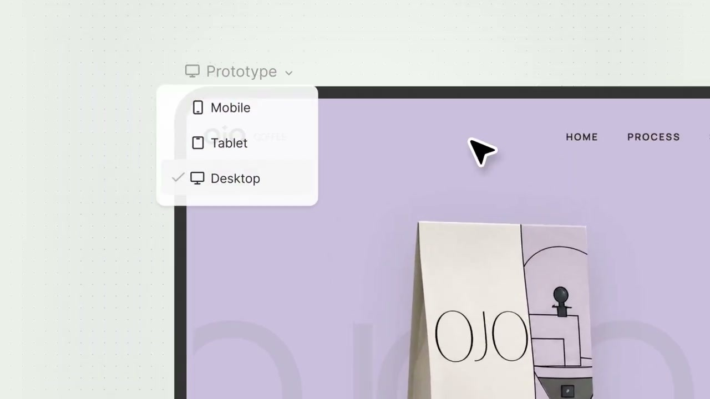

## 問題

多個設計 Agent 合作時，使用者如何知道誰在工作、產出了什麼，以及原型適用哪種裝置？

## 做法

- 發表影片的輸入區在任務文字上方標示 Prototyping Team 與使用的 skills 數；下方仍保留模式和模型選擇。
- 後續畫面在團隊標籤下顯示 OJO Coffee 的需求文件及草圖，再轉到 Prototype 預覽。
- 預覽的裝置選單列出 Mobile、Tablet、Desktop，當前 Desktop 帶勾號。這些都是官方宣傳影片中的展示，未實際建立團隊或編輯畫布。

*任務輸入保留團隊標籤、技能數與模式入口。*

*團隊下方呈現需求文件與草圖，建立中間產物。*

*裝置選單清楚列出 Mobile、Tablet、Desktop，當前選項有勾號。*

## 為什麼有效（推論）

讓執行者、需求文件和成果預覽有可見接點，可能降低多 Agent 工作的黑箱感；skills 數量本身不代表品質或完成度。

## 借鑑要點

- **適合**：從需求整理連到原型的設計工作台。
- **不適合**：不需多階段產出、只有一個固定任務的簡單工具。
- **移植時注意**：團隊與技能標籤應可展開核對；為文件、原型和最終實作分別標示狀態，裝置選單需真實反映佈局能力。

## 來源與核對範圍

- [原帖 2089731834095489430](https://x.com/OJOaidesign/status/2089731834095489430)：已核對 X 官方公開 HTML 內嵌的同 ID Tweet／NoteTweet 正文；發佈時間為 2026-08-18T15:11:09+00:00。
- 已下載並檢視原始媒體；影片僅保留關鍵影格，沒有保存原始影片。媒體出處與擷取時間見本目錄 `evidence.json`。
- 本卡只把貼文文字、附圖與錄影可確認的內容列為觀察；未執行產品驗收，效果解讀列為推論。
