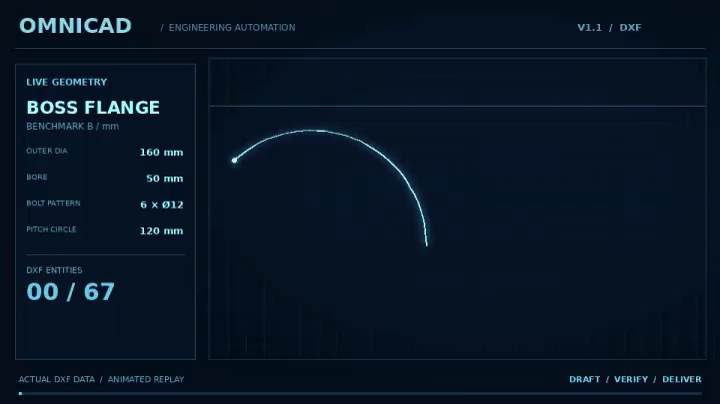
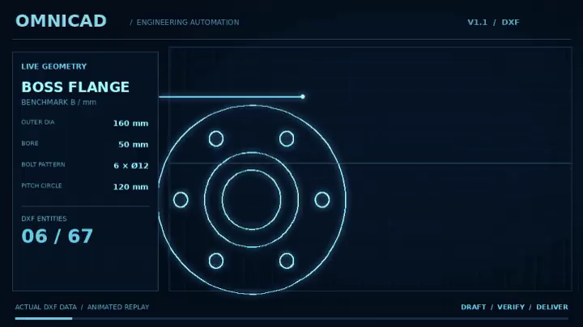
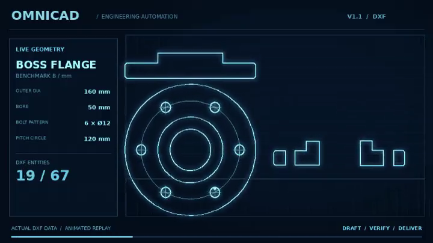

## 問題

幾何生成過程若只顯示等待符號，使用者難以知道正在處理哪一部分。

## 做法

*0 秒：繪圖區只有一段圓弧，左側顯示 00／67，底部進度剛開始。*

*1 秒：圓形與孔位逐漸成形，實體數變為 06／67。*

*2 秒：增加其他視圖與輪廓，實體數顯示 19／67，進度列前移。*

公開動畫的三張取樣顯示：圓弧開始 → 圓與孔位成形 → 加入其他視圖；左欄固定尺寸規格，中央逐步出現線段，實體數與底部進度一起前移。附件標示 V1.1／DXF，發文公告為 V1.2，兩者不能混同；這是重播展示，不足以證明即時 AutoCAD 狀態。

## 為什麼有效（推論）

用可辨識的部分成果與計數對照等待狀態，可能讓使用者更容易判斷進度；沒有真實任務耗時或正確率證據。

## 借鑑要點

- **適合**：需要將中間結果和操作脈絡一起保留的生成或教學工具。
- **不適合**：以動畫或局部取樣取代真實執行驗證。
- **移植時注意**：明示目前狀態、失敗與重試入口，讓鍵盤及讀屏可理解數值與圖形；為互動設定可驗證的操作契約。

## 來源與核對範圍

[作者原帖](https://x.com/CommunismHaruh1/status/2125851327771426869)（`2026-11-26T07:17:07+00:00`）。2026-11-27 核對完整公開原文及官方媒體；只保存三張影格，未保存原始影片。
