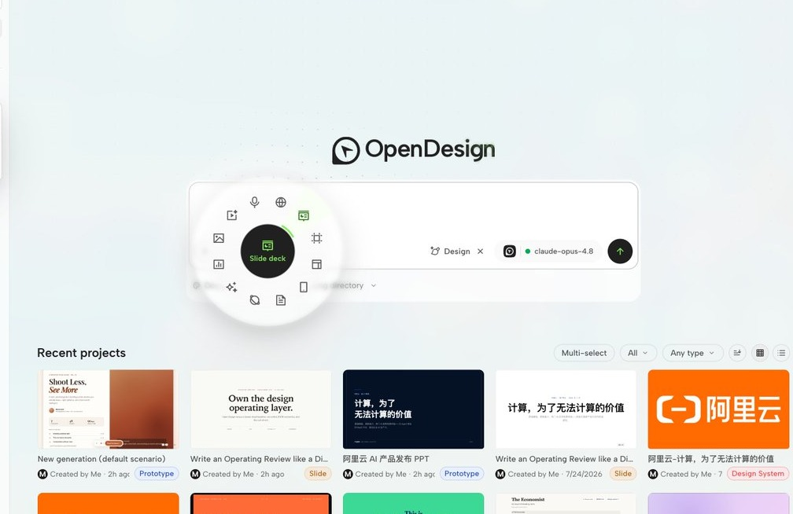
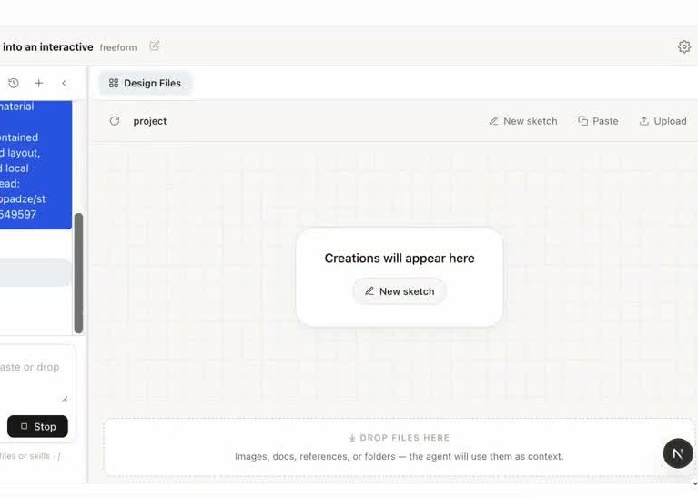
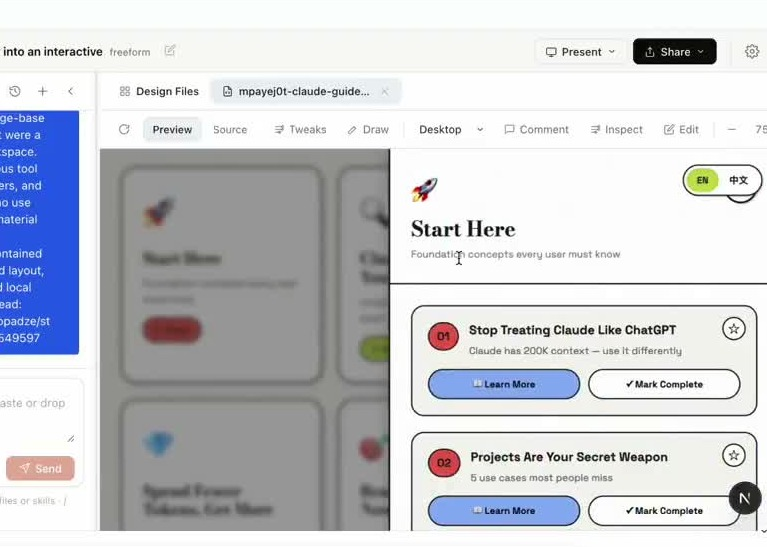
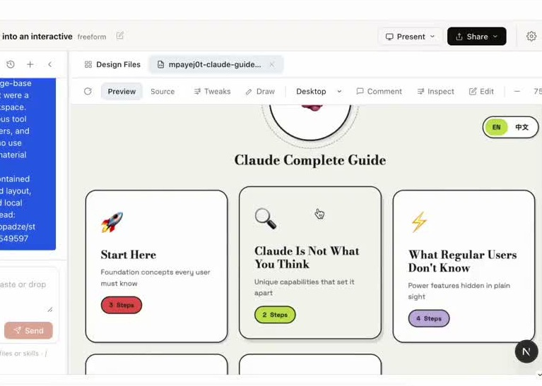

## 問題

不同設計者與 Agent 分別產出設計，團隊難以維持共同上下文與資產。

## 做法

- 官方發布帖介紹 Team Workspace：團隊成員與各自的 Codex 可在同一 Workspace 協作；引用官方帖明確提到 shared live canvas。
- 團隊插件體系可使用 skills 與設計系統，並涵蓋原型、簡報等不同產物。
- 本卡只採用協作結構，不把發布帖中的下載量、規模或穩定性宣稱當成驗收。

### 已檢視的素材

*Open Design 入口把工作區側欄、中央創作入口與最近專案卡片放在同一頁。*

## 為什麼有效（推論）

共同畫布可能使討論圍繞同一物件；團隊設計系統則為多 Agent 產物提供共同視覺約束。

## 借鑑要點

- **適合**：多人與多 Agent 的設計探索。
- **不適合**：需要嚴格隔離且不能共享資產的任務。
- **移植時注意**：共享不代表衝突自動解決；須補充選取、鎖定、版本與審閱權限規則。

## 來源與核實

- [原帖](https://x.com/tuturetom/status/2086829438961119668)：已取得 X 公開頁面內嵌原始 Tweet / NoteTweet 資料，按相同 status ID 核對正文。
- 本卡的「做法」依原帖文字與已檢視素材撰寫；沒有執行產品功能驗收，效果解讀列為推論。
- 原帖內引用來源：https://x.com/OpenDesignHQ/status/2086749655354786159。
- 原帖內引用來源：https://x.com/OpenDesignHQ/status/2084984244762210484。

- 同批協調合併來源：[原帖](https://x.com/OpenDesignHQ/status/2056309544997818507)，發布時間：2026-05-18T09:42:54+00:00。

官方早期示範：Codex 中的 Agent 直接操作畫布，將 design、code 和 motion 串成連續流程；和後期 shared Workspace 共同構成設計上下文持續存在的入口。

*Codex 內的畫布初始狀態與設計入口。*

*畫布中展開可比較的元件與樣式。*

*另一個視圖將卡片組合成可操作的內容。*

- 同批協調合併來源：[原帖](https://x.com/tuturetom/status/2064303471281557649)，發布時間：2026-06-09T11:07:55+00:00。

補充方法：先用 Creative Production 與 Product Design 細化產品想法，再以 Open Design 落實介面，最後讓 html-video 沿用前段上下文製作宣傳素材；不必為影片另起一套產品敘事。這是作者工作流描述，未執行其工程。
