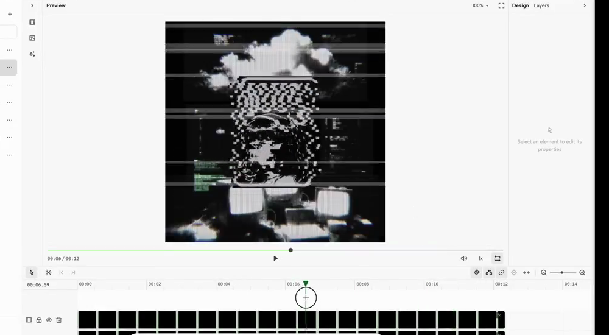

## 問題

製作者挑選動效參考時，需要先判斷用途、比例與節奏，再把參考轉成可修改的專案；只有影片圖庫不足以交代下一步。

## 做法

*上方以影片用途分類，下面用多欄視覺卡片展示模板，並保留產業篩選及排序。*

- 作者影片約 00:12：分類含 Product launch films、Product demos & explainers 等；已選條件另列為可移除的標籤，旁邊有 Clear filters。

*詳情將大幅影片與右側的重建按鈕、來源及規格並排。*

- 約 00:16：右側列出標題、簡短構圖說明、Recreate template、View on GitHub 與 Download motion.md；下方分列時長、長寬比、用途、產業及動效類型。

*Studio 把影片預覽放在中央，播放進度與時間軸放在下方，右側保留 Design／Layers 區域。*

- 約 00:32：同一個 NOUS 視覺主題已出現在 Studio 預覽內；下方時間刻度、播放頭與素材軌道可見，右側提示先選元素再編輯屬性。影片經剪輯，不能據此斷言整段流程無等待或重建成功率。
- 三圖取自作者公開影片並裁去瀏覽器、對話與通知區；未保存原始影片或完整生成提示。
- [官方倉庫](https://github.com/nexu-io/openmotion)確認這是影片製作工具；具體佈局以上述發布示範為證，未驗證目前版本。

## 為什麼有效（推論）

- 用途分類幫助先縮小候選，再以大預覽與規格判斷是否值得重建。
- 在詳情保留重建及來源入口，可減少選完參考後另找交接方法的成本；實際效率未測。

## 借鑑要點

- **適合**：有模板、素材庫與編輯器的創作工具。
- **不適合**：只有觀賞需求、沒有後續編輯流程的影片展示。
- **移植時注意**：保留模板身分與比例等規格；重建期間另補等待、取消、失敗與恢復狀態，不把示範影片當成交付證據。
