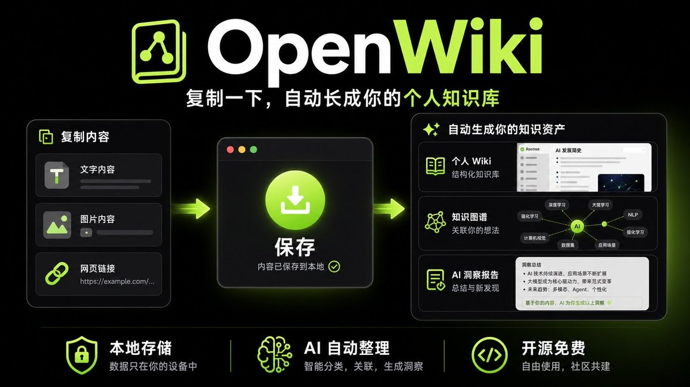

## 問題

使用者複製資料時，不想先決定資料夾、標籤與歸檔位置。

## 做法

- 複製文字、圖片或連結後，桌面彈出保存窗口，使用者只需決定是否留下。
- 保存後自動抓取正文、整理成 Wiki 並建立知識圖譜；後續提供搜尋、提問與圖譜入口。
- 設定頁接入模型服務；資料留在本地，可匯出 Markdown。這些是原帖功能描述，未在實機驗證。

### 已檢視的素材

*原帖示意圖將複製文字、圖片或連結，保存與 AI 整理串成三段。*

## 為什麼有效（推論）

把收集時的分類決策延後，可能降低保存成本；但彈窗是否干擾仍取決於出現頻率。

## 借鑑要點

- **適合**：碎片資料的快速收集。
- **不適合**：必須在寫入前完成分類審批的資料。
- **移植時注意**：加入可忽略的保存提示，並讓自動整理結果可以回查與更正。

## 來源與核實

- [原帖](https://x.com/AI_Jasonyu/status/2063178386659238109)：已取得 X 公開頁面內嵌原始 Tweet / NoteTweet 資料，按相同 status ID 核對正文。
- 本卡的「做法」依原帖文字與已檢視素材撰寫；沒有執行產品功能驗收，效果解讀列為推論。
