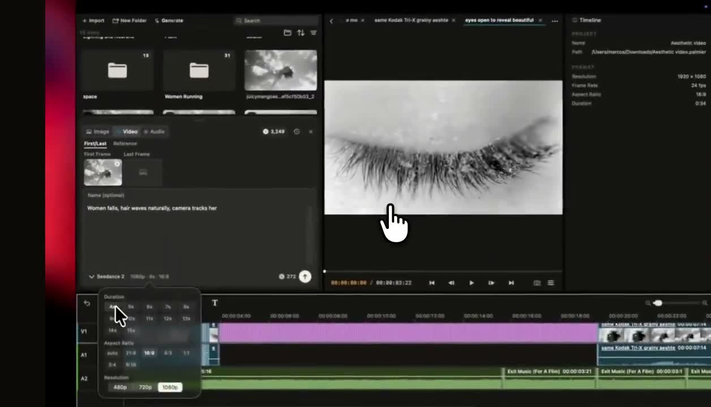
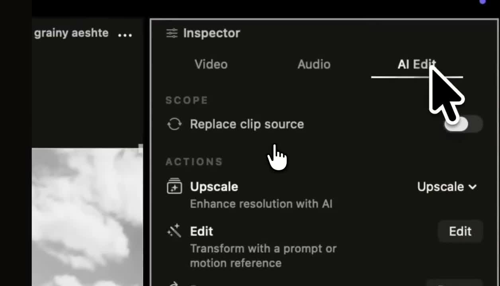
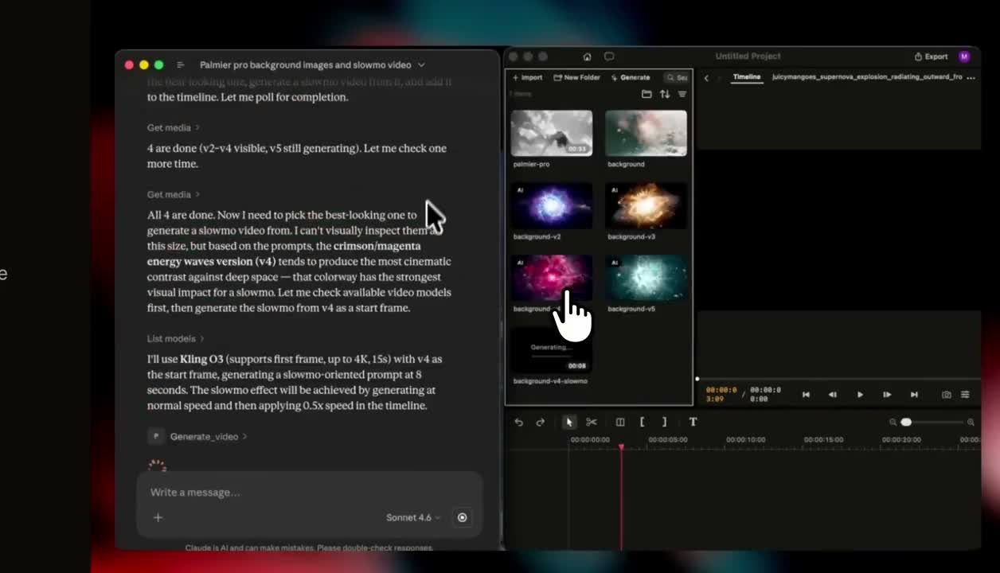
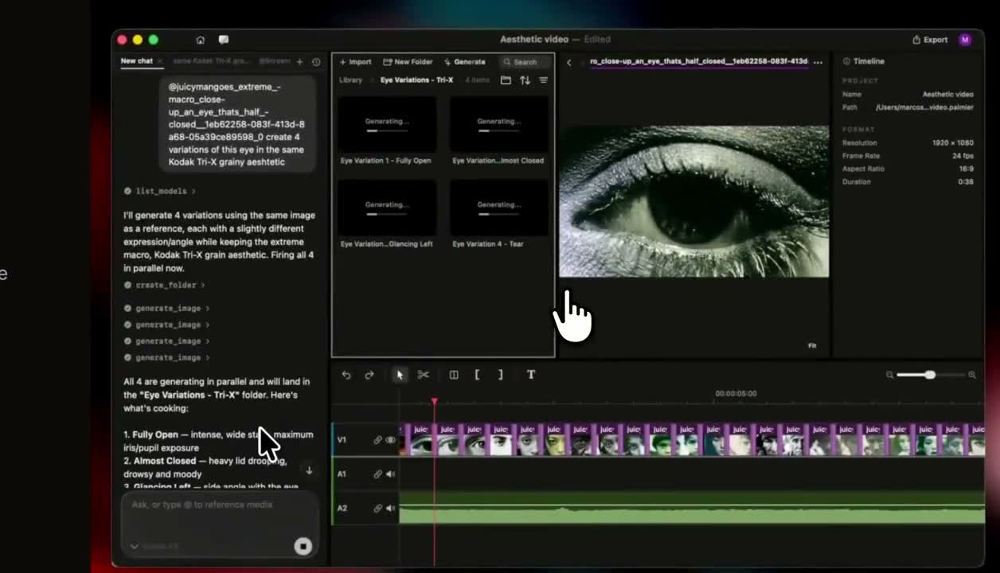

## 問題

用 AI 生成素材後還要下載、匯入並對齊時間線，對話要求與實際剪輯結果容易脫節。

## 做法

*約 11.7 秒：素材庫、中央預覽與底部多軌時間線同時可見。*

*約 18.4 秒：Inspector 的 AI Edit 區列出 Replace clip source、Upscale 與 Edit。*

*約 28.4 秒：對話工作區與素材／預覽／時間線並排。*

*約 38.4 秒：時間線填入多段縮圖與下方音軌，仍可直接檢視剪輯結果。*

**影片觀察**：先選素材與片段，在 Inspector 選 AI 操作；後段以對話提出生成要求，旁邊的編輯器顯示新增素材與有內容的時間線。片段提供的是共用工作物的展示，不能據此還原每一次工具呼叫。

**官方核對**：[官方倉庫](https://github.com/palmier-io/palmier-pro)確認 MCP 連接外部 Agent 與時間線內生成的產品定位。原帖稱免費開源屬當時說法；本卡不延伸為現行授權或訂閱承諾。

## 為什麼有效（推論）

Agent 的結果落在既有時間線，讓人能用熟悉的片段、軌道與預覽檢查；局部 AI 操作也比整段重生成更容易限定修改範圍。

## 借鑑要點

- **適合**：有專業編輯結構、需人手覆核的 AI 創作工具。
- **不適合**：沒有可回查工作物、只回傳一個成品網址的流程。
- **移植時注意**：保留撤銷、選取範圍與生成中狀態；明示外部 Agent 會改哪些片段。

## 來源與核對範圍

- [原帖 2079907060133871894](https://x.com/Easycompany333/status/2079907060133871894)：已核對 X 官方公開頁面內嵌 Tweet／NoteTweet 快取。

- 本卡根據來源文字與已檢視媒體記錄，沒有執行產品功能驗收；作者成效宣稱不視為獨立測試。
