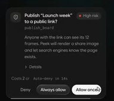
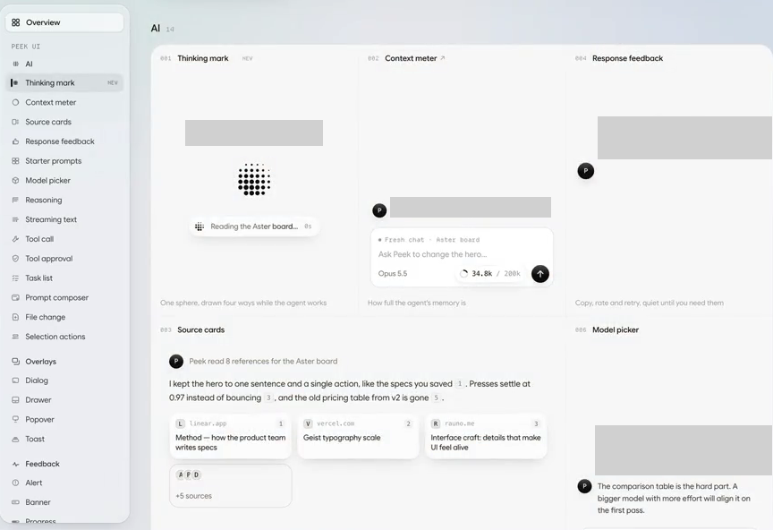
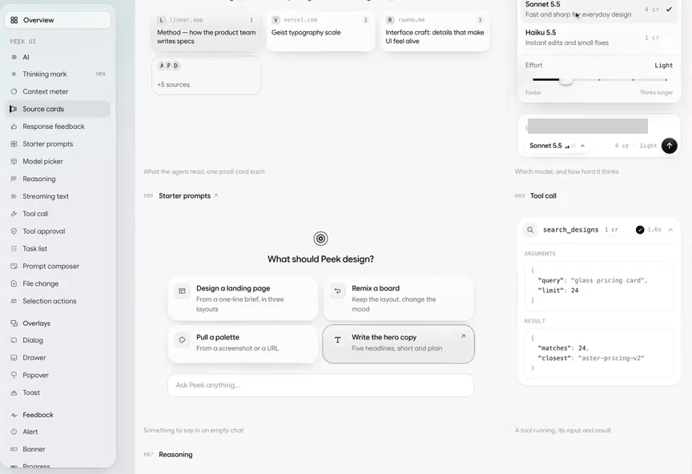

## 問題

AI 工作台同時呈現來源、模型設定、工具紀錄與批准要求時，如何讓每種資訊保有明確的操作語義？

## 做法

- 影片以固定左側分類欄對照右側元件網格，從深色總覽移到淺色 AI 區；捲動時分類欄仍可見。這是示範瀏覽，沒有驗證點擊分類的實際定位。
- 批准卡將發布動作、公開範圍、高風險標記、費用及自動拒絕倒數集中呈現，底部並列 Deny、Always allow、Allow once。只觀察外觀，不據此推定授權範圍或倒數確實執行。
- 來源卡以站點／標題及編號對照回答中的引用；工具卡把名稱、狀態、耗時、arguments 與 result 分層。模型選單則呈現描述、用量標記與 effort 控制。

*批准卡集中顯示發布對象、風險與三種決定入口；費用和倒數皆為示範資料。*

*固定分類欄旁排列思考、上下文容量與來源卡；灰塊遮除示範輸入，不是介面元件。*

*來源、模型選擇、起始建議和工具結果各用不同容器表達；灰塊遮除示範輸入。*

## 為什麼有效（推論）

將高風險決定與一般狀態分成不同容器，可能降低漏讀；引用編號與工具欄位也有助回查依據。這些是視覺組織推論，未有可用性或批准正確率數據。

## 借鑑要點

- **適合**：需要顯示 Agent 執行證據與人工確認的產品。
- **不適合**：直接把示範中 Always allow 當作安全授權策略，或把倒數設計當成使用者同意。
- **移植時注意**：明確限定一次／持續授權的對象與有效期；實際動作前以真實資料核對風險、成本與範圍，提供取消及錯誤處理；折疊工具參數仍須可回查。

## 來源與核對範圍

- [PeekDesign 原帖](https://x.com/PeekDesignn/status/2125093638044799197)：官方同 ID 正文、作者、時間與14.433秒影片可讀；作者稱62個React元件及8種效果，本次未清點、安裝或驗證相容性。
- [Kubai 轉發](https://x.com/Kubai087/status/2125100456888381870)：依同頁原作及作者正文前綴核對；不把RT重複建卡。
- 僅保留6／10／12秒三張裁切影格；沒有保存完整影片。來源及遮罩座標見 `evidence.json`。
- 與既有 [Peek Search 風格搜尋](../noax-peek-search-style-directions/case.md) 屬不同流程：本卡是元件狀態與批准語義，舊卡是搜尋到設計方向，互相連結而不混為同一成果。

- 同發布者另有[波浪確認過渡](../peekdesign-wave-confirmation-transition/case.md)，屬單一動態效果觀察，與本卡元件分類／授權語義分開。
