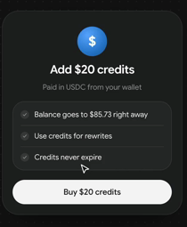
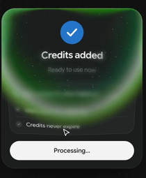
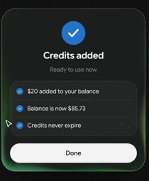
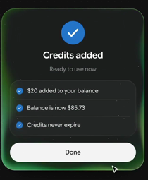
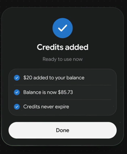

## 問題

從購買入口切到確認內容時，如何用短暫的表面動效強調狀態，又讓金額、說明及完成按鈕回到可閱讀的穩定畫面？

## 做法

[原帖](https://x.com/PeekDesignn/status/2125362009948741757)稱其為 screens 之間的 wave transition；[Kubai 引用帖](https://x.com/Kubai087/status/2125451283175981343)僅表達肯定。實際可見的是 7.25 秒、兩張確認卡並排的剪輯示範；不能據此確認完整導覽或資料提交流程。以下影格裁取右側確認卡，排除左側示例姓名、帳號尾碼與交易備註。

*約 0 秒：卡片顯示 Add $20 credits、三行說明與底部 Buy $20 credits 白色按鈕。*

*約 0.5 秒：綠色亮帶由卡片上半部彎成弧面，中央文字仍可辨識，底部按鈕顯示 Processing…。*

*約 1 秒：亮帶移向卡片下緣，三行勾選說明露出，底部回到 Done。*

*約 5 秒：另一輪綠色波浪移到下半部，底部白色按鈕周圍發亮。*

*約 6 秒：光帶退去，標題、三行說明與 Done 按鈕恢復穩定的深色卡片版面。*

- 錄影中游標移到卡片／按鈕區後可見波浪，未能從抽樣判定點擊、懸停或自動播放是哪個觸發條件。
- 動效期間以寬弧光帶掃過內容及卡邊，局部出現模糊、折射般的扭曲；結束後邊框與文字恢復清晰。這是外觀描述，未確認 shader、遮罩或其他實作技術。
- Processing… 與 Done 是畫面文案，不代表真實網路請求或交易成功；影片沒有顯示資料保存或跨頁返回。

## 為什麼有效（推論）

- 光帶在同一張卡片上移動，可能讓狀態變化保有空間連續性；結束後回到原有閱讀順序，可減少持續動畫對資訊的干擾。
- 寬亮帶與短暫扭曲形成視覺重點，但同時降低局部文字清晰度；沒有閱讀速度、成功率或效能數據。

## 借鑑要點

- **適合**：低頻的完成回饋、展示型確認卡或品牌動效探索。
- **不適合**：需立即核對關鍵數字、連續大量操作，或不能容忍文字瞬間失真的畫面。
- **移植時注意**：先定義真實操作與成功狀態，再決定光帶觸發；保留靜態勾號與文字，提供減少動態效果版本，避免讓裝飾動畫延後 Done 可操作的時間。需另測真實裝置效能與可及性。

## 來源日期

發布者 PeekDesign（@PeekDesignn）的原帖發布於2026-11-24T22:52:45+00:00；Kubai引用發布於2026-11-25T04:47:29+00:00。發布者可核對，不代表已確認實際動效設計者。
