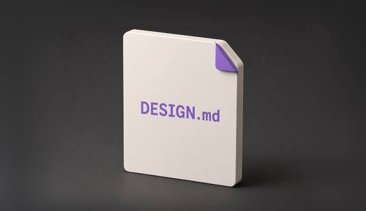
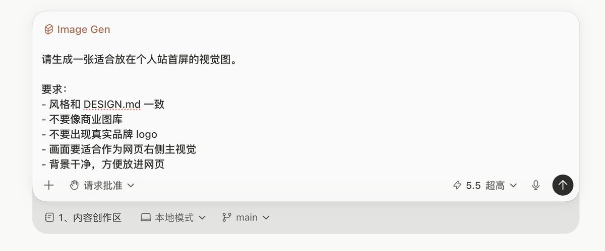
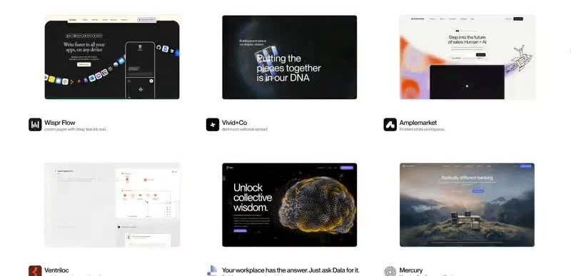
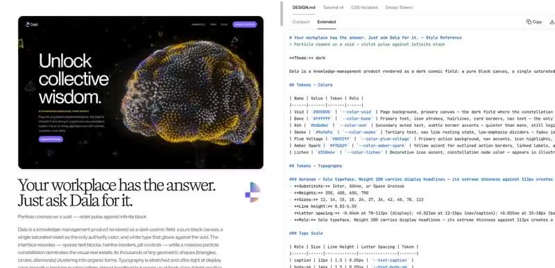
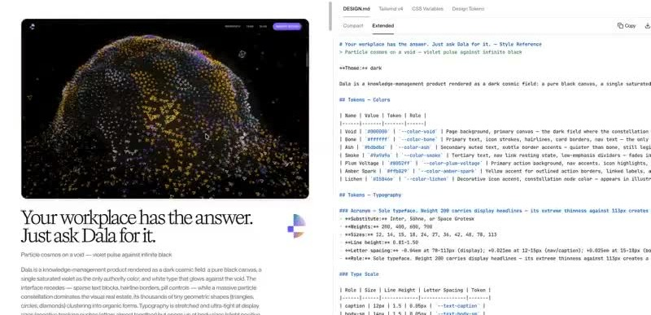

## 問題

要求「有個性的網站」仍太模糊，生成結果容易變成無關的模板與素材。

## 做法

- 全文建議先定義頁面表達、讀者、主參考與不採用部分，再寫顏色、字體、首屏、按鈕、卡片、素材與動效規則。DESIGN.md 經人確認後才實作。
- 只挑三個參考：一個定主方向，另外兩個只借局部。從網站提取風格時，去除原品牌、文字和圖片。
- 頁面完成後對照規則與截圖列出五個問題，逐項修正；素材不合適時先替換素材，再處理裁切和留白。
- 文章另示範在同一畫布比較參考、現頁與生成素材，用圈選註記指出修改位置；不把參考資源清單本身當成設計成果。

### 文章內已檢視素材

*文章以 DESIGN.md 作為設計先行的核心產物。*

*提示詞先交代素材用途、風格與限制條件。*

*參考庫以多張風格卡提供選擇入口。*

*選定風格後，頁面預覽與設計說明並排。*

*另一狀態保留主視覺、標題與規則對照，供後續交接。*

## 為什麼有效（推論）

把方向確認和實作分成兩步，可能減少一次改動把文案、品牌與版式全部帶偏。

## 借鑑要點

- **適合**：個人站與小型介紹頁的協作。
- **不適合**：把設計說明當成永遠不能調整的規格。
- **移植時注意**：每個參考註明採用範圍；評審需兼顧真實內容、響應式與可操作狀態。

## 來源與核實

- [原帖](https://x.com/Jackywxsz/status/2072614425660731498)；原始資料已核對 ID，本文不代表產品實機驗收。

- 文章來源：X 公開狀態頁內嵌 ArticleEntity，已讀取完整 plain_text 與 content_state，並檢視文章媒體。
